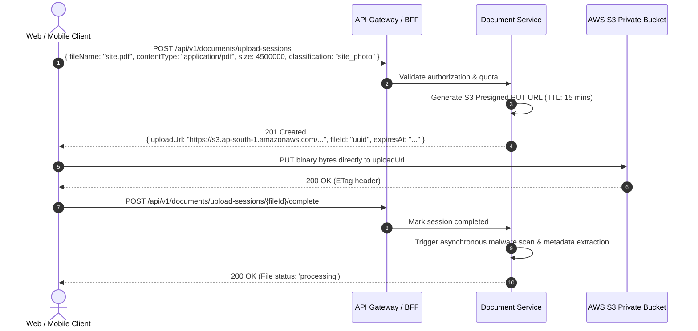

# AETHRA — REST & OpenAPI Standards

> Phase 0 · API Architecture · v0.1.0

---

## 1. Overview & Principles

All external and Backend-for-Frontend (BFF) APIs in AETHRA adhere to strict RESTful conventions, semantic versioning, deterministic JSON envelopes, and RFC 7807 problem details.

### Core Principles
1. **URI Versioning:** Breaking API changes increment the major path version: `/api/v1/...` $\to$ `/api/v2/...`. Minor/patch changes are non-breaking additions.
2. **Predictable Resource Modeling:** Plural nouns for resource endpoints (`/api/v1/quotations`, `/api/v1/customers`).
3. **Stateless Authentication:** Bearer JWT tokens with verified claims; no server-side sticky sessions.
4. **Idempotent Mutations:** Crucial creation endpoints accept an `Idempotency-Key` header to protect against network retries.
5. **No Leaky Abstractions:** Database entities are never returned directly; strictly typed Data Transfer Objects (DTOs) define the public contract.

---

## 2. HTTP Method Semantics

| Method | Idempotent | Safe | Typical Status | Usage |
|---|---|---|---|---|
| `GET` | Yes | Yes | `200 OK` | Retrieve single resource or paginated collection. |
| `POST` | No | No | `201 Created` / `200 OK` | Create new entity or trigger business action (e.g. `/actions/calculate`). |
| `PUT` | Yes | No | `200 OK` | Complete replacement of existing resource. |
| `PATCH`| No | No | `200 OK` | Partial update of specific fields. |
| `DELETE`| Yes| No | `204 No Content` / `200 OK` | Soft delete or archive of resource. |

---

## 3. Standard Request & Response Envelopes

### 3.1 Standard Success Envelope
```json
{
  "success": true,
  "data": {
    "id": "7c9e6679-7425-40de-944b-e07fc1f90ae7",
    "quotationNumber": "QT-2026-0042",
    "totalPayableAmount": 450000.00,
    "status": "issued"
  },
  "meta": {
    "timestamp": "2026-11-03T10:15:30.125Z",
    "correlationId": "c8a4114f-6c19-4a4b-927b-fb86c7cfc563"
  }
}
```

### 3.2 Standard Paginated Collection Envelope
```json
{
  "success": true,
  "data": [
    { "id": "uuid-1", "name": "Residential 5kW" },
    { "id": "uuid-2", "name": "Commercial 50kW" }
  ],
  "pagination": {
    "page": 1,
    "limit": 20,
    "totalItems": 142,
    "totalPages": 8,
    "hasNextPage": true,
    "hasPrevPage": false,
    "nextCursor": "eyJpZCI6InV1aWQtMiJ9"
  },
  "meta": {
    "timestamp": "2026-11-03T10:15:30.125Z",
    "correlationId": "c8a4114f-6c19-4a4b-927b-fb86c7cfc563"
  }
}
```

---

## 4. Error Handling Standard (RFC 7807 Problem Details)

All error responses return `Content-Type: application/problem+json` following RFC 7807:

```json
{
  "type": "https://api.aethra.energy/errors/quotation-already-issued",
  "title": "Quotation Revision Immutable",
  "status": 409,
  "detail": "Quotation revision 1 is currently in 'issued' status and cannot be edited. Create revision 2 to apply changes.",
  "instance": "/api/v1/quotations/7c9e6679-7425-40de-944b-e07fc1f90ae7/revisions/1",
  "code": "ERR_QUOTATION_REVISION_FROZEN",
  "correlationId": "c8a4114f-6c19-4a4b-927b-fb86c7cfc563",
  "invalidParams": [
    {
      "field": "lines[2].unitPrice",
      "reason": "Modifications forbidden on frozen revision"
    }
  ]
}
```

### Standard HTTP Error Status Codes
- `400 Bad Request`: Validation failure (schema mismatch, missing required parameter).
- `401 Unauthorized`: Missing, expired, or cryptographically invalid Bearer JWT.
- `402 Payment Required`: Tenant subscription suspended, unpaid, or module not entitled.
- `403 Forbidden`: Authenticated user lacks RBAC permission or ABAC attribute scope.
- `404 Not Found`: Target resource does not exist within the current tenant boundary.
- `409 Conflict`: Business rule conflict (e.g. concurrency lock, negative stock violation, frozen revision).
- `422 Unprocessable Entity`: Syntactically correct JSON that violates domain invariants.
- `429 Too Many Requests`: Rate limit quota exceeded.
- `500 Internal Server Error`: Unhandled application exception (sanitized in production).

---

## 5. Mandatory HTTP Headers

### 5.1 Request Headers
| Header | Format | Required | Purpose |
|---|---|---|---|
| `Authorization` | `Bearer <JWT>` | Yes (for protected endpoints) | Identity & authentication claims |
| `X-Correlation-ID` | UUIDv4 | Recommended (generated if omitted) | Distributed request tracing |
| `X-Tenant-ID` | UUIDv4 | Conditional (if user belongs to multiple orgs) | Active tenant context switch |
| `Idempotency-Key` | UUIDv4 / String | Required on financial & stock mutations | Deduplication of retried requests |
| `Accept` | `application/json` | Yes | MIME type negotiation |

### 5.2 Response Headers
| Header | Value / Format | Purpose |
|---|---|---|
| `X-Correlation-ID` | UUIDv4 | Echoes the request trace ID for client-side debugging |
| `RateLimit-Limit` | Integer (e.g. `1000`) | Permitted quota in current window |
| `RateLimit-Remaining` | Integer (e.g. `982`) | Remaining requests in window |
| `RateLimit-Reset` | UTC Unix Epoch | Time until rate limit resets |

---

## 6. Query Conventions (Filtering, Sorting, Pagination)

- **Filtering:** Explicit query parameters: `?status=issued&stage=site_survey&capacityKw_gte=10`
- **Sorting:** Comma-separated with minus sign prefix for descending: `?sort=-createdAt,customerName`
- **Field Selection:** `?fields=id,quotationNumber,totalPayableAmount`
- **Pagination Strategy:**
  - **Offset Pagination (Web Desktop Tables):** `?page=2&limit=25`
  - **Cursor Pagination (Mobile Feeds & Infinite Scroll):** `?cursor=aW52XzAyNA==&limit=20`

---

## 7. File Upload Standard (Direct-to-S3 Pre-Signed Uploads)

To prevent backend microservices from becoming bottlenecked on binary multi-part uploads:



---

## 8. Health & Readiness Standard

Every microservice exposes standardized operational probes:
- `GET /health/live`: Liveness probe. Returns `200 OK` if Node.js event loop is responsive. Used by ECS Fargate to restart failed containers.
- `GET /health/ready`: Readiness probe. Returns `200 OK` only when:
  1. PostgreSQL connection pool is verified (`SELECT 1`).
  2. Redis connection is active (`PING`).
  3. Kafka consumer group is connected and healthy.
  If any critical dependency is down, returns `503 Service Unavailable`. ECS withholds traffic until ready.
