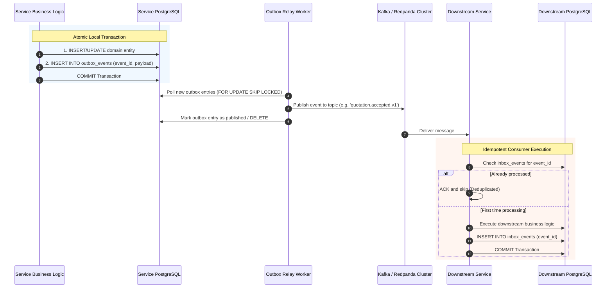

# AETHRA — Microservices Architecture Specification

> Phase 0 · Distributed Systems Architecture · v0.1.0

---

## 1. Architectural Vision & Principles

AETHRA is architected as an **enterprise-grade, event-driven microservices platform** engineered for the renewable energy sector in India (Solar EPC, rooftop & utility installations, BESS energy storage, EV charging, and asset maintenance).

The platform rejects the monolithic and modular-monolith architectural models in favor of independently deployable, autonomous bounded contexts to guarantee:
- Strict commercial and operational isolation between competing vendor organizations.
- Granular, independent horizontal scalability (e.g. scaling IoT telemetry or quotation engines without bloating CRM services).
- Polyglot database optimization and independent database evolution.
- Fault isolation: Failures in downstream notification or third-party CRM integrations cannot crash core engineering or inventory transactions.

### Core Architectural Laws
1. **Single Business Responsibility:** Every microservice models exactly one cohesive bounded context.
2. **Database-Per-Service:** Each microservice exclusively owns its database schema, credentials, and data store. Direct cross-service database queries, joins, and foreign keys are strictly prohibited.
3. **Decoupled Asynchronous Communication:** Cross-service workflows (e.g. quote acceptance $\to$ project creation $\to$ stock reservation) execute via asynchronous event streaming with transactional outbox and consumer inbox patterns.
4. **Zero-Trust Network:** All internal service communications require machine-to-machine authentication, tenant context propagation, and distributed correlation tracking.
5. **No Synchronous Coupling in Critical User Flows:** User-facing requests must not trigger synchronous chains exceeding two service hops.

---

## 2. Microservice Topology & Categorization

The AETHRA platform is organized into 5 functional tiers spanning 23 bounded services:

```mermaid
graph TD
    subgraph "Tier 0: Ingress & Edge"
        GW["API Gateway"]
        WBFF["Web BFF (Next.js App Router)"]
        MBFF["Mobile BFF (React Native / Expo)"]
    end

    subgraph "Tier 1: Core Platform Foundation"
        IDN["Identity Service<br/>(identity_db)"]
        ORG["Organisation & Tenant Service<br/>(organisation_db)"]
        ACS["Access Control Service<br/>(access_control_db)"]
        SUB["Subscription & Entitlement Service<br/>(subscription_db)"]
        AUD["Audit Service<br/>(audit_db)"]
    end

    subgraph "Tier 2: Customer & Governance Bridge"
        CUST["Customer Service<br/>(customer_db)"]
        VREL["Vendor Relationship Service<br/>(vendor_relationship_db)"]
    end

    subgraph "Tier 3: Core Pre-Sales & Commercial"
        CRM["CRM Service<br/>(crm_db)"]
        CAT["Product Catalogue Service<br/>(catalogue_db)"]
        ENG["Engineering & Estimation Service<br/>(engineering_db)"]
        QUO["Quotation Service<br/>(quotation_db)"]
    end

    subgraph "Tier 4: Operations & EPC Execution"
        INV["Inventory Service<br/>(inventory_db)"]
        PRO["Procurement Service<br/>(procurement_db)"]
        PRJ["Project Management Service<br/>(project_db)"]
        SRV["Service Management Service<br/>(service_db)"]
        DOC["Document & File Service<br/>(document_db)"]
    end

    subgraph "Tier 5: Integration, Analytics & AI Boundary"
        NOT["Notification Service<br/>(notification_db)"]
        REP["Reporting & Analytics Service<br/>(reporting_db)"]
        INT["Integration Service<br/>(integration_db)"]
        AI["AI Gateway / Boundary<br/>(Future Integration)"]
    end

    GW --> WBFF & MBFF
    WBFF & MBFF --> IDN & ORG & ACS & SUB & CUST & VREL & CRM & CAT & ENG & QUO & INV & PRO & PRJ & SRV & DOC & REP
    
    style GW fill:#1e293b,stroke:#0f172a,color:#fff
    style WBFF fill:#334155,stroke:#1e293b,color:#fff
    style MBFF fill:#334155,stroke:#1e293b,color:#fff
    style VREL fill:#b91c1c,stroke:#991b1b,color:#fff
    style AI fill:#6b21a8,stroke:#581c87,color:#fff
```

---

## 3. Communication Patterns

### 3.1 Synchronous Communication (REST & gRPC)
- **External to Ingress:** RESTful JSON APIs exposed via API Gateway and client-specific Backend-For-Frontend (BFF) layers.
- **Internal Synchronous RPC:** Used sparingly, exclusively for real-time validation where asynchronous eventual consistency is impossible (e.g. Access Control policy resolution miss, real-time credit check). Internal calls use REST with OpenAPI schemas or gRPC with Protocol Buffers.
- **Synchronous Chains Forbidden:** A request to Quotation Service must NOT make sequential synchronous calls to Catalogue, Engineering, Customer, and Access Control. Instead, required reference data is materialized via local event caches.

### 3.2 Asynchronous Event Streaming (Kafka / Redpanda)
Cross-service orchestration uses an event-driven architecture powered by Kafka:
- **Transactional Outbox Pattern:** To ensure atomic consistency between database state changes and event emission, each microservice writes events to an internal `outbox_events` table inside the same local database transaction. A dedicated CDC worker (e.g. Debezium or polling worker) dispatches outbox entries to Kafka.
- **Consumer Inbox & Deduplication:** Consumers persist incoming message IDs in an `inbox_events` table with unique constraints, ensuring strict business idempotency even with at-least-once Kafka delivery.

---

## 4. Cross-Cutting Engineering Standards

### 4.1 Distributed Tracing & Correlation
- Every incoming HTTP request at the API Gateway or Kafka message initiates a W3C Trace Context trace.
- Node.js OpenTelemetry SDK automatically instruments NestJS HTTP controllers, Kysely database queries, Redis calls, and Kafka consumers.
- Traces are exported via OTLP to AWS X-Ray, Grafana Tempo, or Jaeger.

### 4.2 Structured Logging
- Pino JSON logger with standardized schema:
  `{ timestamp, level, correlationId, service, tenantId, userId, message, context, error }`.
- Production log level defaults to `info`; dynamic elevation to `debug` via admin command for specific correlation IDs.

### 4.3 Container Orchestration & Deployment Model
- Every microservice has its own Dockerfile, CI/CD pipeline, and semantic release cycle.
- Workloads run as independently scaled AWS ECS Fargate tasks in multi-AZ private subnets.
- Resource allocation is sized per workload (e.g., Engineering & Estimation Service gets compute-optimized Fargate profiles; Notification Service gets I/O-optimized profiles).
