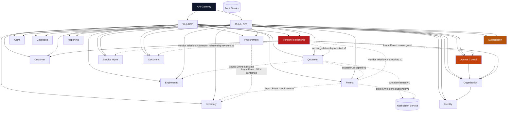

# AETHRA — Service Dependency Matrix & Coupling Analysis

> Phase 0 · Distributed Systems Architecture · v0.1.0

---

## 1. Service Dependency Graph

The following graph maps all runtime dependencies between the AETHRA microservices. Synchronous HTTP/gRPC calls are indicated by solid lines; asynchronous event-driven flows via Kafka are indicated by dashed lines.

---

## 2. Service Dependency Matrix

The table below catalogs synchronous ($\mathbf{S}$) and asynchronous ($\mathbf{A}$) dependencies:

| Calling \ Downstream | IDN | ORG | ACS | SUB | CUST| VREL| CRM | CAT | QUO | ENG | INV | PRO | PRJ | SRV | DOC | NOT | REP | AUD |
|---|---|---|---|---|---|---|---|---|---|---|---|---|---|---|---|---|---|---|
| **Identity (IDN)** | — | | | | | | | | | | | | | | | $\mathbf{A}$ | | $\mathbf{A}$ |
| **Organisation (ORG)**| $\mathbf{S}$ | — | $\mathbf{A}$ | $\mathbf{A}$ | | | | | | | | | | | | $\mathbf{A}$ | | $\mathbf{A}$ |
| **Access Control (ACS)**| $\mathbf{S}$| $\mathbf{S}$| — | | | | | | | | | | | | | | | $\mathbf{A}$ |
| **Subscription (SUB)**| | $\mathbf{S}$| | — | | | | | | | | | | | | $\mathbf{A}$ | | $\mathbf{A}$ |
| **Customer (CUST)** | $\mathbf{S}$| | | | — | | | | | | | | | | $\mathbf{S}$ | $\mathbf{A}$ | | $\mathbf{A}$ |
| **Vendor Rel (VREL)** | $\mathbf{S}$| $\mathbf{S}$| $\mathbf{A}$| | $\mathbf{S}$| — | | | | | | | | | | $\mathbf{A}$ | | $\mathbf{A}$ |
| **CRM** | $\mathbf{S}$| $\mathbf{S}$| $\mathbf{S}$| $\mathbf{S}$| $\mathbf{A}$| $\mathbf{A}$| — | | $\mathbf{A}$| | | | | | $\mathbf{S}$ | $\mathbf{A}$ | | $\mathbf{A}$ |
| **Catalogue (CAT)** | | $\mathbf{S}$| $\mathbf{S}$| | | | | — | | | | | | | $\mathbf{S}$ | | | $\mathbf{A}$ |
| **Quotation (QUO)** | $\mathbf{S}$| $\mathbf{S}$| $\mathbf{S}$| $\mathbf{S}$| $\mathbf{S}$| $\mathbf{S}$| | $\mathbf{S}$| — | $\mathbf{A}$| $\mathbf{A}$| | $\mathbf{A}$| | $\mathbf{S}$ | $\mathbf{A}$ | | $\mathbf{A}$ |
| **Engineering (ENG)** | | $\mathbf{S}$| $\mathbf{S}$| $\mathbf{S}$| | | | $\mathbf{S}$| | — | | | | | $\mathbf{S}$ | | | $\mathbf{A}$ |
| **Inventory (INV)** | $\mathbf{S}$| $\mathbf{S}$| $\mathbf{S}$| $\mathbf{S}$| | | | $\mathbf{S}$| | | — | | | | | $\mathbf{A}$ | | $\mathbf{A}$ |
| **Procurement (PRO)**| $\mathbf{S}$| $\mathbf{S}$| $\mathbf{S}$| $\mathbf{S}$| | | | $\mathbf{S}$| | | $\mathbf{A}$| — | | | $\mathbf{S}$ | $\mathbf{A}$ | | $\mathbf{A}$ |
| **Project (PRJ)** | $\mathbf{S}$| $\mathbf{S}$| $\mathbf{S}$| $\mathbf{S}$| $\mathbf{S}$| $\mathbf{S}$| | | $\mathbf{S}$| | $\mathbf{A}$| | — | | $\mathbf{S}$ | $\mathbf{A}$ | | $\mathbf{A}$ |
| **Service (SRV)** | $\mathbf{S}$| $\mathbf{S}$| $\mathbf{S}$| $\mathbf{S}$| $\mathbf{S}$| $\mathbf{S}$| | $\mathbf{S}$| | | $\mathbf{A}$| | | — | $\mathbf{S}$ | $\mathbf{A}$ | | $\mathbf{A}$ |

$\mathbf{S} = \text{Synchronous internal call (REST/gRPC/JWKS)}$  
$\mathbf{A} = \text{Asynchronous event-driven flow (Kafka Topic)}$

---

## 3. Critical Path & Cascading Failure Analysis

### 3.1 Tier-1 Critical Path Services
The following services are on the critical path for user requests:
1. **API Gateway / BFF:** Total platform outage if unresponsive. Mitigated via multi-AZ load balancing and stateless autoscaling.
2. **Access Control Service & Identity Provider:** If Access Control or Cognito goes down, authorization checks could fail.
   - **Mitigation:** Decentralized caching. Microservices cache user permissions in Redis for 300 seconds and validate JWT signatures using cached public keys. A brief Access Control outage does not disrupt active user sessions.
3. **Vendor Relationship Service:** If this service fails, multi-vendor customer permission checks could fail closed.
   - **Mitigation:** Grant snapshots cached in Redis with immediate cache-eviction triggers on revocation.

### 3.2 Circular Dependency Prevention
- **Hazard Identified in Early Design:** `Organisation Service` $\longleftrightarrow$ `Access Control Service`. (Organisation needs roles; Access Control needs tenant context).
- **Resolution:**
  - Organisation Service owns the raw tenant record and publishes `organisation.created.v1`.
  - Access Control Service listens asynchronously to `organisation.created.v1` and initializes standard default roles (`vendor_owner`, `vendor_manager`, `vendor_employee`) in its own database.
  - No synchronous circular calls exist.

---

## 4. Coupling Reduction Guidelines

1. **Local Read Models for High-Volume Reference Data:**
   - Quotation Service needs product model names and technical specs. Instead of querying Catalogue Service over HTTP for every quote calculation, Quotation Service keeps a read-optimized local projection of active product models updated via Kafka events (`catalogue.model.created.v1`).
2. **Event-Driven Workflows Over Sagas with Synchronous Coordinators:**
   - Procurement does not synchronously write stock ledger entries into Inventory Service. Instead, Goods Receipt emits `procurement.goods_receipt.confirmed.v1`, which Inventory consumes independently.
3. **Outbox-Inbox Decoupling:**
   - Guarantees that database writes succeed even if Kafka brokers undergo a rolling restart.
