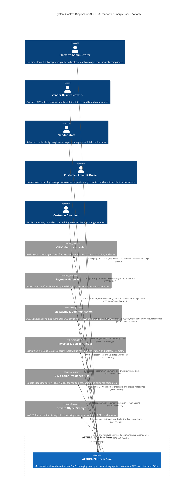

# AETHRA — System Context (C4 Level 1)

> Phase 0 · Distributed Systems Architecture · v0.1.0

---

## 1. System Context Diagram (C4 Level 1)

The following diagram illustrates the AETHRA platform boundary, external human actors across vendor and customer organizations, and external third-party service integrations.

---

## 2. External Actors & Persona Breakdown

### 2.1 Vendor Organization Personas
1. **Vendor Owner / Executive:**
   - Primary commercial stakeholder.
   - Goals: Maximize gross margins on solar installations, track pipeline conversion, control procurement spending, ensure timely customer handovers.
2. **Sales Representative:**
   - Uses mobile/web CRM to log leads, schedule site surveys, initiate preliminary engineering sizing, and deliver formal proposals.
3. **Solar Design Engineer:**
   - Executes structural/electrical calculations, configures string sizing, balances DC/AC ratios, and generates technical Bill of Materials.
4. **Project Manager & Site Supervisor:**
   - Coordinates equipment deliveries from warehouses to sites, tracks installation milestones, uploads discom net-metering inspection reports, and conducts customer plant handovers.
5. **O&M Field Technician:**
   - Dispatched for routine plant cleaning, inverter fault diagnosis, warranty replacements, and emergency site visits.

### 2.2 Customer Personas
1. **Customer Account Owner (Signatory):**
   - Residential homeowner, factory owner, or commercial building administrator.
   - Authorizes vendor access to their property, digitally signs quotation revisions, and approves final handover sign-off.
2. **Customer Delegated Site User:**
   - Building manager, tenant, or family member who needs read-only visibility into power generation without access to billing details.

---

## 3. External System Integrations & Boundaries

| External System | Integration Protocol | Ingress / Egress | Resilience & Fallback Strategy |
|---|---|---|---|
| **AWS Cognito (OIDC)** | OIDC / OAuth 2.0 (JWKS) | Bidirectional | JWKS keys cached in memory; gateway operates without real-time auth server hits on every request. |
| **Razorpay / Cashfree** | REST APIs + Webhooks | Bidirectional | Asynchronous webhook verification with signature checks; missed webhooks reconciled via polling cron jobs. |
| **AWS SES** | HTTPS / SDK | Egress | Asynchronous background dispatch via BullMQ; automatic retry with exponential backoff on SES throttling. |
| **Kaleyra / Textlocal (SMS)**| HTTPS REST | Egress | Dedicated OTP retry provider fallback in case primary SMS gateway reports high latency. |
| **Gupshup (WhatsApp)** | HTTPS REST | Egress | Opt-in verification; falls back to SMS if WhatsApp delivery fails or user is not on WhatsApp. |
| **Growatt / Solis / Sungrow**| REST Polling / Webhooks | Ingress | Decoupled ingest queue; high-volume IoT messages buffered through Kafka topic `integration.inverter.telemetry`. |
| **Google Maps Platform**| HTTPS REST | Egress | Geocoding results cached per address; rooftop coordinates stored permanently in `customer_properties`. |
| **AWS S3** | Presigned S3 URLs | Direct Client-to-S3 | Pre-signed upload/download links bypass microservices; S3 bucket encrypted with AWS KMS. |
