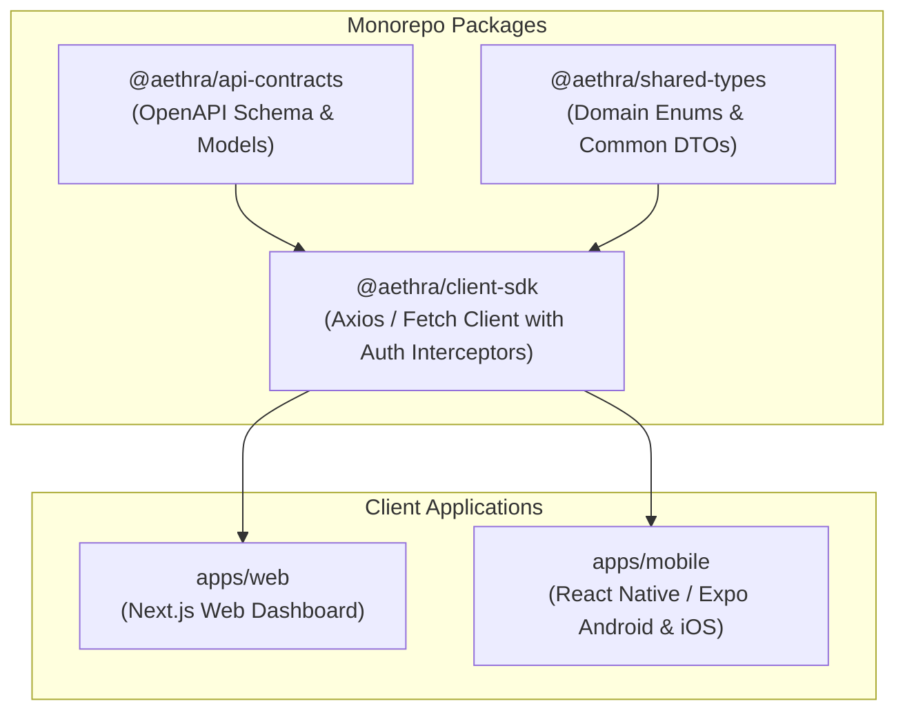
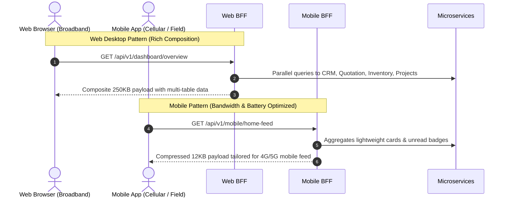

# AETHRA — Web, Android & iOS Client Architecture & Scaffolding Strategy

> Phase 0 · Frontend & Mobile Architecture · v0.1.0

---

## 1. Multi-Platform Vision & Scaffolding Scope

AETHRA supports three first-class client applications:
1. **Desktop Web Application:** Built for vendor administrators, solar design engineers, accountants, and procurement leads.
2. **Android Application:** Built for field technicians, site survey engineers, sales representatives, and customer mobile users.
3. **iOS Application:** Built for sales executives and customer property owners.

> **Phase 0 & 1 Scope Restriction:** No UI screens, navigation layouts, CSS designs, or visual components will be implemented during this phase. This document defines the **repository scaffolding, shared API client contracts, token lifecycle, and offline synchronization strategy**.

---

## 2. Technology Stack Selection

| Platform | Framework | Language | State Management & Cache | Local Offline Storage |
|---|---|---|---|---|
| **Web** | Next.js (App Router) | TypeScript | TanStack Query (React Query) | IndexedDB / LocalStorage |
| **Android** | React Native (Expo SDK) | TypeScript | TanStack Query | SQLite / WatermelonDB |
| **iOS** | React Native (Expo SDK) | TypeScript | TanStack Query | SQLite / WatermelonDB |



---

## 3. Backend-for-Frontend (BFF) Architectural Patterns

To optimize performance across distinct network profiles and viewport form factors, the platform uses two specialized BFF gateways:



### 3.1 Web BFF (`apps/web-bff`)
- Operates in the same low-latency VPC subnet as backend microservices.
- Composes complex desktop dashboard views across CRM, Engineering, and Inventory in a single round-trip.
- Formats monetary figures (INR formatting), dates (IST timezone), and complex nested grids.

### 3.2 Mobile BFF (`apps/mobile-bff`)
- Strips non-essential desktop metadata to reduce mobile cellular data consumption.
- Performs payload compression (Brotli / Gzip).
- Generates dynamic thumbnail image URLs for mobile equipment cards.
- Coordinates offline sync batch uploads for field technicians.

---

## 4. Authentication, Session & Token Lifecycle

Both Web and Mobile clients use standard OIDC OAuth 2.0 flows with Proof Key for Code Exchange (PKCE):

```mermaid
sequenceDiagram
    autonumber
    actor User as User (Web / Mobile)
    participant Client as Client App (Next.js / Expo)
    participant OIDC as AWS Cognito / Identity Provider
    participant GW as API Gateway / BFF

    User->>Client: Click Login
    Client->>OIDC: Authorization Code Flow + PKCE
    OIDC-->>Client: Access Token (JWT, 1 hr) + Refresh Token (30 days)
    Client->>Client: Store Refresh Token securely<br/>(Web: HttpOnly Cookie; Mobile: SecureStore / Keychain)

    Client->>GW: API Request with Header: Authorization: Bearer <Access_Token>
    alt Access Token Expired (401 Unauthorized)
        Client->>OIDC: POST /oauth2/token (grant_type=refresh_token)
        OIDC-->>Client: New Access Token
        Client->>GW: Replay failed request seamlessly
    end
```

---

## 5. Mobile Offline-First Architecture (Field Operations)

Field technicians and site engineers often survey solar sites or perform maintenance in remote agricultural locations with zero cellular coverage.

### Sync Workflow
1. **Offline Persistence:** Technicians fill out site surveys, capture roof photos, and log checklist items offline in local SQLite/WatermelonDB.
2. **Optimistic UI:** Local updates reflect immediately on the device UI with a "Pending Sync" badge.
3. **Sync Queue:** Outbound mutations are stored in a persistent `sync_mutation_queue` with client-generated UUIDs (`idempotencyKey`).
4. **Resumption:** When connectivity restores:
   - Mobile client dispatches batch mutations to `POST /api/v1/mobile/sync/batch`.
   - Backend processes mutations idempotently using the client UUIDs.
   - Any conflict (e.g. ticket reassigned while offline) is flagged for user resolution.

---

## 6. Binary File Handling Strategy

Clients never stream binary files through the Node.js BFF or microservices:
1. Client requests a signed upload URL via `POST /api/v1/documents/upload-sessions`.
2. Client uploads raw binary data (PDF proposal or JPEG site survey photo) directly to AWS S3 via an HTTP `PUT` request with progress tracking.
3. Client notifies Document Service of completion via `POST /api/v1/documents/upload-sessions/{id}/complete`.

---

## 7. Push Notification Registration

Mobile apps register device tokens upon user login:
```typescript
POST /api/v1/notifications/devices
{
  "deviceToken": "fcm_or_apns_registration_token",
  "platform": "android" | "ios",
  "appVersion": "1.0.0",
  "locale": "en-IN"
}
```
Tokens are linked to `customer_users` or `organisation_memberships` in the Notification Service database and cleaned up on logout.
