# AETHRA — Access Control Service ERD

> Phase 0 · Database: `access_control_db` · v0.1.0

---

## 1. Overview

The Access Control Service manages roles, permissions, and access policies. It supports both **system-defined roles** (platform-wide) and **organisation-custom roles** (tenant-scoped). The `organisation_id` column is nullable on `roles` and `permissions` to allow system-level definitions.

---

## 2. ERD

```mermaid
erDiagram
    roles {
        uuid id PK "gen_random_uuid()"
        uuid organisation_id "nullable — NULL for system roles"
        text name "NOT NULL"
        text slug "NOT NULL"
        text description "nullable"
        boolean is_system "NOT NULL DEFAULT false"
        boolean is_active "NOT NULL DEFAULT true"
        timestamptz created_at "NOT NULL DEFAULT now()"
        timestamptz updated_at "NOT NULL DEFAULT now()"
    }

    permissions {
        uuid id PK "gen_random_uuid()"
        text resource "NOT NULL — e.g. leads, quotations"
        text action "NOT NULL — e.g. read, create, update, delete"
        text slug "NOT NULL, UNIQUE"
        text description "nullable"
        boolean is_active "NOT NULL DEFAULT true"
        timestamptz created_at "NOT NULL DEFAULT now()"
    }

    role_permissions {
        uuid id PK "gen_random_uuid()"
        uuid role_id FK "NOT NULL → roles.id"
        uuid permission_id FK "NOT NULL → permissions.id"
        timestamptz created_at "NOT NULL DEFAULT now()"
    }

    membership_roles {
        uuid id PK "gen_random_uuid()"
        uuid membership_id "NOT NULL — ext ref → organisation_db.organisation_memberships.id"
        uuid organisation_id "NOT NULL — ext ref → organisation_db.organisations.id"
        uuid role_id FK "NOT NULL → roles.id"
        timestamptz assigned_at "NOT NULL DEFAULT now()"
        uuid assigned_by_user_id "nullable — ext ref → identity_db.users.id"
    }

    access_scopes {
        uuid id PK "gen_random_uuid()"
        uuid organisation_id "NOT NULL — ext ref"
        text scope_type "NOT NULL — branch|warehouse|region|all"
        text scope_name "NOT NULL"
        uuid scope_reference_id "nullable — e.g. branch_id"
        boolean is_active "NOT NULL DEFAULT true"
        timestamptz created_at "NOT NULL DEFAULT now()"
    }

    resource_assignments {
        uuid id PK "gen_random_uuid()"
        uuid organisation_id "NOT NULL — ext ref"
        uuid user_id "NOT NULL — ext ref → identity_db.users.id"
        uuid scope_id FK "nullable → access_scopes.id"
        text resource_type "NOT NULL"
        uuid resource_id "NOT NULL"
        text access_level "NOT NULL DEFAULT 'read' — read|write|admin"
        timestamptz assigned_at "NOT NULL DEFAULT now()"
        uuid assigned_by_user_id "nullable — ext ref"
        timestamptz expires_at "nullable"
    }

    policy_cache_metadata {
        uuid id PK "gen_random_uuid()"
        uuid organisation_id "NOT NULL — ext ref"
        text cache_key "NOT NULL"
        text cache_version "NOT NULL"
        timestamptz computed_at "NOT NULL DEFAULT now()"
        timestamptz expires_at "NOT NULL"
        int policy_count "NOT NULL DEFAULT 0"
    }

    temporary_access_grants {
        uuid id PK "gen_random_uuid()"
        uuid organisation_id "NOT NULL — ext ref"
        uuid user_id "NOT NULL — ext ref → identity_db.users.id"
        uuid granted_by_user_id "NOT NULL — ext ref → identity_db.users.id"
        text resource_type "NOT NULL"
        uuid resource_id "nullable"
        text access_level "NOT NULL"
        text reason "NOT NULL"
        timestamptz granted_at "NOT NULL DEFAULT now()"
        timestamptz expires_at "NOT NULL"
        timestamptz revoked_at "nullable"
        text revocation_reason "nullable"
    }

    roles ||--o{ role_permissions : "has"
    permissions ||--o{ role_permissions : "granted by"
    roles ||--o{ membership_roles : "assigned via"
    access_scopes ||--o{ resource_assignments : "scopes"
```



---

## 3. Table Specifications

### 3.1 `roles`

```sql
CREATE TABLE app.roles (
    id                  UUID PRIMARY KEY DEFAULT gen_random_uuid(),
    organisation_id     UUID,  -- NULL = system role, non-NULL = org-custom role
    name                TEXT NOT NULL,
    slug                TEXT NOT NULL,
    description         TEXT,
    is_system           BOOLEAN NOT NULL DEFAULT false,
    is_active           BOOLEAN NOT NULL DEFAULT true,
    created_at          TIMESTAMPTZ NOT NULL DEFAULT now(),
    updated_at          TIMESTAMPTZ NOT NULL DEFAULT now(),
    UNIQUE (organisation_id, slug)
);

-- System roles have unique slugs globally
CREATE UNIQUE INDEX uq_roles_system_slug ON app.roles (slug) WHERE is_system = true;
CREATE INDEX ix_roles_org ON app.roles (organisation_id) WHERE organisation_id IS NOT NULL;

ALTER TABLE app.roles ENABLE ROW LEVEL SECURITY;
ALTER TABLE app.roles FORCE ROW LEVEL SECURITY;
-- Policy: see system roles OR roles belonging to current tenant
CREATE POLICY tenant_isolation ON app.roles
    USING (
        is_system = true
        OR organisation_id = current_setting('app.current_tenant')::uuid
    )
    WITH CHECK (
        organisation_id = current_setting('app.current_tenant')::uuid
    );
```

### 3.2 `permissions`

Platform-wide permission definitions — **no RLS**.

```sql
CREATE TABLE app.permissions (
    id              UUID PRIMARY KEY DEFAULT gen_random_uuid(),
    resource        TEXT NOT NULL,
    action          TEXT NOT NULL,
    slug            TEXT NOT NULL UNIQUE,
    description     TEXT,
    is_active       BOOLEAN NOT NULL DEFAULT true,
    created_at      TIMESTAMPTZ NOT NULL DEFAULT now(),
    UNIQUE (resource, action)
);
```

### 3.3 `role_permissions`

```sql
CREATE TABLE app.role_permissions (
    id              UUID PRIMARY KEY DEFAULT gen_random_uuid(),
    role_id         UUID NOT NULL REFERENCES app.roles(id) ON DELETE CASCADE,
    permission_id   UUID NOT NULL REFERENCES app.permissions(id) ON DELETE CASCADE,
    created_at      TIMESTAMPTZ NOT NULL DEFAULT now(),
    UNIQUE (role_id, permission_id)
);

CREATE INDEX ix_role_perms_role ON app.role_permissions (role_id);
CREATE INDEX ix_role_perms_perm ON app.role_permissions (permission_id);
```

### 3.4 `membership_roles`

Maps an organisation membership to one or more roles.

```sql
CREATE TABLE app.membership_roles (
    id                      UUID PRIMARY KEY DEFAULT gen_random_uuid(),
    membership_id           UUID NOT NULL,  -- ext ref → organisation_db
    organisation_id         UUID NOT NULL,  -- ext ref → organisation_db
    role_id                 UUID NOT NULL REFERENCES app.roles(id) ON DELETE CASCADE,
    assigned_at             TIMESTAMPTZ NOT NULL DEFAULT now(),
    assigned_by_user_id     UUID,  -- ext ref → identity_db
    UNIQUE (membership_id, role_id)
);

CREATE INDEX ix_membership_roles_org ON app.membership_roles (organisation_id);
CREATE INDEX ix_membership_roles_membership ON app.membership_roles (membership_id);

ALTER TABLE app.membership_roles ENABLE ROW LEVEL SECURITY;
ALTER TABLE app.membership_roles FORCE ROW LEVEL SECURITY;
CREATE POLICY tenant_isolation ON app.membership_roles
    USING (organisation_id = current_setting('app.current_tenant')::uuid)
    WITH CHECK (organisation_id = current_setting('app.current_tenant')::uuid);
```

### 3.5 `access_scopes`

Defines scope boundaries within an organisation (e.g., branch-level, warehouse-level).

```sql
CREATE TABLE app.access_scopes (
    id                      UUID PRIMARY KEY DEFAULT gen_random_uuid(),
    organisation_id         UUID NOT NULL,
    scope_type              TEXT NOT NULL
                                CHECK (scope_type IN ('branch', 'warehouse', 'region', 'all')),
    scope_name              TEXT NOT NULL,
    scope_reference_id      UUID,  -- points to branch_id, warehouse_id, etc.
    is_active               BOOLEAN NOT NULL DEFAULT true,
    created_at              TIMESTAMPTZ NOT NULL DEFAULT now(),
    UNIQUE (organisation_id, scope_type, scope_reference_id)
);

CREATE INDEX ix_access_scopes_org ON app.access_scopes (organisation_id);

ALTER TABLE app.access_scopes ENABLE ROW LEVEL SECURITY;
ALTER TABLE app.access_scopes FORCE ROW LEVEL SECURITY;
CREATE POLICY tenant_isolation ON app.access_scopes
    USING (organisation_id = current_setting('app.current_tenant')::uuid)
    WITH CHECK (organisation_id = current_setting('app.current_tenant')::uuid);
```

### 3.6 `resource_assignments`

```sql
CREATE TABLE app.resource_assignments (
    id                      UUID PRIMARY KEY DEFAULT gen_random_uuid(),
    organisation_id         UUID NOT NULL,
    user_id                 UUID NOT NULL,
    scope_id                UUID REFERENCES app.access_scopes(id) ON DELETE SET NULL,
    resource_type           TEXT NOT NULL,
    resource_id             UUID NOT NULL,
    access_level            TEXT NOT NULL DEFAULT 'read'
                                CHECK (access_level IN ('read', 'write', 'admin')),
    assigned_at             TIMESTAMPTZ NOT NULL DEFAULT now(),
    assigned_by_user_id     UUID,
    expires_at              TIMESTAMPTZ
);

CREATE INDEX ix_res_assign_org ON app.resource_assignments (organisation_id);
CREATE INDEX ix_res_assign_user ON app.resource_assignments (organisation_id, user_id);
CREATE INDEX ix_res_assign_resource ON app.resource_assignments (resource_type, resource_id);

ALTER TABLE app.resource_assignments ENABLE ROW LEVEL SECURITY;
ALTER TABLE app.resource_assignments FORCE ROW LEVEL SECURITY;
CREATE POLICY tenant_isolation ON app.resource_assignments
    USING (organisation_id = current_setting('app.current_tenant')::uuid)
    WITH CHECK (organisation_id = current_setting('app.current_tenant')::uuid);
```

### 3.7 `policy_cache_metadata`

Tracks computed policy bundles for caching/invalidation.

```sql
CREATE TABLE app.policy_cache_metadata (
    id                  UUID PRIMARY KEY DEFAULT gen_random_uuid(),
    organisation_id     UUID NOT NULL,
    cache_key           TEXT NOT NULL,
    cache_version       TEXT NOT NULL,
    computed_at         TIMESTAMPTZ NOT NULL DEFAULT now(),
    expires_at          TIMESTAMPTZ NOT NULL,
    policy_count        INTEGER NOT NULL DEFAULT 0,
    UNIQUE (organisation_id, cache_key)
);

CREATE INDEX ix_policy_cache_org ON app.policy_cache_metadata (organisation_id);

ALTER TABLE app.policy_cache_metadata ENABLE ROW LEVEL SECURITY;
ALTER TABLE app.policy_cache_metadata FORCE ROW LEVEL SECURITY;
CREATE POLICY tenant_isolation ON app.policy_cache_metadata
    USING (organisation_id = current_setting('app.current_tenant')::uuid)
    WITH CHECK (organisation_id = current_setting('app.current_tenant')::uuid);
```

### 3.8 `temporary_access_grants`

```sql
CREATE TABLE app.temporary_access_grants (
    id                      UUID PRIMARY KEY DEFAULT gen_random_uuid(),
    organisation_id         UUID NOT NULL,
    user_id                 UUID NOT NULL,
    granted_by_user_id      UUID NOT NULL,
    resource_type           TEXT NOT NULL,
    resource_id             UUID,
    access_level            TEXT NOT NULL
                                CHECK (access_level IN ('read', 'write', 'admin')),
    reason                  TEXT NOT NULL,
    granted_at              TIMESTAMPTZ NOT NULL DEFAULT now(),
    expires_at              TIMESTAMPTZ NOT NULL,
    revoked_at              TIMESTAMPTZ,
    revocation_reason       TEXT
);

CREATE INDEX ix_temp_grants_org ON app.temporary_access_grants (organisation_id);
CREATE INDEX ix_temp_grants_user ON app.temporary_access_grants (organisation_id, user_id);
CREATE INDEX ix_temp_grants_active ON app.temporary_access_grants (organisation_id, user_id, expires_at)
    WHERE revoked_at IS NULL;

ALTER TABLE app.temporary_access_grants ENABLE ROW LEVEL SECURITY;
ALTER TABLE app.temporary_access_grants FORCE ROW LEVEL SECURITY;
CREATE POLICY tenant_isolation ON app.temporary_access_grants
    USING (organisation_id = current_setting('app.current_tenant')::uuid)
    WITH CHECK (organisation_id = current_setting('app.current_tenant')::uuid);
```

---

## 4. RLS Summary

| Table | RLS | Notes |
|-------|-----|-------|
| `roles` | ✅ | Sees system roles + own org roles; can only write own org roles |
| `permissions` | ❌ | Platform-wide definitions |
| `role_permissions` | ❌ | Controlled indirectly via role ownership |
| `membership_roles` | ✅ | `organisation_id` |
| `access_scopes` | ✅ | `organisation_id` |
| `resource_assignments` | ✅ | `organisation_id` |
| `policy_cache_metadata` | ✅ | `organisation_id` |
| `temporary_access_grants` | ✅ | `organisation_id` |

---

## 5. Open Decisions

| # | Decision | Options |
|---|----------|---------|
| 1 | Hierarchical roles (role inheritance) | Flat roles for Day 1 vs. role-parent hierarchy |
| 2 | Permission granularity | Resource+Action (current) vs. attribute-based (ABAC) |
| 3 | Policy cache storage | PostgreSQL (current) vs. Redis for faster evaluation |
