# AETHRA — Product Catalogue Service ERD

> Phase 0 · Database: `catalogue_db` · v0.1.0

---

## 1. Overview

The Product Catalogue Service manages equipment master data (solar panels, inverters, batteries, mounting structures, cables, balance of system components, meters, and heat pumps).

**Architecture Rules:**
1. **Global Master Catalogue vs. Vendor Private Entries:**
   - Standard equipment categories, brands, OEM models, technical specifications, and compliance certificates are **platform-wide global reference data** curated by OEMs and platform admins.
   - Vendor-specific purchase costs, margins, retail prices, custom SKU codes, and supplier linkages are **strictly vendor-tenant-scoped** within `vendor_catalogue_entries`.
2. Pricing and cost sensitivity: One vendor must NEVER be able to see another vendor's cost structures, margins, or private pricing lists.

---

## 2. ERD

```mermaid
erDiagram
    product_categories ||--o{ product_categories : "sub-category hierarchy"
    product_categories ||--o{ product_models : "categorizes"
    product_categories ||--o{ product_specifications : "defines specs for"
    brands ||--o{ product_models : "manufactures"
    units ||--o{ product_specifications : "measured in"
    product_models ||--o{ specification_values : "has specs"
    product_specifications ||--o{ specification_values : "spec definition"
    product_models ||--o{ product_documents : "has technical sheets"
    product_models ||--o{ warranty_templates : "standard OEM warranty"
    product_models ||--o{ vendor_catalogue_entries : "vendor price & sku"

    product_categories {
        uuid id PK "gen_random_uuid()"
        uuid parent_category_id FK "nullable → product_categories.id"
        text code "NOT NULL, UNIQUE — solar_pv_module|inverter|bess_battery|mounting_structure|bos"
        text name "NOT NULL"
        text description "nullable"
        boolean is_active "NOT NULL DEFAULT true"
        timestamptz created_at "NOT NULL DEFAULT now()"
    }

    brands {
        uuid id PK "gen_random_uuid()"
        text name "NOT NULL, UNIQUE — e.g. Waaree, Tata Power Solar, Growatt, Sungrow, Enphase"
        text origin_country "NOT NULL DEFAULT 'IN'"
        text website_url "nullable"
        text logo_url "nullable"
        boolean is_verified "NOT NULL DEFAULT true"
        timestamptz created_at "NOT NULL DEFAULT now()"
    }

    units {
        uuid id PK "gen_random_uuid()"
        text code "NOT NULL, UNIQUE — Wp, kW, kWh, Ah, V, A, mm, kg, nos, mtr"
        text name "NOT NULL"
        text unit_category "NOT NULL — power|energy|electrical|dimension|weight|quantity"
    }

    product_models {
        uuid id PK "gen_random_uuid()"
        uuid category_id FK "NOT NULL → product_categories.id"
        uuid brand_id FK "NOT NULL → brands.id"
        text model_code "NOT NULL, UNIQUE"
        text display_name "NOT NULL"
        text description "nullable"
        boolean is_discontinued "NOT NULL DEFAULT false"
        jsonb metadata "nullable — tier rating, certifications (BIS, IEC, MNRE)"
        timestamptz created_at "NOT NULL DEFAULT now()"
        timestamptz updated_at "NOT NULL DEFAULT now()"
    }

    product_specifications {
        uuid id PK "gen_random_uuid()"
        uuid category_id FK "NOT NULL → product_categories.id"
        text spec_key "NOT NULL — e.g. rated_power, cell_type, efficiency_percent, max_system_voltage"
        text label "NOT NULL"
        text data_type "NOT NULL — numeric|text|boolean|range"
        uuid default_unit_id FK "nullable → units.id"
        boolean is_filterable "NOT NULL DEFAULT true"
        boolean is_required "NOT NULL DEFAULT false"
        timestamptz created_at "NOT NULL DEFAULT now()"
    }

    specification_values {
        uuid id PK "gen_random_uuid()"
        uuid model_id FK "NOT NULL → product_models.id"
        uuid spec_id FK "NOT NULL → product_specifications.id"
        text text_value "nullable"
        numeric numeric_value "nullable"
        uuid unit_id FK "nullable → units.id"
        timestamptz created_at "NOT NULL DEFAULT now()"
    }

    product_documents {
        uuid id PK "gen_random_uuid()"
        uuid model_id FK "NOT NULL → product_models.id"
        text doc_type "NOT NULL — datasheet|installation_manual|warranty_card|certificate_bis|certificate_iec"
        text title "NOT NULL"
        text file_reference_id "NOT NULL — external Document Service files.id"
        timestamptz created_at "NOT NULL DEFAULT now()"
    }

    warranty_templates {
        uuid id PK "gen_random_uuid()"
        uuid model_id FK "NOT NULL → product_models.id"
        int standard_warranty_months "NOT NULL DEFAULT 12"
        int performance_warranty_months "nullable DEFAULT 300 — e.g. 25 years for solar modules"
        numeric guaranteed_efficiency_percent "nullable — e.g. 80.00"
        text terms_summary "nullable"
        timestamptz created_at "NOT NULL DEFAULT now()"
    }

    vendor_catalogue_entries {
        uuid id PK "gen_random_uuid()"
        uuid organisation_id "NOT NULL — vendor tenant ID"
        uuid model_id FK "NOT NULL → product_models.id"
        text vendor_sku "NOT NULL — vendor internal part number"
        numeric standard_cost_price "NOT NULL DEFAULT 0.00 — confidential vendor procurement cost"
        numeric standard_selling_price "NOT NULL DEFAULT 0.00 — standard base price before quotation discounts"
        numeric min_selling_price "NOT NULL DEFAULT 0.00 — floor price for margin protection"
        numeric tax_rate_percent "NOT NULL DEFAULT 13.8 — GST rate (e.g. 12% or composite solar rate)"
        boolean is_available "NOT NULL DEFAULT true"
        boolean is_preferred "NOT NULL DEFAULT false"
        int lead_time_days "NOT NULL DEFAULT 3"
        jsonb vendor_notes "nullable"
        timestamptz created_at "NOT NULL DEFAULT now()"
        timestamptz updated_at "NOT NULL DEFAULT now()"
    }
```



---

## 3. Data Dictionary & Constraints

### 3.1 `vendor_catalogue_entries`
- Unique constraint: `UNIQUE(organisation_id, model_id)` ensures one commercial record per model per vendor.
- Unique constraint: `UNIQUE(organisation_id, vendor_sku)` prevents duplicate SKUs within an organization.
- Financial check: `CHECK (min_selling_price <= standard_selling_price)` protects pricing rules.

### 3.2 `specification_values`
- Unique constraint: `UNIQUE(model_id, spec_id)` prevents conflicting specifications on a model.

---

## 4. Cross-Service References

| Local Column | Target Service | Entity Referenced | Relationship |
|---|---|---|---|
| `vendor_catalogue_entries.organisation_id` | Organisation Service | `organisations.id` | Vendor tenant ownership |
| `product_documents.file_reference_id` | Document Service | `files.id` | Pointer to securely stored technical PDF/spec sheet in S3 |

---

## 5. Security & Isolation

- Base catalogue tables (`product_categories`, `brands`, `units`, `product_models`, `specification_values`, `product_documents`, `warranty_templates`) are public read-only to all authenticated services and tenants.
- `vendor_catalogue_entries` has strict PostgreSQL RLS:
  ```sql
  CREATE POLICY vendor_catalogue_isolation ON vendor_catalogue_entries
    USING (organisation_id = NULLIF(current_setting('app.current_organisation_id', true), '')::uuid);
  ```
- Public/Customer APIs strip `standard_cost_price` and `min_selling_price` — only vendor authorized staff with `catalogue.price.view_cost` permission can view cost fields.
