# AETHRA — CRM Service ERD

> Phase 0 · Database: `crm_db` · v0.1.0

---

## 1. Overview

The CRM Service manages vendor pre-sales pipelines, inquiries, lead sources, qualification stages, sales representative assignments, customer interaction logs, follow-up scheduling, and conversion workflows into customer relationships or quotations.

**Architecture Rules:**
1. CRM records are **strictly vendor-owned and private**. A lead entered by Vendor A is completely invisible to Vendor B, even if the person's phone number or email matches.
2. Tenant isolation via PostgreSQL RLS on `organisation_id` is mandatory across all CRM tables.
3. On lead qualification and conversion, the CRM service triggers cross-service events (`crm.lead.converted.v1`) to invite the customer via Vendor Relationship Service and optionally initialize a draft Quotation.

---

## 2. ERD

```mermaid
erDiagram
    lead_sources ||--o{ leads : "originated from"
    lead_stages ||--o{ leads : "current status"
    leads ||--o{ lead_assignments : "assigned to"
    leads ||--o{ lead_activities : "audit log"
    leads ||--o{ lead_follow_ups : "scheduled"
    leads ||--o{ lead_interactions : "history"
    leads ||--o{ lead_conversions : "converts to"

    lead_sources {
        uuid id PK "gen_random_uuid()"
        uuid organisation_id "NOT NULL — tenant discriminator"
        text name "NOT NULL — e.g. Website, Referral, Cold Call, Expo, Meta Ads"
        text channel_type "NOT NULL DEFAULT 'digital' — digital|offline|partner|referral"
        boolean is_active "NOT NULL DEFAULT true"
        timestamptz created_at "NOT NULL DEFAULT now()"
    }

    lead_stages {
        uuid id PK "gen_random_uuid()"
        uuid organisation_id "NOT NULL — tenant discriminator"
        text name "NOT NULL — e.g. New, Contacted, Site Visit Scheduled, Qualified, Proposal Sent, Won, Lost"
        int stage_order "NOT NULL DEFAULT 1"
        boolean is_won "NOT NULL DEFAULT false"
        boolean is_lost "NOT NULL DEFAULT false"
        boolean is_active "NOT NULL DEFAULT true"
        timestamptz created_at "NOT NULL DEFAULT now()"
    }

    leads {
        uuid id PK "gen_random_uuid()"
        uuid organisation_id "NOT NULL — tenant discriminator"
        text lead_code "NOT NULL — human-readable code e.g. 'LD-2026-0001'"
        uuid lead_source_id FK "nullable → lead_sources.id"
        uuid current_stage_id FK "NOT NULL → lead_stages.id"
        text prospect_name "NOT NULL"
        text prospect_phone "NOT NULL"
        text prospect_email "nullable"
        text prospect_type "NOT NULL DEFAULT 'residential' — residential|commercial|industrial|agricultural"
        text site_address "nullable"
        text site_city "nullable"
        text site_state "nullable"
        text site_postal_code "nullable"
        numeric estimated_monthly_bill "nullable"
        numeric proposed_capacity_kw "nullable"
        numeric budget_estimate "nullable"
        text priority "NOT NULL DEFAULT 'medium' — low|medium|high|urgent"
        text status "NOT NULL DEFAULT 'open' — open|converted|disqualified|archived"
        uuid assigned_agent_user_id "nullable — external Identity user ID"
        timestamptz created_at "NOT NULL DEFAULT now()"
        timestamptz updated_at "NOT NULL DEFAULT now()"
    }

    lead_assignments {
        uuid id PK "gen_random_uuid()"
        uuid organisation_id "NOT NULL — tenant discriminator"
        uuid lead_id FK "NOT NULL → leads.id"
        uuid assigned_to_user_id "NOT NULL — external Identity user ID"
        uuid assigned_by_user_id "NOT NULL — external Identity user ID"
        text assignment_notes "nullable"
        timestamptz assigned_at "NOT NULL DEFAULT now()"
        timestamptz unassigned_at "nullable"
    }

    lead_activities {
        uuid id PK "gen_random_uuid()"
        uuid organisation_id "NOT NULL — tenant discriminator"
        uuid lead_id FK "NOT NULL → leads.id"
        text activity_type "NOT NULL — stage_change|note_added|call_logged|email_sent|site_visit|quote_created"
        text title "NOT NULL"
        text description "nullable"
        uuid performed_by_user_id "NOT NULL — external Identity user ID"
        jsonb metadata "nullable — before/after stage, duration, outcome"
        timestamptz created_at "NOT NULL DEFAULT now()"
    }

    lead_follow_ups {
        uuid id PK "gen_random_uuid()"
        uuid organisation_id "NOT NULL — tenant discriminator"
        uuid lead_id FK "NOT NULL → leads.id"
        uuid assigned_to_user_id "NOT NULL — external Identity user ID"
        timestamptz scheduled_at "NOT NULL"
        text follow_up_type "NOT NULL DEFAULT 'call' — call|site_visit|meeting|whatsapp|email"
        text reminder_note "nullable"
        text status "NOT NULL DEFAULT 'pending' — pending|completed|rescheduled|cancelled"
        timestamptz completed_at "nullable"
        text completion_outcome "nullable"
        timestamptz created_at "NOT NULL DEFAULT now()"
    }

    lead_interactions {
        uuid id PK "gen_random_uuid()"
        uuid organisation_id "NOT NULL — tenant discriminator"
        uuid lead_id FK "NOT NULL → leads.id"
        text channel "NOT NULL — phone_call|whatsapp|email|in_person"
        text direction "NOT NULL DEFAULT 'outbound' — inbound|outbound"
        int duration_seconds "nullable"
        text summary "NOT NULL"
        text outcome "nullable — interested|call_back|not_reachable|not_interested"
        uuid recorded_by_user_id "NOT NULL — external Identity user ID"
        timestamptz recorded_at "NOT NULL DEFAULT now()"
    }

    lead_conversions {
        uuid id PK "gen_random_uuid()"
        uuid organisation_id "NOT NULL — tenant discriminator"
        uuid lead_id FK "NOT NULL, UNIQUE → leads.id"
        uuid customer_id "nullable — external Customer Service customer_accounts.id"
        uuid quotation_id "nullable — external Quotation Service quotations.id"
        uuid converted_by_user_id "NOT NULL — external Identity user ID"
        text conversion_type "NOT NULL DEFAULT 'customer_and_quote' — customer_only|customer_and_quote|direct_project"
        timestamptz converted_at "NOT NULL DEFAULT now()"
    }
```



---

## 3. Data Dictionary & Constraints

### 3.1 `leads`
- Unique constraint: `UNIQUE(organisation_id, lead_code)` ensures lead codes are unique per tenant.
- Duplicate detection index: `CREATE INDEX idx_leads_phone_org ON leads(organisation_id, prospect_phone);` allows fast duplicate check during lead capture.
- Compound filtering index: `CREATE INDEX idx_leads_stage_status ON leads(organisation_id, current_stage_id, status);`

### 3.2 `lead_stages`
- Unique constraint: `UNIQUE(organisation_id, stage_order)` prevents ambiguous stage sorting.

---

## 4. Cross-Service References

| Local Column | Target Service | Entity Referenced | Relationship |
|---|---|---|---|
| `organisation_id` | Organisation Service | `organisations.id` | Tenant isolation boundary |
| `assigned_agent_user_id` | Identity Service | `users.id` | Assigned sales rep |
| `performed_by_user_id` | Identity Service | `users.id` | Staff member who performed activity |
| `lead_conversions.customer_id` | Customer Service | `customer_accounts.id` | Target converted customer account |
| `lead_conversions.quotation_id` | Quotation Service | `quotations.id` | Resulting quotation draft |

---

## 5. Security & Isolation

- Row-level security is enforced on every table using `organisation_id`:
  ```sql
  CREATE POLICY crm_tenant_isolation ON leads
    USING (organisation_id = NULLIF(current_setting('app.current_organisation_id', true), '')::uuid);
  ```
- Subscriptions guard: Requires active entitlement for the `crm` module.
- Sensitive lead logs are never accessible to external customer portal users.
