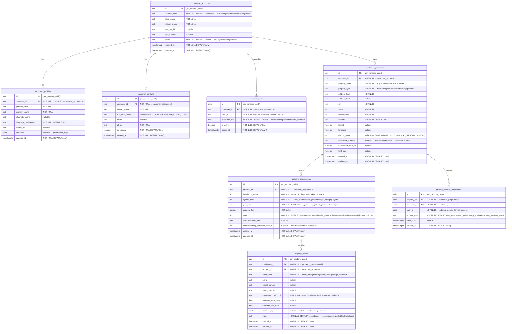

# AETHRA — Customer Service ERD

> Phase 0 · Database: `customer_db` · v0.1.0

---

## 1. Overview

The Customer Service owns core customer identities, profiles, contacts, customer-linked user accounts, customer real estate properties, property-level installations (e.g. rooftop solar setups), equipment asset registers, and property access delegations.

**Fundamental Architecture Rule:**
- Customer accounts and customer properties are **independent of any single vendor**.
- A customer (e.g., a homeowner or factory owner) may interact with Vendor A for a 10kW solar installation, Vendor B for battery energy storage, and Vendor C for annual maintenance.
- Vendor access to customer and property data is governed explicitly through the **Vendor Relationship Service**, never by hardcoding a `vendor_id` or single `organisation_id` foreign key on the customer record.

---

## 2. ERD

---

## 3. Data Dictionary & Constraints

### 3.1 `customer_accounts`
- PK: `id` (UUID).
- Uniqueness: Optional composite check on `(pan_tax_id)` and `(gst_number)` where not null.

### 3.2 `customer_users`
- Constraint: `UNIQUE(customer_id, user_id)` ensures a user cannot have duplicate mappings to the same customer account.
- Index: `CREATE INDEX idx_customer_users_user_id ON customer_users(user_id);` enables fast lookup of all customer accounts accessible by a logged-in user.

### 3.3 `customer_properties`
- Index: `CREATE INDEX idx_customer_properties_customer ON customer_properties(customer_id);`
- Index: `CREATE INDEX idx_customer_properties_geo ON customer_properties(postal_code, city);`

### 3.4 `property_assets`
- Index: `CREATE INDEX idx_property_assets_serial ON property_assets(serial_number) WHERE serial_number IS NOT NULL;`

---

## 4. Cross-Service References

| Local Column | Target Service | Entity Referenced | Relationship Description |
|---|---|---|---|
| `customer_users.user_id` | Identity Service | `users.id` | Maps login credentials to customer portal permissions |
| `property_access_delegations.user_id` | Identity Service | `users.id` | Delegated family/caretaker access |
| `property_assets.catalogue_product_id` | Product Catalogue | `product_models.id` | Connects deployed equipment to official OEM catalogue specifications |
| `property_installations.commissioning_certificate_doc_id` | Document Service | `files.id` | Pointer to uploaded handover/discom document |

---

## 5. Security & Access Rules

- Direct customer portal access uses `customer_users` mapping verified via JWT sub claims.
- **Vendor access is never direct**: When a vendor API queries customer records, the request passes through the **Vendor Relationship Service**, which checks if an active, non-revoked grant exists for `(organisation_id, customer_id, property_id)`.
- RLS policy on Customer Service evaluates vendor grants through contextual session attributes or cached grant tokens passed by the API Gateway/BFF.
