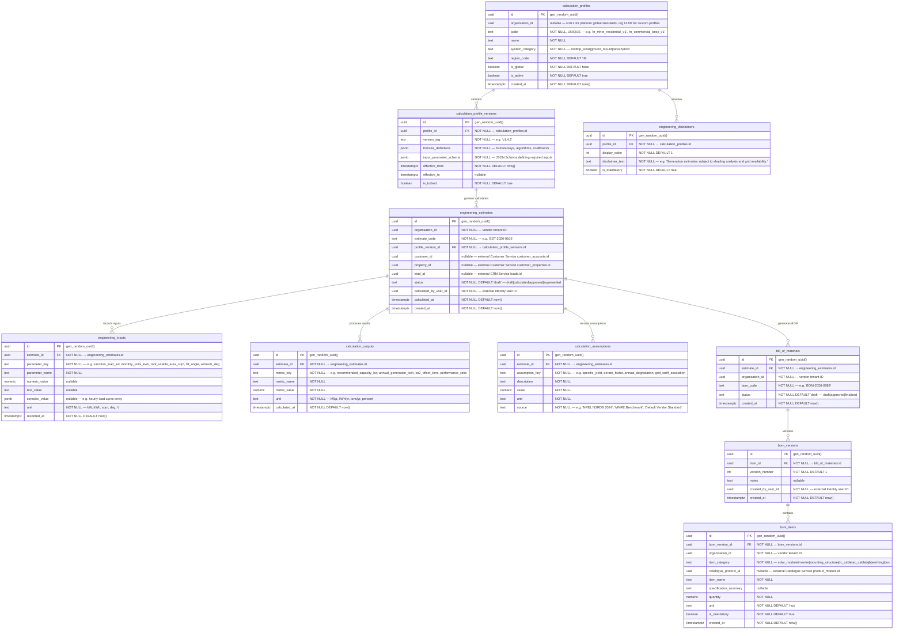

# AETHRA — Engineering & Estimation Service ERD

> Phase 0 · Database: `engineering_db` · v0.1.0

---

## 1. Overview

The Engineering & Estimation Service is the technical sizing and Bill of Materials (BOM) calculation engine of the AETHRA platform. It evaluates site solar irradiation, roof tilt/azimuth, shadow losses, load profiles, inverter-to-module string sizing, battery capacity requirements, and generates versioned engineering estimates.

**Fundamental Architecture Rules:**
1. **Calculation Reproducibility & Immutability:** Engineering calculations must remain 100% reproducible over time. Every estimate permanently records:
   - All input values and their exact units.
   - The exact rule/formula version (`calculation_profile_versions.id`).
   - All explicit assumptions (e.g., derating factor = 0.78, specific yield = 1500 kWh/kWp/year).
   - Calculation timestamp and engine version.
2. **Strict Separation of Engineering Rules:** The calculation engine does not invent formulas on the fly. It executes parameterized calculation profiles configured per region, discom standard, or vendor preference.
3. **Bill of Materials (BOM) Versioning:** Engineering outputs compile directly into BOM versions, which specify exact quantities of modules, inverters, structures, cables, and junction boxes for downstream quotation and procurement.

---

## 2. ERD



---

## 3. Data Dictionary & Constraints

### 3.1 `engineering_estimates`
- Unique constraint: `UNIQUE(organisation_id, estimate_code)`.
- Immutability: Once `status = 'approved'`, estimate inputs, outputs, and assumptions are locked.

### 3.2 `engineering_inputs`
- Unique constraint: `UNIQUE(estimate_id, parameter_key)` ensures single parameter assignment per estimate.

### 3.3 `bom_versions`
- Unique constraint: `UNIQUE(bom_id, version_number)`.

---

## 4. Cross-Service References

| Local Column | Target Service | Entity Referenced | Relationship |
|---|---|---|---|
| `organisation_id` | Organisation Service | `organisations.id` | Vendor tenant boundary |
| `customer_id` | Customer Service | `customer_accounts.id` | Client account |
| `property_id` | Customer Service | `customer_properties.id` | Physical rooftop/ground site |
| `lead_id` | CRM Service | `leads.id` | CRM inquiry link |
| `bom_items.catalogue_product_id` | Catalogue Service | `product_models.id` | OEM equipment specifications |
| `calculated_by_user_id` | Identity Service | `users.id` | System engineer author |

---

## 5. Security & Isolation

- Row-level security on all tenant tables:
  ```sql
  CREATE POLICY engineering_tenant_isolation ON engineering_estimates
    USING (organisation_id = NULLIF(current_setting('app.current_organisation_id', true), '')::uuid);
  ```
- Subscriptions check: Requires active entitlement for the `engineering` module.
- Generates `engineering.estimate.completed.v1` and `engineering.bom.generated.v1` events for consumption by Quotation Service.
