# AETHRA — Identity Service ERD

> Phase 0 · Database: `identity_db` · v0.1.0

---

## 1. Overview

The Identity Service owns user authentication primitives. It does **not** store organisation memberships or roles (those belong to Organisation and Access Control services respectively). Identity data is **not tenant-scoped** — user records are global.

---

## 2. ERD

```mermaid
erDiagram
    users {
        uuid id PK "gen_random_uuid()"
        text full_name "NOT NULL"
        text email "NOT NULL, UNIQUE"
        text phone "UNIQUE, nullable"
        text email_status "NOT NULL DEFAULT 'unverified' — unverified|verified"
        text phone_status "NOT NULL DEFAULT 'unverified' — unverified|verified"
        text avatar_url "nullable"
        text status "NOT NULL DEFAULT 'active' — active|suspended|deactivated"
        jsonb metadata "nullable — extensible profile hints"
        timestamptz created_at "NOT NULL DEFAULT now()"
        timestamptz updated_at "NOT NULL DEFAULT now()"
        timestamptz last_login_at "nullable"
    }

    user_auth_providers {
        uuid id PK "gen_random_uuid()"
        uuid user_id FK "NOT NULL → users.id"
        text provider_type "NOT NULL — google|microsoft|email_password|phone_otp"
        text provider_subject "NOT NULL — sub claim from OIDC provider"
        text provider_issuer "NOT NULL — issuer URL"
        jsonb provider_metadata "nullable — extra claims"
        timestamptz linked_at "NOT NULL DEFAULT now()"
        timestamptz last_used_at "nullable"
    }

    email_verifications {
        uuid id PK "gen_random_uuid()"
        uuid user_id FK "NOT NULL → users.id"
        text email "NOT NULL"
        text token_hash "NOT NULL"
        text status "NOT NULL DEFAULT 'pending' — pending|verified|expired"
        timestamptz created_at "NOT NULL DEFAULT now()"
        timestamptz expires_at "NOT NULL"
        timestamptz verified_at "nullable"
    }

    phone_verifications {
        uuid id PK "gen_random_uuid()"
        uuid user_id FK "NOT NULL → users.id"
        text phone "NOT NULL"
        text otp_hash "NOT NULL"
        int attempt_count "NOT NULL DEFAULT 0"
        text status "NOT NULL DEFAULT 'pending' — pending|verified|expired|failed"
        timestamptz created_at "NOT NULL DEFAULT now()"
        timestamptz expires_at "NOT NULL"
        timestamptz verified_at "nullable"
    }

    account_recovery {
        uuid id PK "gen_random_uuid()"
        uuid user_id FK "NOT NULL → users.id"
        text recovery_method "NOT NULL — email_link|phone_otp|support_manual"
        text token_hash "nullable — hashed recovery token"
        text status "NOT NULL DEFAULT 'pending' — pending|used|expired|cancelled"
        text ip_address "nullable"
        text user_agent "nullable"
        timestamptz created_at "NOT NULL DEFAULT now()"
        timestamptz expires_at "NOT NULL"
        timestamptz completed_at "nullable"
    }

    user_sessions {
        uuid id PK "gen_random_uuid()"
        uuid user_id FK "NOT NULL → users.id"
        text session_provider_ref "NOT NULL — reference to OIDC provider session"
        text ip_address "nullable"
        text user_agent "nullable"
        text device_fingerprint "nullable"
        jsonb geo_location "nullable"
        boolean is_active "NOT NULL DEFAULT true"
        timestamptz created_at "NOT NULL DEFAULT now()"
        timestamptz last_activity_at "NOT NULL DEFAULT now()"
        timestamptz expires_at "NOT NULL"
        timestamptz revoked_at "nullable"
    }

    users ||--o{ user_auth_providers : "has"
    users ||--o{ email_verifications : "requests"
    users ||--o{ phone_verifications : "requests"
    users ||--o{ account_recovery : "initiates"
    users ||--o{ user_sessions : "has"
```



---

## 3. Table Specifications

### 3.1 `users`

The root identity record. One row per human user across the entire platform.

| Column | Type | Constraints | Notes |
|--------|------|-------------|-------|
| `id` | `UUID` | PK, DEFAULT `gen_random_uuid()` | Globally unique user identifier |
| `full_name` | `TEXT` | NOT NULL | Display name |
| `email` | `TEXT` | NOT NULL, UNIQUE | Primary email — used for login |
| `phone` | `TEXT` | UNIQUE, nullable | E.164 format |
| `email_status` | `TEXT` | NOT NULL, DEFAULT `'unverified'` | `unverified`, `verified` |
| `phone_status` | `TEXT` | NOT NULL, DEFAULT `'unverified'` | `unverified`, `verified` |
| `avatar_url` | `TEXT` | nullable | URL to avatar image |
| `status` | `TEXT` | NOT NULL, DEFAULT `'active'` | `active`, `suspended`, `deactivated` |
| `metadata` | `JSONB` | nullable | Extensible data (locale, timezone preferences) |
| `created_at` | `TIMESTAMPTZ` | NOT NULL, DEFAULT `now()` | |
| `updated_at` | `TIMESTAMPTZ` | NOT NULL, DEFAULT `now()` | Updated via trigger |
| `last_login_at` | `TIMESTAMPTZ` | nullable | Last successful authentication |

**Indexes:**
| Name | Columns | Type | Notes |
|------|---------|------|-------|
| `pk_users` | `id` | PRIMARY KEY | |
| `uq_users_email` | `email` | UNIQUE | Case-insensitive login lookup |
| `uq_users_phone` | `phone` | UNIQUE | WHERE phone IS NOT NULL |
| `ix_users_status` | `status` | B-tree | Filter active users |
| `ix_users_created_at` | `created_at` | B-tree | Chronological listing |

```sql
CREATE TABLE app.users (
    id              UUID PRIMARY KEY DEFAULT gen_random_uuid(),
    full_name       TEXT NOT NULL,
    email           TEXT NOT NULL,
    phone           TEXT,
    email_status    TEXT NOT NULL DEFAULT 'unverified'
                        CHECK (email_status IN ('unverified', 'verified')),
    phone_status    TEXT NOT NULL DEFAULT 'unverified'
                        CHECK (phone_status IN ('unverified', 'verified')),
    avatar_url      TEXT,
    status          TEXT NOT NULL DEFAULT 'active'
                        CHECK (status IN ('active', 'suspended', 'deactivated')),
    metadata        JSONB,
    created_at      TIMESTAMPTZ NOT NULL DEFAULT now(),
    updated_at      TIMESTAMPTZ NOT NULL DEFAULT now(),
    last_login_at   TIMESTAMPTZ
);

CREATE UNIQUE INDEX uq_users_email ON app.users (lower(email));
CREATE UNIQUE INDEX uq_users_phone ON app.users (phone) WHERE phone IS NOT NULL;
CREATE INDEX ix_users_status ON app.users (status);
CREATE INDEX ix_users_created_at ON app.users (created_at);
```

### 3.2 `user_auth_providers`

Maps a user to one or more OIDC / authentication providers.

| Column | Type | Constraints | Notes |
|--------|------|-------------|-------|
| `id` | `UUID` | PK | |
| `user_id` | `UUID` | FK → `users.id`, NOT NULL | |
| `provider_type` | `TEXT` | NOT NULL | `google`, `microsoft`, `email_password`, `phone_otp` |
| `provider_subject` | `TEXT` | NOT NULL | `sub` claim from provider |
| `provider_issuer` | `TEXT` | NOT NULL | Issuer URL |
| `provider_metadata` | `JSONB` | nullable | Extra provider claims |
| `linked_at` | `TIMESTAMPTZ` | NOT NULL, DEFAULT `now()` | When provider was linked |
| `last_used_at` | `TIMESTAMPTZ` | nullable | Last authentication via this provider |

**Indexes:**
| Name | Columns | Type |
|------|---------|------|
| `pk_user_auth_providers` | `id` | PRIMARY KEY |
| `uq_auth_provider_subject` | `(provider_issuer, provider_subject)` | UNIQUE |
| `ix_auth_providers_user_id` | `user_id` | B-tree |

```sql
CREATE TABLE app.user_auth_providers (
    id                  UUID PRIMARY KEY DEFAULT gen_random_uuid(),
    user_id             UUID NOT NULL REFERENCES app.users(id) ON DELETE CASCADE,
    provider_type       TEXT NOT NULL
                            CHECK (provider_type IN ('google', 'microsoft', 'email_password', 'phone_otp')),
    provider_subject    TEXT NOT NULL,
    provider_issuer     TEXT NOT NULL,
    provider_metadata   JSONB,
    linked_at           TIMESTAMPTZ NOT NULL DEFAULT now(),
    last_used_at        TIMESTAMPTZ,
    UNIQUE (provider_issuer, provider_subject)
);

CREATE INDEX ix_auth_providers_user_id ON app.user_auth_providers (user_id);
```

### 3.3 `email_verifications`

| Column | Type | Constraints | Notes |
|--------|------|-------------|-------|
| `id` | `UUID` | PK | |
| `user_id` | `UUID` | FK → `users.id`, NOT NULL | |
| `email` | `TEXT` | NOT NULL | Email being verified |
| `token_hash` | `TEXT` | NOT NULL | SHA-256 hash of verification token |
| `status` | `TEXT` | NOT NULL, DEFAULT `'pending'` | `pending`, `verified`, `expired` |
| `created_at` | `TIMESTAMPTZ` | NOT NULL, DEFAULT `now()` | |
| `expires_at` | `TIMESTAMPTZ` | NOT NULL | Token expiry |
| `verified_at` | `TIMESTAMPTZ` | nullable | |

**Indexes:**
| Name | Columns | Type |
|------|---------|------|
| `pk_email_verifications` | `id` | PRIMARY KEY |
| `ix_email_verif_user` | `user_id` | B-tree |
| `ix_email_verif_token` | `token_hash` | B-tree |
| `ix_email_verif_status` | `(user_id, status)` | B-tree, WHERE status = 'pending' |

```sql
CREATE TABLE app.email_verifications (
    id              UUID PRIMARY KEY DEFAULT gen_random_uuid(),
    user_id         UUID NOT NULL REFERENCES app.users(id) ON DELETE CASCADE,
    email           TEXT NOT NULL,
    token_hash      TEXT NOT NULL,
    status          TEXT NOT NULL DEFAULT 'pending'
                        CHECK (status IN ('pending', 'verified', 'expired')),
    created_at      TIMESTAMPTZ NOT NULL DEFAULT now(),
    expires_at      TIMESTAMPTZ NOT NULL,
    verified_at     TIMESTAMPTZ
);

CREATE INDEX ix_email_verif_user ON app.email_verifications (user_id);
CREATE INDEX ix_email_verif_token ON app.email_verifications (token_hash);
CREATE INDEX ix_email_verif_pending ON app.email_verifications (user_id, status) WHERE status = 'pending';
```

### 3.4 `phone_verifications`

| Column | Type | Constraints | Notes |
|--------|------|-------------|-------|
| `id` | `UUID` | PK | |
| `user_id` | `UUID` | FK → `users.id`, NOT NULL | |
| `phone` | `TEXT` | NOT NULL | |
| `otp_hash` | `TEXT` | NOT NULL | Hashed OTP |
| `attempt_count` | `INTEGER` | NOT NULL, DEFAULT `0` | Rate-limiting |
| `status` | `TEXT` | NOT NULL, DEFAULT `'pending'` | `pending`, `verified`, `expired`, `failed` |
| `created_at` | `TIMESTAMPTZ` | NOT NULL, DEFAULT `now()` | |
| `expires_at` | `TIMESTAMPTZ` | NOT NULL | |
| `verified_at` | `TIMESTAMPTZ` | nullable | |

```sql
CREATE TABLE app.phone_verifications (
    id              UUID PRIMARY KEY DEFAULT gen_random_uuid(),
    user_id         UUID NOT NULL REFERENCES app.users(id) ON DELETE CASCADE,
    phone           TEXT NOT NULL,
    otp_hash        TEXT NOT NULL,
    attempt_count   INTEGER NOT NULL DEFAULT 0,
    status          TEXT NOT NULL DEFAULT 'pending'
                        CHECK (status IN ('pending', 'verified', 'expired', 'failed')),
    created_at      TIMESTAMPTZ NOT NULL DEFAULT now(),
    expires_at      TIMESTAMPTZ NOT NULL,
    verified_at     TIMESTAMPTZ
);

CREATE INDEX ix_phone_verif_user ON app.phone_verifications (user_id);
CREATE INDEX ix_phone_verif_pending ON app.phone_verifications (user_id, status) WHERE status = 'pending';
```

### 3.5 `account_recovery`

| Column | Type | Constraints | Notes |
|--------|------|-------------|-------|
| `id` | `UUID` | PK | |
| `user_id` | `UUID` | FK → `users.id`, NOT NULL | |
| `recovery_method` | `TEXT` | NOT NULL | `email_link`, `phone_otp`, `support_manual` |
| `token_hash` | `TEXT` | nullable | Hashed recovery token |
| `status` | `TEXT` | NOT NULL, DEFAULT `'pending'` | `pending`, `used`, `expired`, `cancelled` |
| `ip_address` | `TEXT` | nullable | Request IP for audit |
| `user_agent` | `TEXT` | nullable | |
| `created_at` | `TIMESTAMPTZ` | NOT NULL, DEFAULT `now()` | |
| `expires_at` | `TIMESTAMPTZ` | NOT NULL | |
| `completed_at` | `TIMESTAMPTZ` | nullable | |

```sql
CREATE TABLE app.account_recovery (
    id                  UUID PRIMARY KEY DEFAULT gen_random_uuid(),
    user_id             UUID NOT NULL REFERENCES app.users(id) ON DELETE CASCADE,
    recovery_method     TEXT NOT NULL
                            CHECK (recovery_method IN ('email_link', 'phone_otp', 'support_manual')),
    token_hash          TEXT,
    status              TEXT NOT NULL DEFAULT 'pending'
                            CHECK (status IN ('pending', 'used', 'expired', 'cancelled')),
    ip_address          TEXT,
    user_agent          TEXT,
    created_at          TIMESTAMPTZ NOT NULL DEFAULT now(),
    expires_at          TIMESTAMPTZ NOT NULL,
    completed_at        TIMESTAMPTZ
);

CREATE INDEX ix_recovery_user ON app.account_recovery (user_id);
CREATE INDEX ix_recovery_token ON app.account_recovery (token_hash) WHERE token_hash IS NOT NULL;
CREATE INDEX ix_recovery_pending ON app.account_recovery (user_id, status) WHERE status = 'pending';
```

### 3.6 `user_sessions`

Stores session metadata only. Actual tokens and session state are managed by the OIDC provider.

| Column | Type | Constraints | Notes |
|--------|------|-------------|-------|
| `id` | `UUID` | PK | |
| `user_id` | `UUID` | FK → `users.id`, NOT NULL | |
| `session_provider_ref` | `TEXT` | NOT NULL | Reference/ID in OIDC provider |
| `ip_address` | `TEXT` | nullable | |
| `user_agent` | `TEXT` | nullable | |
| `device_fingerprint` | `TEXT` | nullable | |
| `geo_location` | `JSONB` | nullable | `{country, region, city}` |
| `is_active` | `BOOLEAN` | NOT NULL, DEFAULT `true` | |
| `created_at` | `TIMESTAMPTZ` | NOT NULL, DEFAULT `now()` | |
| `last_activity_at` | `TIMESTAMPTZ` | NOT NULL, DEFAULT `now()` | |
| `expires_at` | `TIMESTAMPTZ` | NOT NULL | |
| `revoked_at` | `TIMESTAMPTZ` | nullable | |

```sql
CREATE TABLE app.user_sessions (
    id                      UUID PRIMARY KEY DEFAULT gen_random_uuid(),
    user_id                 UUID NOT NULL REFERENCES app.users(id) ON DELETE CASCADE,
    session_provider_ref    TEXT NOT NULL,
    ip_address              TEXT,
    user_agent              TEXT,
    device_fingerprint      TEXT,
    geo_location            JSONB,
    is_active               BOOLEAN NOT NULL DEFAULT true,
    created_at              TIMESTAMPTZ NOT NULL DEFAULT now(),
    last_activity_at        TIMESTAMPTZ NOT NULL DEFAULT now(),
    expires_at              TIMESTAMPTZ NOT NULL,
    revoked_at              TIMESTAMPTZ
);

CREATE INDEX ix_sessions_user ON app.user_sessions (user_id);
CREATE INDEX ix_sessions_active ON app.user_sessions (user_id, is_active) WHERE is_active = true;
CREATE INDEX ix_sessions_expiry ON app.user_sessions (expires_at) WHERE is_active = true;
```

---

## 4. Design Notes

> [!NOTE]
> - **No RLS** on any table in `identity_db`. User identity is global, not tenant-scoped.
> - **No organisation_id** anywhere. Organisation membership is owned by the Organisation Service.
> - The `user_sessions` table stores metadata for audit/device-management UIs. The actual session tokens (JWTs, refresh tokens) live in the OIDC provider.
> - `token_hash` and `otp_hash` columns store **hashed** values only — never plaintext.
> - Email uniqueness is enforced case-insensitively via `lower(email)` functional index.
> - Phone numbers use E.164 format (e.g., `+919876543210`).

---

## 5. Open Decisions

| # | Decision | Options |
|---|----------|---------|
| 1 | Soft-delete vs. hard-delete on `users` | `status = 'deactivated'` (current) vs. `deleted_at` column |
| 2 | Session table retention / archival | Partition by month vs. periodic cleanup job |
| 3 | Rate-limiting on verifications | `attempt_count` column vs. external rate limiter (Redis) |
