# AETHRA — Inventory Service ERD

> Phase 0 · Database: `inventory_db` · v0.1.0

---

## 1. Overview

The Inventory Service manages multi-warehouse stock ledgers, physical stock balances, equipment serial number and batch tracking, stock reservations for solar projects, inter-warehouse transfers, goods receipts, issues, returns, and physical audit adjustments.

**Fundamental Architecture Rules:**
1. **Append-Only Stock Ledger:** The inventory balance is a derived view. All stock movements are recorded as **immutable, append-only journal entries** in `stock_ledger_entries`. Direct updates to stock balances without a ledger entry are architecturally forbidden.
2. **Concurrency-Safe Atomic Posting:** Stock posting executes with row-level pessimistic locks (`SELECT ... FOR UPDATE` on `stock_balances`) to prevent race conditions during concurrent allocations or issues.
3. **Negative Stock Prevention:** The system strictly rejects transactions that cause negative available stock (`balance - reserved < 0`), unless an organization-level override flag (`allow_negative_stock`) is explicitly enabled in the vendor configuration.
4. **Data Isolation:** Inventory data is strictly isolated per vendor tenant (`organisation_id`). External services (Procurement, Projects, Services) interact strictly via versioned asynchronous events or REST APIs.

---

## 2. ERD

```mermaid
erDiagram
    warehouses ||--o{ stock_balances : "holds"
    warehouses ||--o{ stock_ledger_entries : "origin/destination"
    warehouses ||--o{ stock_transfers : "source/destination"
    stock_balances ||--o{ stock_reservations : "reserves"
    stock_ledger_entries ||--o{ batch_numbers : "associated with"
    stock_ledger_entries ||--o{ serial_numbers : "associated with"
    stock_receipts ||--o{ stock_ledger_entries : "produces"
    stock_issues ||--o{ stock_ledger_entries : "produces"
    stock_returns ||--o{ stock_ledger_entries : "produces"
    stock_adjustments ||--o{ stock_ledger_entries : "produces"
    stock_reservations ||--o{ project_allocations : "earmarked for"

    warehouses {
        uuid id PK "gen_random_uuid()"
        uuid organisation_id "NOT NULL — vendor tenant ID"
        text warehouse_code "NOT NULL — e.g. 'WH-BLR-01'"
        text name "NOT NULL"
        text address "NOT NULL"
        text city "NOT NULL"
        text state "NOT NULL"
        text postal_code "NOT NULL"
        boolean is_active "NOT NULL DEFAULT true"
        timestamptz created_at "NOT NULL DEFAULT now()"
    }

    stock_balances {
        uuid id PK "gen_random_uuid()"
        uuid organisation_id "NOT NULL — vendor tenant ID"
        uuid warehouse_id FK "NOT NULL → warehouses.id"
        uuid catalogue_product_id "NOT NULL — external Catalogue Service product_models.id"
        numeric on_hand_quantity "NOT NULL DEFAULT 0.00 — physical stock in warehouse"
        numeric reserved_quantity "NOT NULL DEFAULT 0.00 — earmarked for active projects"
        numeric available_quantity "NOT NULL DEFAULT 0.00 — (on_hand - reserved)"
        numeric average_unit_cost "NOT NULL DEFAULT 0.00 — weighted moving average cost"
        timestamptz last_movement_at "NOT NULL DEFAULT now()"
        timestamptz updated_at "NOT NULL DEFAULT now()"
    }

    stock_ledger_entries {
        uuid id PK "gen_random_uuid()"
        uuid organisation_id "NOT NULL — vendor tenant ID"
        uuid warehouse_id FK "NOT NULL → warehouses.id"
        uuid catalogue_product_id "NOT NULL — external Catalogue Service product_models.id"
        text movement_type "NOT NULL — receipt|issue|transfer_in|transfer_out|adjustment|return"
        numeric quantity "NOT NULL — positive for intake, negative for outflow"
        numeric unit_cost "NOT NULL"
        numeric total_cost "NOT NULL"
        numeric balance_after "NOT NULL — snapshot of on_hand balance after movement"
        text reference_doc_type "NOT NULL — goods_receipt|project_issue|transfer_order|physical_count"
        uuid reference_doc_id "NOT NULL — source transaction ID"
        uuid batch_id "nullable → batch_numbers.id"
        uuid created_by_user_id "NOT NULL — external Identity user ID"
        timestamptz posted_at "NOT NULL DEFAULT now()"
    }

    stock_reservations {
        uuid id PK "gen_random_uuid()"
        uuid organisation_id "NOT NULL — vendor tenant ID"
        uuid warehouse_id FK "NOT NULL → warehouses.id"
        uuid catalogue_product_id "NOT NULL — external Catalogue Service product_models.id"
        uuid project_id "NOT NULL — external Project Service projects.id"
        numeric quantity_reserved "NOT NULL"
        numeric quantity_fulfilled "NOT NULL DEFAULT 0.00"
        text status "NOT NULL DEFAULT 'active' — active|fulfilled|cancelled|expired"
        timestamptz expires_at "nullable"
        timestamptz created_at "NOT NULL DEFAULT now()"
        timestamptz updated_at "NOT NULL DEFAULT now()"
    }

    stock_transfers {
        uuid id PK "gen_random_uuid()"
        uuid organisation_id "NOT NULL — vendor tenant ID"
        text transfer_code "NOT NULL — e.g. 'TR-2026-0033'"
        uuid from_warehouse_id FK "NOT NULL → warehouses.id"
        uuid to_warehouse_id FK "NOT NULL → warehouses.id"
        text status "NOT NULL DEFAULT 'draft' — draft|in_transit|completed|cancelled"
        uuid dispatched_by_user_id "nullable"
        uuid received_by_user_id "nullable"
        timestamptz dispatched_at "nullable"
        timestamptz received_at "nullable"
        timestamptz created_at "NOT NULL DEFAULT now()"
    }

    stock_receipts {
        uuid id PK "gen_random_uuid()"
        uuid organisation_id "NOT NULL — vendor tenant ID"
        text receipt_code "NOT NULL — e.g. 'GRN-2026-0091'"
        uuid warehouse_id FK "NOT NULL → warehouses.id"
        uuid purchase_order_id "nullable — external Procurement Service purchase_orders.id"
        uuid supplier_id "nullable — external Procurement Service suppliers.id"
        text status "NOT NULL DEFAULT 'draft' — draft|inspected|posted|cancelled"
        uuid received_by_user_id "NOT NULL — external Identity user ID"
        timestamptz posted_at "nullable"
        timestamptz created_at "NOT NULL DEFAULT now()"
    }

    stock_issues {
        uuid id PK "gen_random_uuid()"
        uuid organisation_id "NOT NULL — vendor tenant ID"
        text issue_code "NOT NULL — e.g. 'ISS-2026-0044'"
        uuid warehouse_id FK "NOT NULL → warehouses.id"
        uuid project_id "nullable — external Project Service projects.id"
        uuid reservation_id FK "nullable → stock_reservations.id"
        text reason "NOT NULL DEFAULT 'project_installation' — project_installation|service_replacement|scrap"
        uuid issued_to_user_id "NOT NULL — external Identity user ID (technician/subcontractor)"
        timestamptz issued_at "NOT NULL DEFAULT now()"
    }

    stock_returns {
        uuid id PK "gen_random_uuid()"
        uuid organisation_id "NOT NULL — vendor tenant ID"
        text return_code "NOT NULL — e.g. 'RET-2026-0012'"
        uuid warehouse_id FK "NOT NULL → warehouses.id"
        uuid project_id "nullable — external Project Service projects.id"
        text return_type "NOT NULL — unused_surplus|defective_rma|warranty_return"
        uuid received_by_user_id "NOT NULL"
        timestamptz returned_at "NOT NULL DEFAULT now()"
    }

    stock_adjustments {
        uuid id PK "gen_random_uuid()"
        uuid organisation_id "NOT NULL — vendor tenant ID"
        uuid warehouse_id FK "NOT NULL → warehouses.id"
        uuid catalogue_product_id "NOT NULL"
        numeric discrepancy_quantity "NOT NULL — delta between physical count and system balance"
        text reason "NOT NULL — physical_count|damage|theft|write_off"
        uuid approved_by_user_id "NOT NULL — external Identity user ID"
        timestamptz adjusted_at "NOT NULL DEFAULT now()"
    }

    batch_numbers {
        uuid id PK "gen_random_uuid()"
        uuid organisation_id "NOT NULL — vendor tenant ID"
        uuid catalogue_product_id "NOT NULL"
        text batch_code "NOT NULL — OEM manufacturing lot code"
        date manufacturing_date "nullable"
        date expiry_date "nullable"
        timestamptz created_at "NOT NULL DEFAULT now()"
    }

    serial_numbers {
        uuid id PK "gen_random_uuid()"
        uuid organisation_id "NOT NULL — vendor tenant ID"
        uuid catalogue_product_id "NOT NULL"
        text serial_number "NOT NULL"
        uuid current_warehouse_id FK "nullable → warehouses.id"
        uuid assigned_project_id "nullable — external Project Service projects.id"
        text status "NOT NULL DEFAULT 'in_stock' — in_stock|reserved|issued|installed|defective"
        timestamptz registered_at "NOT NULL DEFAULT now()"
        timestamptz updated_at "NOT NULL DEFAULT now()"
    }

    project_allocations {
        uuid id PK "gen_random_uuid()"
        uuid reservation_id FK "NOT NULL → stock_reservations.id"
        uuid organisation_id "NOT NULL — vendor tenant ID"
        uuid project_id "NOT NULL — external Project Service projects.id"
        numeric allocated_quantity "NOT NULL"
        timestamptz allocated_at "NOT NULL DEFAULT now()"
    }
```



---

## 3. Data Dictionary & Constraints

### 3.1 `stock_balances`
- Unique constraint: `UNIQUE(organisation_id, warehouse_id, catalogue_product_id)`.
- Available calculation: Managed via trigger or computed column `CHECK (available_quantity = on_hand_quantity - reserved_quantity)`.
- Negative constraint: `CHECK (available_quantity >= 0 OR is_negative_allowed = true)`.

### 3.2 `serial_numbers`
- Unique constraint: `UNIQUE(organisation_id, catalogue_product_id, serial_number)`.

---

## 4. Cross-Service References

| Local Column | Target Service | Entity Referenced | Relationship |
|---|---|---|---|
| `organisation_id` | Organisation Service | `organisations.id` | Vendor tenant boundary |
| `warehouses.id` | Organisation Service | `warehouses.id` | Synced local reference from master Org structure |
| `catalogue_product_id` | Catalogue Service | `product_models.id` | Equipment model definition |
| `project_id` | Project Service | `projects.id` | Project destination for reserved/issued stock |
| `purchase_order_id` | Procurement Service | `purchase_orders.id` | Goods receipt procurement link |
| `created_by_user_id` | Identity Service | `users.id` | Warehouse manager / technician |

---

## 5. Security & Isolation

- Row-level security on all tables:
  ```sql
  CREATE POLICY inventory_vendor_isolation ON stock_balances
    USING (organisation_id = NULLIF(current_setting('app.current_organisation_id', true), '')::uuid);
  ```
- Subscriptions check: Requires active entitlement for the `inventory` module.
- Inventory emits `inventory.stock.received.v1`, `inventory.stock.reserved.v1`, and `inventory.stock.issued.v1` events.
