# AETHRA — Organisation Service ERD

> Phase 0 · Database: `organisation_db` · v0.1.0

---

## 1. Overview

The Organisation Service manages vendor organisations, their profiles, branches, warehouses, configurations, and user memberships. `organisation_id` is the **primary tenant discriminator** across the platform.

---

## 2. ERD

```mermaid
erDiagram
    organisations {
        uuid id PK "gen_random_uuid()"
        text name "NOT NULL"
        text slug "NOT NULL, UNIQUE"
        text type "NOT NULL DEFAULT 'vendor' — vendor|partner|internal"
        text status "NOT NULL DEFAULT 'active' — active|suspended|deactivated"
        text gstin "nullable, UNIQUE"
        text pan "nullable"
        text registration_number "nullable"
        timestamptz created_at "NOT NULL DEFAULT now()"
        timestamptz updated_at "NOT NULL DEFAULT now()"
    }

    organisation_profiles {
        uuid id PK "gen_random_uuid()"
        uuid organisation_id FK "NOT NULL, UNIQUE → organisations.id"
        text display_name "nullable"
        text tagline "nullable"
        text logo_url "nullable"
        text website "nullable"
        text description "nullable"
        text primary_email "nullable"
        text primary_phone "nullable"
        jsonb address "nullable — structured address"
        jsonb social_links "nullable"
        timestamptz created_at "NOT NULL DEFAULT now()"
        timestamptz updated_at "NOT NULL DEFAULT now()"
    }

    business_categories {
        uuid id PK "gen_random_uuid()"
        text name "NOT NULL, UNIQUE"
        text description "nullable"
        boolean is_active "NOT NULL DEFAULT true"
        timestamptz created_at "NOT NULL DEFAULT now()"
    }

    organisation_business_categories {
        uuid id PK "gen_random_uuid()"
        uuid organisation_id FK "NOT NULL → organisations.id"
        uuid business_category_id FK "NOT NULL → business_categories.id"
        boolean is_primary "NOT NULL DEFAULT false"
        timestamptz created_at "NOT NULL DEFAULT now()"
    }

    branches {
        uuid id PK "gen_random_uuid()"
        uuid organisation_id FK "NOT NULL → organisations.id"
        text name "NOT NULL"
        text code "NOT NULL"
        text type "NOT NULL DEFAULT 'office' — office|site|depot"
        text status "NOT NULL DEFAULT 'active' — active|inactive"
        jsonb address "NOT NULL — structured address"
        text phone "nullable"
        text email "nullable"
        boolean is_headquarters "NOT NULL DEFAULT false"
        text gstin "nullable — branch-level GST"
        timestamptz created_at "NOT NULL DEFAULT now()"
        timestamptz updated_at "NOT NULL DEFAULT now()"
    }

    warehouses {
        uuid id PK "gen_random_uuid()"
        uuid organisation_id FK "NOT NULL → organisations.id"
        uuid branch_id FK "nullable → branches.id"
        text name "NOT NULL"
        text code "NOT NULL"
        text type "NOT NULL DEFAULT 'standard' — standard|virtual|transit"
        text status "NOT NULL DEFAULT 'active' — active|inactive"
        jsonb address "nullable"
        boolean allow_negative_stock "NOT NULL DEFAULT false"
        timestamptz created_at "NOT NULL DEFAULT now()"
        timestamptz updated_at "NOT NULL DEFAULT now()"
    }

    organisation_configurations {
        uuid id PK "gen_random_uuid()"
        uuid organisation_id FK "NOT NULL → organisations.id"
        text config_key "NOT NULL"
        text config_value "NOT NULL"
        text data_type "NOT NULL DEFAULT 'string' — string|integer|boolean|json"
        text description "nullable"
        timestamptz created_at "NOT NULL DEFAULT now()"
        timestamptz updated_at "NOT NULL DEFAULT now()"
    }

    organisation_memberships {
        uuid id PK "gen_random_uuid()"
        uuid organisation_id FK "NOT NULL → organisations.id"
        uuid user_id "NOT NULL — ext ref → identity_db.users.id"
        text status "NOT NULL DEFAULT 'active' — active|suspended|removed"
        text designation "nullable"
        text department "nullable"
        boolean is_owner "NOT NULL DEFAULT false"
        timestamptz joined_at "NOT NULL DEFAULT now()"
        timestamptz updated_at "NOT NULL DEFAULT now()"
        timestamptz removed_at "nullable"
    }

    membership_invitations {
        uuid id PK "gen_random_uuid()"
        uuid organisation_id FK "NOT NULL → organisations.id"
        uuid invited_by_user_id "NOT NULL — ext ref → identity_db.users.id"
        text invitee_email "NOT NULL"
        text status "NOT NULL DEFAULT 'pending' — pending|accepted|declined|expired|cancelled"
        text token_hash "NOT NULL"
        text role_hint "nullable — suggested role on accept"
        timestamptz created_at "NOT NULL DEFAULT now()"
        timestamptz expires_at "NOT NULL"
        timestamptz responded_at "nullable"
    }

    organisations ||--|| organisation_profiles : "has"
    organisations ||--o{ organisation_business_categories : "categorised by"
    business_categories ||--o{ organisation_business_categories : "used by"
    organisations ||--o{ branches : "has"
    organisations ||--o{ warehouses : "has"
    branches ||--o{ warehouses : "hosts"
    organisations ||--o{ organisation_configurations : "configured by"
    organisations ||--o{ organisation_memberships : "has members"
    organisations ||--o{ membership_invitations : "invites"
```



---

## 3. Table Specifications

### 3.1 `organisations`

| Column | Type | Constraints | Notes |
|--------|------|-------------|-------|
| `id` | `UUID` | PK, DEFAULT `gen_random_uuid()` | The tenant discriminator |
| `name` | `TEXT` | NOT NULL | Legal / registered name |
| `slug` | `TEXT` | NOT NULL, UNIQUE | URL-friendly identifier |
| `type` | `TEXT` | NOT NULL, DEFAULT `'vendor'` | `vendor`, `partner`, `internal` |
| `status` | `TEXT` | NOT NULL, DEFAULT `'active'` | `active`, `suspended`, `deactivated` |
| `gstin` | `TEXT` | UNIQUE, nullable | GST Identification Number (India) |
| `pan` | `TEXT` | nullable | PAN (India) |
| `registration_number` | `TEXT` | nullable | Company registration |
| `created_at` | `TIMESTAMPTZ` | NOT NULL, DEFAULT `now()` | |
| `updated_at` | `TIMESTAMPTZ` | NOT NULL, DEFAULT `now()` | |

**Indexes:**
```sql
CREATE TABLE app.organisations (
    id                      UUID PRIMARY KEY DEFAULT gen_random_uuid(),
    name                    TEXT NOT NULL,
    slug                    TEXT NOT NULL,
    type                    TEXT NOT NULL DEFAULT 'vendor'
                                CHECK (type IN ('vendor', 'partner', 'internal')),
    status                  TEXT NOT NULL DEFAULT 'active'
                                CHECK (status IN ('active', 'suspended', 'deactivated')),
    gstin                   TEXT,
    pan                     TEXT,
    registration_number     TEXT,
    created_at              TIMESTAMPTZ NOT NULL DEFAULT now(),
    updated_at              TIMESTAMPTZ NOT NULL DEFAULT now()
);

CREATE UNIQUE INDEX uq_organisations_slug ON app.organisations (slug);
CREATE UNIQUE INDEX uq_organisations_gstin ON app.organisations (gstin) WHERE gstin IS NOT NULL;
CREATE INDEX ix_organisations_status ON app.organisations (status);
```

> [!NOTE]
> The `organisations` table itself is **not RLS-protected** because a user may belong to multiple organisations and must be able to list them. However, all child tables (branches, warehouses, configs, memberships) **are** RLS-protected by `organisation_id`.

### 3.2 `organisation_profiles`

```sql
CREATE TABLE app.organisation_profiles (
    id                  UUID PRIMARY KEY DEFAULT gen_random_uuid(),
    organisation_id     UUID NOT NULL UNIQUE REFERENCES app.organisations(id) ON DELETE CASCADE,
    display_name        TEXT,
    tagline             TEXT,
    logo_url            TEXT,
    website             TEXT,
    description         TEXT,
    primary_email       TEXT,
    primary_phone       TEXT,
    address             JSONB,
    social_links        JSONB,
    created_at          TIMESTAMPTZ NOT NULL DEFAULT now(),
    updated_at          TIMESTAMPTZ NOT NULL DEFAULT now()
);
-- RLS
ALTER TABLE app.organisation_profiles ENABLE ROW LEVEL SECURITY;
ALTER TABLE app.organisation_profiles FORCE ROW LEVEL SECURITY;
CREATE POLICY tenant_isolation ON app.organisation_profiles
    USING (organisation_id = current_setting('app.current_tenant')::uuid)
    WITH CHECK (organisation_id = current_setting('app.current_tenant')::uuid);
```

### 3.3 `business_categories`

Platform-wide reference table — **no RLS**.

```sql
CREATE TABLE app.business_categories (
    id              UUID PRIMARY KEY DEFAULT gen_random_uuid(),
    name            TEXT NOT NULL UNIQUE,
    description     TEXT,
    is_active       BOOLEAN NOT NULL DEFAULT true,
    created_at      TIMESTAMPTZ NOT NULL DEFAULT now()
);
```

### 3.4 `organisation_business_categories`

```sql
CREATE TABLE app.organisation_business_categories (
    id                      UUID PRIMARY KEY DEFAULT gen_random_uuid(),
    organisation_id         UUID NOT NULL REFERENCES app.organisations(id) ON DELETE CASCADE,
    business_category_id    UUID NOT NULL REFERENCES app.business_categories(id) ON DELETE CASCADE,
    is_primary              BOOLEAN NOT NULL DEFAULT false,
    created_at              TIMESTAMPTZ NOT NULL DEFAULT now(),
    UNIQUE (organisation_id, business_category_id)
);

CREATE INDEX ix_org_biz_cat_org ON app.organisation_business_categories (organisation_id);

ALTER TABLE app.organisation_business_categories ENABLE ROW LEVEL SECURITY;
ALTER TABLE app.organisation_business_categories FORCE ROW LEVEL SECURITY;
CREATE POLICY tenant_isolation ON app.organisation_business_categories
    USING (organisation_id = current_setting('app.current_tenant')::uuid)
    WITH CHECK (organisation_id = current_setting('app.current_tenant')::uuid);
```

### 3.5 `branches`

```sql
CREATE TABLE app.branches (
    id                  UUID PRIMARY KEY DEFAULT gen_random_uuid(),
    organisation_id     UUID NOT NULL REFERENCES app.organisations(id) ON DELETE CASCADE,
    name                TEXT NOT NULL,
    code                TEXT NOT NULL,
    type                TEXT NOT NULL DEFAULT 'office'
                            CHECK (type IN ('office', 'site', 'depot')),
    status              TEXT NOT NULL DEFAULT 'active'
                            CHECK (status IN ('active', 'inactive')),
    address             JSONB NOT NULL,
    phone               TEXT,
    email               TEXT,
    is_headquarters     BOOLEAN NOT NULL DEFAULT false,
    gstin               TEXT,
    created_at          TIMESTAMPTZ NOT NULL DEFAULT now(),
    updated_at          TIMESTAMPTZ NOT NULL DEFAULT now(),
    UNIQUE (organisation_id, code)
);

CREATE INDEX ix_branches_org ON app.branches (organisation_id);

ALTER TABLE app.branches ENABLE ROW LEVEL SECURITY;
ALTER TABLE app.branches FORCE ROW LEVEL SECURITY;
CREATE POLICY tenant_isolation ON app.branches
    USING (organisation_id = current_setting('app.current_tenant')::uuid)
    WITH CHECK (organisation_id = current_setting('app.current_tenant')::uuid);
```

### 3.6 `warehouses`

```sql
CREATE TABLE app.warehouses (
    id                      UUID PRIMARY KEY DEFAULT gen_random_uuid(),
    organisation_id         UUID NOT NULL REFERENCES app.organisations(id) ON DELETE CASCADE,
    branch_id               UUID REFERENCES app.branches(id) ON DELETE SET NULL,
    name                    TEXT NOT NULL,
    code                    TEXT NOT NULL,
    type                    TEXT NOT NULL DEFAULT 'standard'
                                CHECK (type IN ('standard', 'virtual', 'transit')),
    status                  TEXT NOT NULL DEFAULT 'active'
                                CHECK (status IN ('active', 'inactive')),
    address                 JSONB,
    allow_negative_stock    BOOLEAN NOT NULL DEFAULT false,
    created_at              TIMESTAMPTZ NOT NULL DEFAULT now(),
    updated_at              TIMESTAMPTZ NOT NULL DEFAULT now(),
    UNIQUE (organisation_id, code)
);

CREATE INDEX ix_warehouses_org ON app.warehouses (organisation_id);
CREATE INDEX ix_warehouses_branch ON app.warehouses (branch_id) WHERE branch_id IS NOT NULL;

ALTER TABLE app.warehouses ENABLE ROW LEVEL SECURITY;
ALTER TABLE app.warehouses FORCE ROW LEVEL SECURITY;
CREATE POLICY tenant_isolation ON app.warehouses
    USING (organisation_id = current_setting('app.current_tenant')::uuid)
    WITH CHECK (organisation_id = current_setting('app.current_tenant')::uuid);
```

### 3.7 `organisation_configurations`

```sql
CREATE TABLE app.organisation_configurations (
    id                  UUID PRIMARY KEY DEFAULT gen_random_uuid(),
    organisation_id     UUID NOT NULL REFERENCES app.organisations(id) ON DELETE CASCADE,
    config_key          TEXT NOT NULL,
    config_value        TEXT NOT NULL,
    data_type           TEXT NOT NULL DEFAULT 'string'
                            CHECK (data_type IN ('string', 'integer', 'boolean', 'json')),
    description         TEXT,
    created_at          TIMESTAMPTZ NOT NULL DEFAULT now(),
    updated_at          TIMESTAMPTZ NOT NULL DEFAULT now(),
    UNIQUE (organisation_id, config_key)
);

CREATE INDEX ix_org_config_org ON app.organisation_configurations (organisation_id);

ALTER TABLE app.organisation_configurations ENABLE ROW LEVEL SECURITY;
ALTER TABLE app.organisation_configurations FORCE ROW LEVEL SECURITY;
CREATE POLICY tenant_isolation ON app.organisation_configurations
    USING (organisation_id = current_setting('app.current_tenant')::uuid)
    WITH CHECK (organisation_id = current_setting('app.current_tenant')::uuid);
```

### 3.8 `organisation_memberships`

```sql
CREATE TABLE app.organisation_memberships (
    id                  UUID PRIMARY KEY DEFAULT gen_random_uuid(),
    organisation_id     UUID NOT NULL REFERENCES app.organisations(id) ON DELETE CASCADE,
    user_id             UUID NOT NULL,  -- external ref → identity_db.users.id
    status              TEXT NOT NULL DEFAULT 'active'
                            CHECK (status IN ('active', 'suspended', 'removed')),
    designation         TEXT,
    department          TEXT,
    is_owner            BOOLEAN NOT NULL DEFAULT false,
    joined_at           TIMESTAMPTZ NOT NULL DEFAULT now(),
    updated_at          TIMESTAMPTZ NOT NULL DEFAULT now(),
    removed_at          TIMESTAMPTZ,
    UNIQUE (organisation_id, user_id)
);

CREATE INDEX ix_memberships_org ON app.organisation_memberships (organisation_id);
CREATE INDEX ix_memberships_user ON app.organisation_memberships (user_id);
CREATE INDEX ix_memberships_active ON app.organisation_memberships (organisation_id, status)
    WHERE status = 'active';

ALTER TABLE app.organisation_memberships ENABLE ROW LEVEL SECURITY;
ALTER TABLE app.organisation_memberships FORCE ROW LEVEL SECURITY;
CREATE POLICY tenant_isolation ON app.organisation_memberships
    USING (organisation_id = current_setting('app.current_tenant')::uuid)
    WITH CHECK (organisation_id = current_setting('app.current_tenant')::uuid);
```

### 3.9 `membership_invitations`

```sql
CREATE TABLE app.membership_invitations (
    id                      UUID PRIMARY KEY DEFAULT gen_random_uuid(),
    organisation_id         UUID NOT NULL REFERENCES app.organisations(id) ON DELETE CASCADE,
    invited_by_user_id      UUID NOT NULL,  -- external ref → identity_db.users.id
    invitee_email           TEXT NOT NULL,
    status                  TEXT NOT NULL DEFAULT 'pending'
                                CHECK (status IN ('pending', 'accepted', 'declined', 'expired', 'cancelled')),
    token_hash              TEXT NOT NULL,
    role_hint               TEXT,
    created_at              TIMESTAMPTZ NOT NULL DEFAULT now(),
    expires_at              TIMESTAMPTZ NOT NULL,
    responded_at            TIMESTAMPTZ
);

CREATE INDEX ix_invitations_org ON app.membership_invitations (organisation_id);
CREATE INDEX ix_invitations_email ON app.membership_invitations (invitee_email);
CREATE INDEX ix_invitations_token ON app.membership_invitations (token_hash);
CREATE INDEX ix_invitations_pending ON app.membership_invitations (organisation_id, status)
    WHERE status = 'pending';

ALTER TABLE app.membership_invitations ENABLE ROW LEVEL SECURITY;
ALTER TABLE app.membership_invitations FORCE ROW LEVEL SECURITY;
CREATE POLICY tenant_isolation ON app.membership_invitations
    USING (organisation_id = current_setting('app.current_tenant')::uuid)
    WITH CHECK (organisation_id = current_setting('app.current_tenant')::uuid);
```

---

## 4. RLS Summary

| Table | RLS Enabled | Discriminator |
|-------|-------------|---------------|
| `organisations` | ❌ No | Users list their own memberships to find orgs |
| `organisation_profiles` | ✅ Yes | `organisation_id` |
| `business_categories` | ❌ No | Platform-wide reference data |
| `organisation_business_categories` | ✅ Yes | `organisation_id` |
| `branches` | ✅ Yes | `organisation_id` |
| `warehouses` | ✅ Yes | `organisation_id` |
| `organisation_configurations` | ✅ Yes | `organisation_id` |
| `organisation_memberships` | ✅ Yes | `organisation_id` |
| `membership_invitations` | ✅ Yes | `organisation_id` |

---

## 5. Open Decisions

| # | Decision | Options |
|---|----------|---------|
| 1 | `organisations` table RLS | Currently unprotected; could add RLS with a policy allowing access if user has membership | 
| 2 | Address schema in JSONB | Freeform vs. enforced JSON Schema validation at app layer |
| 3 | Org slug generation | Auto-generated from name vs. user-chosen |
