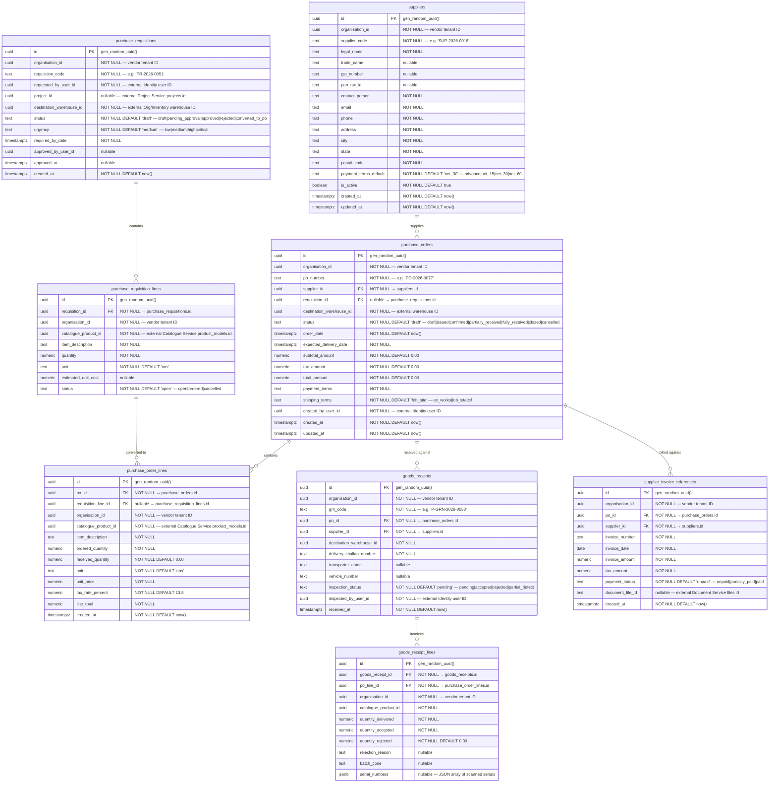

# AETHRA — Procurement Service ERD

> Phase 0 · Database: `procurement_db` · v0.1.0

---

## 1. Overview

The Procurement Service manages supplier master records, purchase requisitions, supplier quotation comparisons, purchase orders (POs), line-item tracking, goods receipt coordination, and vendor bill/invoice records.

**Fundamental Architecture Rules:**
1. **Zero Direct Inventory Writes:** The Procurement Service never directly writes to the `inventory_db`. When a Goods Receipt is finalized in Procurement, it publishes the domain event `procurement.goods_receipt.confirmed.v1` (or calls the Inventory Service REST intake endpoint). The Inventory Service independently verifies physical quantities and writes to its own append-only ledger.
2. **Vendor Multi-Tenant Isolation:** All procurement contracts, supplier pricing negotiations, purchase orders, and payment terms are strictly isolated to the owning vendor organization (`organisation_id`).
3. **Traceability:** Procurement links back to project requirements through purchase requisitions generated from project Bill of Materials (BOM).

---

## 2. ERD



---

## 3. Data Dictionary & Constraints

### 3.1 `suppliers`
- Unique constraint: `UNIQUE(organisation_id, supplier_code)`.
- Index: `CREATE INDEX idx_suppliers_gst ON suppliers(organisation_id, gst_number) WHERE gst_number IS NOT NULL;`

### 3.2 `purchase_orders`
- Unique constraint: `UNIQUE(organisation_id, po_number)`.

---

## 4. Cross-Service References

| Local Column | Target Service | Entity Referenced | Relationship |
|---|---|---|---|
| `organisation_id` | Organisation Service | `organisations.id` | Vendor tenant boundary |
| `project_id` | Project Service | `projects.id` | Originating project demanding materials |
| `destination_warehouse_id` | Organisation Service | `warehouses.id` | Delivery destination |
| `catalogue_product_id` | Catalogue Service | `product_models.id` | Catalogue model specification |
| `created_by_user_id` | Identity Service | `users.id` | Procurement specialist |
| `document_file_id` | Document Service | `files.id` | Uploaded scan of supplier tax invoice |

---

## 5. Security & Isolation

- Row-level security on all tables:
  ```sql
  CREATE POLICY procurement_vendor_isolation ON purchase_orders
    USING (organisation_id = NULLIF(current_setting('app.current_organisation_id', true), '')::uuid);
  ```
- Subscriptions check: Requires active entitlement for the `procurement` module.
- Event emission: Confirmation of a Goods Receipt emits `procurement.goods_receipt.confirmed.v1`, prompting Inventory Service to execute physical ledger receipt.
