# AETHRA — Project Management Service ERD

> Phase 0 · Database: `project_db` · v0.1.0

---

## 1. Overview

The Project Management Service manages solar EPC project execution, site surveys, civil/structural installation, electrical wiring, net metering approvals, CEIG/discom inspections, plant commissioning, milestone progression, and customer handovers.

**Fundamental Architecture Rules:**
1. **Contractual Traceability:** Projects created from accepted quotations permanently preserve the exact quotation revision reference (`accepted_quotation_revision_id`).
2. **Strict Internal vs. Customer Boundary:**
   - Internal engineering tasks, subcontractor assignments, internal delay notes, margin metrics, and issue logs are **strictly vendor-private**.
   - Customer-visible updates are projected through the curated `customer_progress_views` table, ensuring clients only see high-level milestones (e.g. "Site Structure Completed", "Net Meter Installed") with clean progress percentages.
3. **Commissioning & Handover Flow:** Handover completion publishes `project.handover.completed.v1`, which prompts Customer Service to mark the installation as `operational` and register equipment assets.

---

## 2. ERD

```mermaid
erDiagram
    projects ||--o{ project_sites : "located at"
    projects ||--o{ milestones : "milestone phases"
    milestones ||--o{ tasks : "decomposed into"
    tasks ||--o{ task_dependencies : "prerequisite"
    tasks ||--o{ task_assignments : "allocated to"
    projects ||--o{ project_events : "audit log"
    projects ||--o{ handover_records : "sign-off"
    projects ||--o{ customer_progress_views : "customer projection"

    projects {
        uuid id PK "gen_random_uuid()"
        uuid organisation_id "NOT NULL — vendor tenant ID"
        text project_code "NOT NULL — e.g. 'PRJ-2026-0028'"
        text project_name "NOT NULL"
        uuid customer_id "NOT NULL — external Customer Service customer_accounts.id"
        uuid property_id "NOT NULL — external Customer Service customer_properties.id"
        uuid quotation_id "nullable — external Quotation Service quotations.id"
        uuid accepted_quotation_revision_id "nullable — exact accepted revision ID"
        text project_type "NOT NULL DEFAULT 'residential_rooftop' — residential_rooftop|commercial_industrial|ground_mount|bess"
        numeric capacity_kw "NOT NULL"
        text status "NOT NULL DEFAULT 'initiated' — initiated|site_survey|engineering|procurement|construction|inspection|commissioned|handover_complete|on_hold|cancelled"
        date planned_start_date "NOT NULL"
        date planned_completion_date "NOT NULL"
        date actual_start_date "nullable"
        date actual_completion_date "nullable"
        uuid project_manager_user_id "NOT NULL — external Identity user ID"
        timestamptz created_at "NOT NULL DEFAULT now()"
        timestamptz updated_at "NOT NULL DEFAULT now()"
    }

    project_sites {
        uuid id PK "gen_random_uuid()"
        uuid project_id FK "NOT NULL, UNIQUE → projects.id"
        uuid organisation_id "NOT NULL — vendor tenant ID"
        text site_contact_name "NOT NULL"
        text site_contact_phone "NOT NULL"
        text site_address "NOT NULL"
        numeric latitude "nullable"
        numeric longitude "nullable"
        text discom_subdivision "nullable"
        text sanctioned_load_kw "nullable"
        text discom_application_number "nullable"
        timestamptz survey_completed_at "nullable"
    }

    milestones {
        uuid id PK "gen_random_uuid()"
        uuid project_id FK "NOT NULL → projects.id"
        uuid organisation_id "NOT NULL — vendor tenant ID"
        text milestone_name "NOT NULL — e.g. 'Structure Erection', 'Module Mounting', 'Inverter Wiring', 'Net Metering Testing'"
        int sequence_order "NOT NULL DEFAULT 1"
        text status "NOT NULL DEFAULT 'pending' — pending|in_progress|completed|delayed"
        date target_date "NOT NULL"
        date completed_date "nullable"
        boolean is_customer_visible "NOT NULL DEFAULT true"
        numeric weightage_percent "NOT NULL DEFAULT 10.00"
        timestamptz created_at "NOT NULL DEFAULT now()"
    }

    tasks {
        uuid id PK "gen_random_uuid()"
        uuid milestone_id FK "NOT NULL → milestones.id"
        uuid project_id FK "NOT NULL → projects.id"
        uuid organisation_id "NOT NULL — vendor tenant ID"
        text task_name "NOT NULL"
        text description "nullable"
        text status "NOT NULL DEFAULT 'todo' — todo|in_progress|blocked|done|cancelled"
        text priority "NOT NULL DEFAULT 'medium' — low|medium|high|critical"
        date start_date "nullable"
        date due_date "NOT NULL"
        date finished_at "nullable"
        numeric estimated_hours "nullable"
        numeric actual_hours "nullable"
        timestamptz created_at "NOT NULL DEFAULT now()"
    }

    task_dependencies {
        uuid id PK "gen_random_uuid()"
        uuid task_id FK "NOT NULL → tasks.id"
        uuid depends_on_task_id FK "NOT NULL → tasks.id"
        text dependency_type "NOT NULL DEFAULT 'finish_to_start' — finish_to_start|start_to_start"
    }

    task_assignments {
        uuid id PK "gen_random_uuid()"
        uuid task_id FK "NOT NULL → tasks.id"
        uuid organisation_id "NOT NULL — vendor tenant ID"
        uuid assigned_user_id "NOT NULL — external Identity user ID (technician, engineer, subcontractor)"
        text role_on_task "NOT NULL DEFAULT 'lead' — lead|assistant|inspector"
        timestamptz assigned_at "NOT NULL DEFAULT now()"
    }

    project_events {
        uuid id PK "gen_random_uuid()"
        uuid project_id FK "NOT NULL → projects.id"
        uuid organisation_id "NOT NULL — vendor tenant ID"
        text event_type "NOT NULL — stage_change|milestone_achieved|delay_reported|inspection_passed|document_uploaded"
        text event_summary "NOT NULL"
        jsonb event_details "nullable"
        boolean is_customer_visible "NOT NULL DEFAULT false"
        uuid triggered_by_user_id "NOT NULL — external Identity user ID"
        timestamptz created_at "NOT NULL DEFAULT now()"
    }

    handover_records {
        uuid id PK "gen_random_uuid()"
        uuid project_id FK "NOT NULL, UNIQUE → projects.id"
        uuid organisation_id "NOT NULL — vendor tenant ID"
        date handover_date "NOT NULL"
        text discom_inspection_letter_doc_id "nullable — external Document Service files.id"
        text commissioning_report_doc_id "NOT NULL — external Document Service files.id"
        text warranty_pack_doc_id "NOT NULL — external Document Service files.id"
        uuid signed_off_by_vendor_user_id "NOT NULL — Identity user ID"
        uuid accepted_by_customer_user_id "nullable — Identity user ID"
        timestamptz customer_accepted_at "nullable"
        text customer_satisfaction_rating "nullable — 1 to 5"
        text handover_status "NOT NULL DEFAULT 'pending_customer_signature' — pending_customer_signature|fully_completed"
        timestamptz created_at "NOT NULL DEFAULT now()"
    }

    customer_progress_views {
        uuid id PK "gen_random_uuid()"
        uuid project_id FK "NOT NULL, UNIQUE → projects.id"
        uuid customer_id "NOT NULL — external Customer Service customer_accounts.id"
        uuid property_id "NOT NULL — external Customer Service customer_properties.id"
        numeric overall_progress_percentage "NOT NULL DEFAULT 0.00"
        text current_phase_display "NOT NULL DEFAULT 'Initiation & Approvals'"
        jsonb published_milestones "NOT NULL — array of sanitized customer milestone objects"
        timestamptz last_published_at "NOT NULL DEFAULT now()"
        timestamptz updated_at "NOT NULL DEFAULT now()"
    }
```



---

## 3. Data Dictionary & Constraints

### 3.1 `projects`
- Unique constraint: `UNIQUE(organisation_id, project_code)`.
- Index: `CREATE INDEX idx_projects_customer ON projects(customer_id);`

### 3.2 `customer_progress_views`
- Index: `CREATE INDEX idx_cust_prog_cust ON customer_progress_views(customer_id);`
- Sanitization: Updated by a background projection worker or domain event handler whenever vendor managers trigger "Publish Customer Update".

---

## 4. Cross-Service References

| Local Column | Target Service | Entity Referenced | Relationship |
|---|---|---|---|
| `organisation_id` | Organisation Service | `organisations.id` | Vendor tenant boundary |
| `customer_id` | Customer Service | `customer_accounts.id` | Customer account |
| `property_id` | Customer Service | `customer_properties.id` | Project physical site |
| `quotation_id` | Quotation Service | `quotations.id` | Originating quotation |
| `accepted_quotation_revision_id` | Quotation Service | `quotation_revisions.id` | Exact agreed scope and pricing revision |
| `project_manager_user_id` | Identity Service | `users.id` | Project lead |
| `commissioning_report_doc_id` | Document Service | `files.id` | Official commissioning certificate PDF in S3 |

---

## 5. Security & Isolation

- Row-level security for vendor operations:
  ```sql
  CREATE POLICY project_vendor_isolation ON projects
    USING (organisation_id = NULLIF(current_setting('app.current_organisation_id', true), '')::uuid);
  ```
- Customer Mobile / Web Portal consumes `customer_progress_views` exclusively, ensuring complete isolation from internal tasks, vendor costs, and subcontractor communications.
- On handover sign-off, publishes `project.milestone.published.v1` and `project.handover.completed.v1`.
