# AETHRA — Quotation Service ERD

> Phase 0 · Database: `quotation_db` · v0.1.0

---

## 1. Overview

The Quotation Service manages customer commercial proposals, pricing calculations, itemized system packages, revision history, customer acceptance workflows, and legal proposal documents.

**Fundamental Architecture Rules:**
1. **Immutable Revisions Once Issued:** Once a quotation revision transitions from `draft` to `issued` (sent to customer), it is **frozen forever**. Any edits, price negotiations, or scope adjustments create a new revision (`revision_number = n + 1`).
2. **Historical Pricing Snapshots:** To guarantee contract integrity, every line item captures a full **pricing snapshot** of the model name, specifications, unit cost, selling price, and tax rate at the time the revision was generated. Subsequent changes in the Product Catalogue never alter historical quotations.
3. **Acceptance Reference Integrity:** When a customer accepts a proposal, the acceptance workflow references the **exact revision ID** (`accepted_revision_id`). Downstream Project Management inherits this exact revision snapshot.
4. **Information Segregation:** Internal cost prices, profit margins, and sales rep commission rules are **never** present in customer-facing views or PDFs.

---

## 2. ERD

```mermaid
erDiagram
    quotations ||--o{ quotation_revisions : "versioned into"
    quotation_revisions ||--o{ quotation_lines : "contains"
    quotation_lines ||--o{ pricing_snapshots : "freezes price"
    quotation_revisions ||--o{ quotation_discounts : "applies"
    quotation_revisions ||--o{ quotation_taxes : "computes"
    quotation_revisions ||--o{ payment_terms : "defines milestone schedule"
    quotation_revisions ||--o{ quotation_documents : "generated PDF"
    quotation_revisions ||--o{ customer_responses : "accepted or rejected"

    quotations {
        uuid id PK "gen_random_uuid()"
        uuid organisation_id "NOT NULL — vendor tenant ID"
        text quotation_number "NOT NULL — human-readable code e.g. 'QT-2026-0042'"
        uuid customer_id "NOT NULL — external Customer Service customer_accounts.id"
        uuid property_id "nullable — external Customer Service customer_properties.id"
        uuid lead_id "nullable — external CRM Service leads.id"
        uuid engineering_estimate_id "nullable — external Engineering Service engineering_estimates.id"
        text title "NOT NULL — e.g. '10 kWp Grid-Tied Solar Rooftop System'"
        uuid current_active_revision_id "nullable — pointer to latest issued or draft revision"
        uuid accepted_revision_id "nullable — pointer to exact accepted revision"
        text status "NOT NULL DEFAULT 'draft' — draft|issued|under_review|accepted|rejected|expired|superseded"
        timestamptz created_at "NOT NULL DEFAULT now()"
        timestamptz updated_at "NOT NULL DEFAULT now()"
    }

    quotation_revisions {
        uuid id PK "gen_random_uuid()"
        uuid quotation_id FK "NOT NULL → quotations.id"
        uuid organisation_id "NOT NULL — vendor tenant ID"
        int revision_number "NOT NULL DEFAULT 1"
        text status "NOT NULL DEFAULT 'draft' — draft|issued|accepted|rejected|expired|superseded"
        timestamptz valid_until "NOT NULL"
        numeric subtotal_amount "NOT NULL DEFAULT 0.00"
        numeric total_discount_amount "NOT NULL DEFAULT 0.00"
        numeric total_tax_amount "NOT NULL DEFAULT 0.00"
        numeric total_payable_amount "NOT NULL DEFAULT 0.00"
        numeric estimated_subsidy_amount "NOT NULL DEFAULT 0.00 — e.g. PM Surya Ghar subsidy projection"
        numeric net_customer_cost "NOT NULL DEFAULT 0.00 — total_payable minus subsidy"
        numeric internal_estimated_cost "NOT NULL DEFAULT 0.00 — confidential vendor cost"
        numeric internal_projected_margin "NOT NULL DEFAULT 0.00 — confidential vendor margin"
        text notes_customer "nullable — terms & conditions shown to client"
        text notes_internal "nullable — internal approvals, rep justification"
        uuid created_by_user_id "NOT NULL — external Identity user ID"
        timestamptz issued_at "nullable — timestamp frozen forever"
        timestamptz created_at "NOT NULL DEFAULT now()"
    }

    quotation_lines {
        uuid id PK "gen_random_uuid()"
        uuid revision_id FK "NOT NULL → quotation_revisions.id"
        uuid organisation_id "NOT NULL — vendor tenant ID"
        int item_order "NOT NULL DEFAULT 1"
        text line_type "NOT NULL DEFAULT 'product' — product|service|labour|freight|bos_package"
        uuid catalogue_product_id "nullable — external Catalogue Service product_models.id"
        text item_description "NOT NULL"
        numeric quantity "NOT NULL DEFAULT 1"
        text unit "NOT NULL DEFAULT 'nos'"
        numeric unit_price "NOT NULL DEFAULT 0.00"
        numeric line_total "NOT NULL DEFAULT 0.00"
        numeric discount_amount "NOT NULL DEFAULT 0.00"
        numeric tax_rate_percent "NOT NULL DEFAULT 13.8"
        numeric tax_amount "NOT NULL DEFAULT 0.00"
        numeric net_amount "NOT NULL DEFAULT 0.00"
        timestamptz created_at "NOT NULL DEFAULT now()"
    }

    pricing_snapshots {
        uuid id PK "gen_random_uuid()"
        uuid quotation_line_id FK "NOT NULL, UNIQUE → quotation_lines.id"
        uuid revision_id FK "NOT NULL → quotation_revisions.id"
        uuid organisation_id "NOT NULL — vendor tenant ID"
        text brand_name "NOT NULL"
        text model_code "NOT NULL"
        text display_name "NOT NULL"
        jsonb technical_specs_snapshot "NOT NULL"
        numeric captured_unit_cost "NOT NULL — frozen internal cost"
        numeric captured_unit_price "NOT NULL — frozen catalogue price"
        numeric captured_tax_rate "NOT NULL — frozen tax percentage"
        timestamptz captured_at "NOT NULL DEFAULT now()"
    }

    quotation_discounts {
        uuid id PK "gen_random_uuid()"
        uuid revision_id FK "NOT NULL → quotation_revisions.id"
        uuid organisation_id "NOT NULL — vendor tenant ID"
        text discount_type "NOT NULL — percentage|fixed_amount|promotional_code"
        text description "NOT NULL"
        numeric rate_or_amount "NOT NULL"
        numeric calculated_discount "NOT NULL"
        uuid approved_by_user_id "nullable — managerial discount sign-off"
        timestamptz created_at "NOT NULL DEFAULT now()"
    }

    quotation_taxes {
        uuid id PK "gen_random_uuid()"
        uuid revision_id FK "NOT NULL → quotation_revisions.id"
        uuid organisation_id "NOT NULL — vendor tenant ID"
        text tax_name "NOT NULL — e.g. CGST, SGST, IGST, Composite GST"
        numeric tax_rate_percent "NOT NULL"
        numeric taxable_base_amount "NOT NULL"
        numeric tax_amount "NOT NULL"
        timestamptz created_at "NOT NULL DEFAULT now()"
    }

    payment_terms {
        uuid id PK "gen_random_uuid()"
        uuid revision_id FK "NOT NULL → quotation_revisions.id"
        uuid organisation_id "NOT NULL — vendor tenant ID"
        int milestone_sequence "NOT NULL DEFAULT 1"
        text milestone_name "NOT NULL — e.g. Advance on Order, On Delivery of Modules, Handover"
        numeric percentage_of_total "NOT NULL"
        numeric calculated_amount "NOT NULL"
        int due_days_after_trigger "NOT NULL DEFAULT 0"
        timestamptz created_at "NOT NULL DEFAULT now()"
    }

    quotation_documents {
        uuid id PK "gen_random_uuid()"
        uuid revision_id FK "NOT NULL → quotation_revisions.id"
        uuid organisation_id "NOT NULL — vendor tenant ID"
        text doc_type "NOT NULL DEFAULT 'customer_proposal_pdf' — customer_proposal_pdf|internal_costing_sheet"
        text file_reference_id "NOT NULL — external Document Service files.id"
        text sha256_hash "NOT NULL — tamper verification of generated PDF"
        timestamptz generated_at "NOT NULL DEFAULT now()"
    }

    customer_responses {
        uuid id PK "gen_random_uuid()"
        uuid quotation_id FK "NOT NULL → quotations.id"
        uuid revision_id FK "NOT NULL → quotation_revisions.id"
        uuid organisation_id "NOT NULL — vendor tenant ID"
        uuid customer_user_id "NOT NULL — external Identity Service users.id"
        text decision "NOT NULL — accept|reject|request_changes"
        text customer_comments "nullable"
        text signature_type "NOT NULL DEFAULT 'digital_click' — digital_click|otp_verified|signed_scan"
        text signature_verification_token "nullable"
        text ip_address "NOT NULL"
        text user_agent "NOT NULL"
        timestamptz responded_at "NOT NULL DEFAULT now()"
    }
```



---

## 3. Data Dictionary & Constraints

### 3.1 `quotations`
- Unique constraint: `UNIQUE(organisation_id, quotation_number)`.
- Foreign key protection: `accepted_revision_id` must point to a revision belonging to this quotation.

### 3.2 `quotation_revisions`
- Unique constraint: `UNIQUE(quotation_id, revision_number)`.
- Immutability trigger:
  ```sql
  CREATE OR REPLACE FUNCTION prevent_issued_revision_update()
  RETURNS TRIGGER AS $$
  BEGIN
    IF OLD.status IN ('issued', 'accepted', 'rejected', 'superseded') THEN
      RAISE EXCEPTION 'Quotation revision % is frozen and cannot be modified.', OLD.id;
    END IF;
    RETURN NEW;
  END;
  $$ LANGUAGE plpgsql;

  CREATE TRIGGER trg_freeze_issued_revision
    BEFORE UPDATE ON quotation_revisions
    FOR EACH ROW
    WHEN (OLD.status IN ('issued', 'accepted', 'rejected', 'superseded') AND NEW.status = OLD.status)
    EXECUTE FUNCTION prevent_issued_revision_update();
  ```

---

## 4. Cross-Service References

| Local Column | Target Service | Entity Referenced | Relationship |
|---|---|---|---|
| `quotations.organisation_id` | Organisation Service | `organisations.id` | Vendor organization |
| `quotations.customer_id` | Customer Service | `customer_accounts.id` | Target customer |
| `quotations.property_id` | Customer Service | `customer_properties.id` | Proposed installation site |
| `quotations.lead_id` | CRM Service | `leads.id` | Originating sales lead |
| `quotations.engineering_estimate_id` | Engineering Service | `engineering_estimates.id` | Sizing & BOM source |
| `customer_responses.customer_user_id` | Identity Service | `users.id` | Signatory who accepted/rejected |
| `quotation_documents.file_reference_id` | Document Service | `files.id` | PDF storage in S3 |

---

## 5. Security & Isolation

- Vendor Tenant RLS on all tables:
  ```sql
  CREATE POLICY quotation_vendor_isolation ON quotations
    USING (organisation_id = NULLIF(current_setting('app.current_organisation_id', true), '')::uuid);
  ```
- Customer Portal Access: When queried by a customer user, queries filter by `customer_id` validated against active relationships, AND all internal pricing (`internal_estimated_cost`, `internal_projected_margin`, `captured_unit_cost`) are omitted at the API/DQL layer.
- Acceptance triggers `quotation.accepted.v1` event, initiating the project creation saga.
