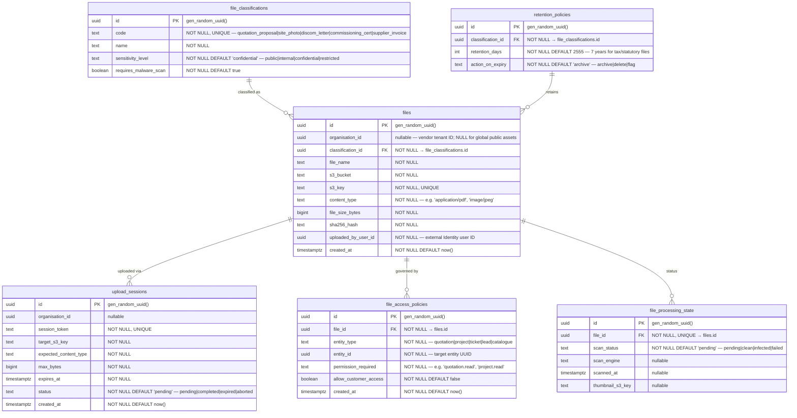
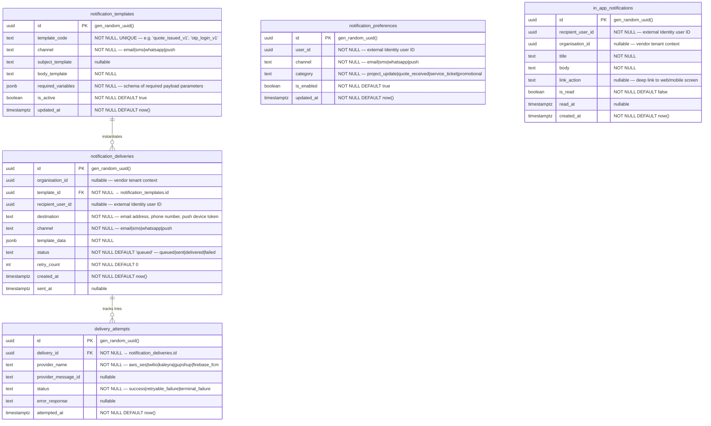
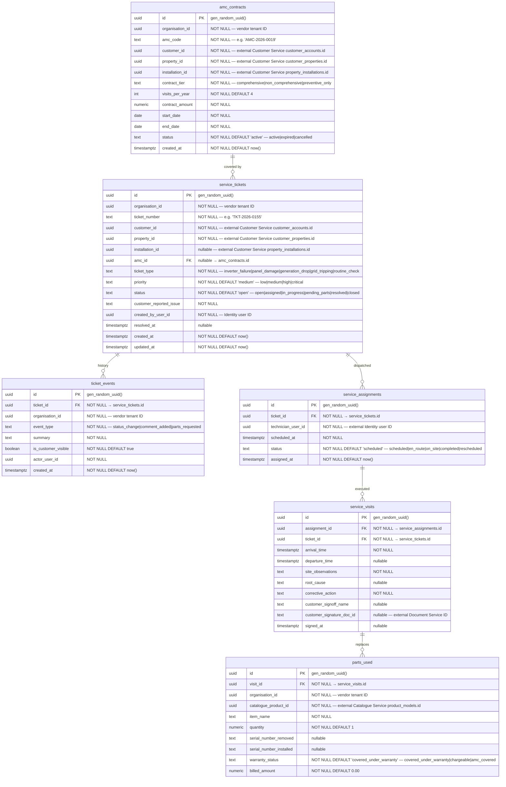
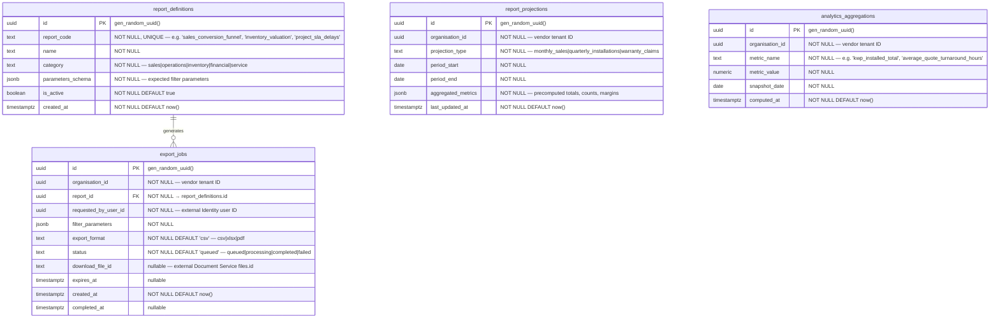
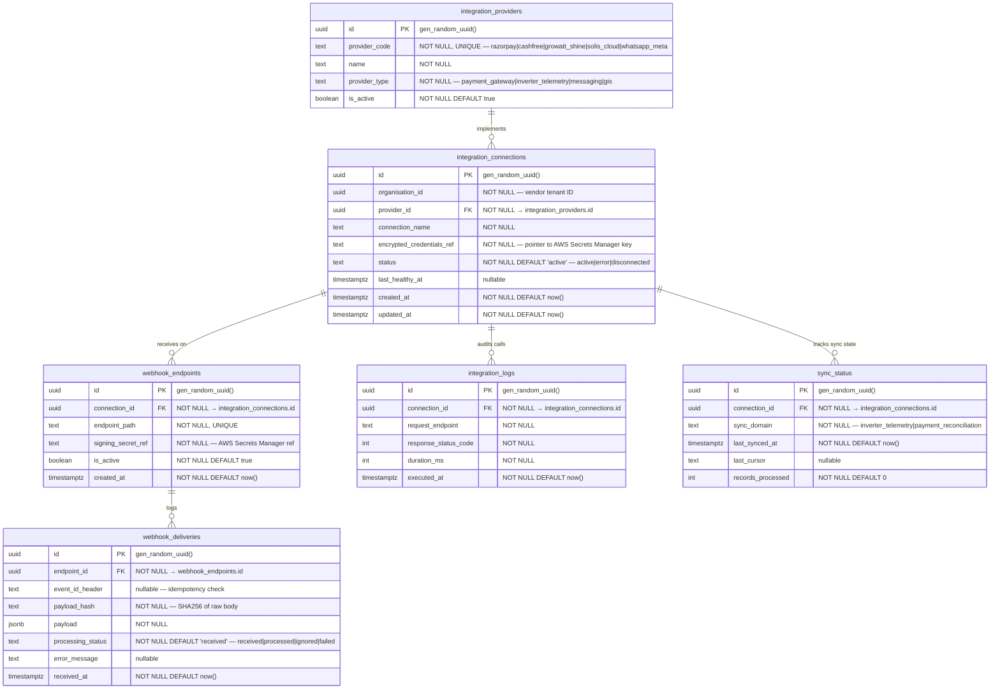
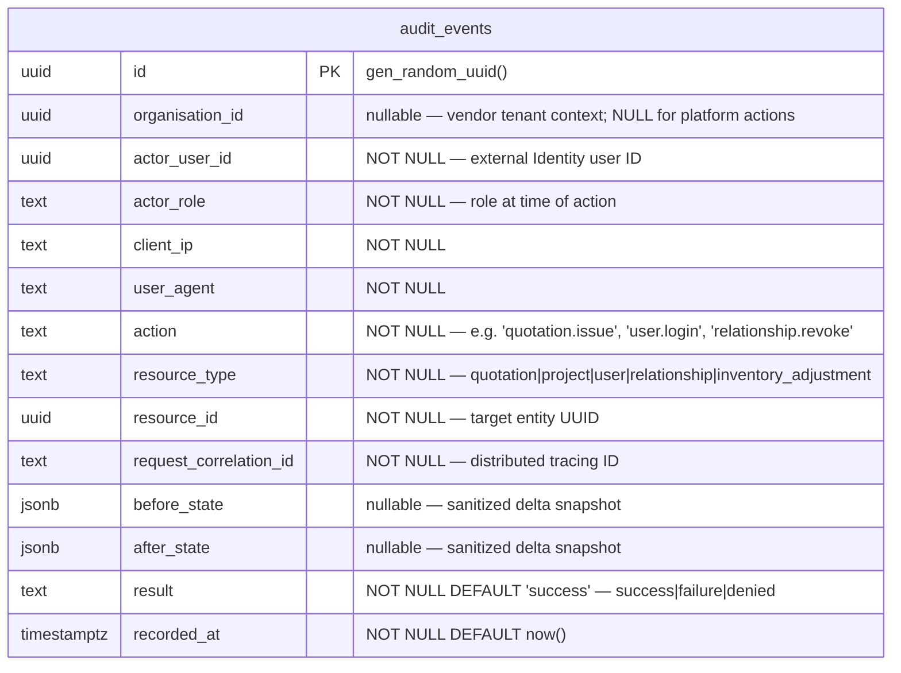

# AETHRA — Supporting Services ERD

> Phase 0 · Databases: `document_db`, `notification_db`, `service_db`, `reporting_db`, `integration_db`, `audit_db` · v0.1.0

---

## 1. Document & File Service (`document_db`)

### 1.1 Overview
The Document & File Service manages private S3 object storage references, pre-signed upload sessions, malware scanning states, access authorization, and document retention.
- **Rule:** Permanent public S3 URLs are strictly prohibited. Files are accessed via time-limited, signed HMAC URLs generated only after authorization evaluation.

### 1.2 ERD


---

## 2. Notification Service (`notification_db`)

### 2.1 Overview
The Notification Service handles multi-channel delivery (Email, SMS, WhatsApp, Web Push, and Mobile In-App) via resilient provider adapters. Provider outages never compromise transactional business operations.

### 2.2 ERD


---

## 3. Service Management Service (`service_db`)

### 3.1 Overview
The Service Management Service handles post-commissioning operations: customer support tickets, maintenance requests, annual maintenance contracts (AMC), technician on-site visits, and warranty spare parts replacement.

### 3.2 ERD


---

## 4. Reporting & Analytics Service (`reporting_db`)

### 4.1 Overview
The Reporting & Analytics Service maintains aggregated read models, periodic performance rollups, and asynchronous data export jobs (CSV, XLSX, PDF). It guarantees that heavy analytical queries never impact transactional operational databases.

### 4.2 ERD


---

## 5. Integration Service (`integration_db`)

### 5.1 Overview
The Integration Service orchestrates webhooks, provider credentials, and sync jobs for third-party systems (Payment Gateways, Inverter IoT Clouds, WhatsApp Business BSPs, and ERP connectors).

### 5.2 ERD


---

## 6. Audit Service (`audit_db`)

### 6.1 Overview
The Audit Service owns the centralized, tamper-resistant audit trail. It records every security-sensitive action, privileged override, role grant, relationship change, and financial update across the entire platform.

**Rules:**
1. **Strictly Append-Only:** Tables have no `UPDATE` or `DELETE` permissions granted to the runtime application user.
2. **Credential Cleanliness:** Passwords, OTPs, raw JWTs, and credit card numbers are strictly scrubbed before ingestion.
3. **Correlation:** Every record indexes `request_correlation_id` and `event_id` to trace distributed requests across microservices.

### 6.2 ERD


### 6.3 Audit Security Constraints
```sql
-- Revoke update and delete from application role
REVOKE UPDATE, DELETE, TRUNCATE ON audit_events FROM aethra_audit_app_role;

-- Compound indexes for fast audit forensics
CREATE INDEX idx_audit_org_time ON audit_events(organisation_id, recorded_at DESC);
CREATE INDEX idx_audit_resource ON audit_events(resource_type, resource_id);
CREATE INDEX idx_audit_correlation ON audit_events(request_correlation_id);
CREATE INDEX idx_audit_actor ON audit_events(actor_user_id, recorded_at DESC);
```
