# AETHRA — Subscription & Entitlement Service ERD

> Phase 0 · Database: `subscription_db` · v0.1.0

---

## 1. Overview

The Subscription & Entitlement Service owns commercial plans, modules, feature flags, vendor organisation subscriptions, entitlement quotas, and usage metering.

**Critical Principle:** Permissions and subscription entitlements are strictly separate:
- A user may have the RBAC permission `quotation.create`, but if the vendor organization does not have an active subscription with the `quotations` module enabled and quota remaining, the request is rejected.
- Tenant isolation: All organization subscriptions and usage records are isolated by `organisation_id`. Plan and module definitions are platform-wide reference data.

---

## 2. ERD

```mermaid
erDiagram
    module_catalogue ||--o{ plan_modules : "included in"
    module_catalogue ||--o{ subscription_modules : "provisioned in"
    feature_catalogue ||--o{ plan_features : "bundled into"
    feature_catalogue ||--o{ entitlement_limits : "governs"
    subscription_plans ||--o{ plan_modules : "contains"
    subscription_plans ||--o{ plan_features : "bundles"
    subscription_plans ||--o{ organisation_subscriptions : "subscribed by"
    organisation_subscriptions ||--o{ subscription_modules : "activates"
    organisation_subscriptions ||--o{ entitlement_limits : "has quotas"
    organisation_subscriptions ||--o{ usage_records : "tracks"
    organisation_subscriptions ||--o{ subscription_events : "history"

    module_catalogue {
        uuid id PK "gen_random_uuid()"
        text code "NOT NULL, UNIQUE — e.g. crm, quotation, engineering, inventory, projects"
        text name "NOT NULL"
        text description "nullable"
        boolean is_core "NOT NULL DEFAULT false"
        boolean is_active "NOT NULL DEFAULT true"
        timestamptz created_at "NOT NULL DEFAULT now()"
        timestamptz updated_at "NOT NULL DEFAULT now()"
    }

    feature_catalogue {
        uuid id PK "gen_random_uuid()"
        text code "NOT NULL, UNIQUE — e.g. max_users, max_projects, solar_calculator_3d, api_access"
        text name "NOT NULL"
        text value_type "NOT NULL — boolean|numeric_limit|tier_enum"
        text default_value "NOT NULL"
        uuid module_id FK "nullable → module_catalogue.id"
        timestamptz created_at "NOT NULL DEFAULT now()"
    }

    subscription_plans {
        uuid id PK "gen_random_uuid()"
        text code "NOT NULL, UNIQUE — starter|professional|enterprise|custom"
        text name "NOT NULL"
        text billing_cycle "NOT NULL DEFAULT 'monthly' — monthly|annual|quarterly"
        numeric price "NOT NULL DEFAULT 0.00"
        text currency "NOT NULL DEFAULT 'INR'"
        boolean is_public "NOT NULL DEFAULT true"
        boolean is_active "NOT NULL DEFAULT true"
        jsonb metadata "nullable"
        timestamptz created_at "NOT NULL DEFAULT now()"
        timestamptz updated_at "NOT NULL DEFAULT now()"
    }

    plan_modules {
        uuid id PK "gen_random_uuid()"
        uuid plan_id FK "NOT NULL → subscription_plans.id"
        uuid module_id FK "NOT NULL → module_catalogue.id"
        boolean is_optional "NOT NULL DEFAULT false"
        timestamptz created_at "NOT NULL DEFAULT now()"
    }

    plan_features {
        uuid id PK "gen_random_uuid()"
        uuid plan_id FK "NOT NULL → subscription_plans.id"
        uuid feature_id FK "NOT NULL → feature_catalogue.id"
        text feature_value "NOT NULL — e.g. '10', 'true', 'unlimited'"
        timestamptz created_at "NOT NULL DEFAULT now()"
    }

    organisation_subscriptions {
        uuid id PK "gen_random_uuid()"
        uuid organisation_id "NOT NULL — external tenant ID"
        uuid plan_id FK "NOT NULL → subscription_plans.id"
        text status "NOT NULL DEFAULT 'trial' — trial|active|past_due|grace_period|suspended|cancelled"
        timestamptz current_period_start "NOT NULL"
        timestamptz current_period_end "NOT NULL"
        timestamptz trial_ends_at "nullable"
        timestamptz grace_period_ends_at "nullable"
        timestamptz cancelled_at "nullable"
        text cancellation_reason "nullable"
        text billing_contact_email "nullable"
        jsonb payment_metadata "nullable — gateway sub ID, razorpay_subscription_id"
        timestamptz created_at "NOT NULL DEFAULT now()"
        timestamptz updated_at "NOT NULL DEFAULT now()"
    }

    subscription_modules {
        uuid id PK "gen_random_uuid()"
        uuid organisation_id "NOT NULL — tenant discriminator"
        uuid subscription_id FK "NOT NULL → organisation_subscriptions.id"
        uuid module_id FK "NOT NULL → module_catalogue.id"
        text status "NOT NULL DEFAULT 'active' — active|suspended|disabled"
        timestamptz activated_at "NOT NULL DEFAULT now()"
        timestamptz expires_at "nullable"
    }

    entitlement_limits {
        uuid id PK "gen_random_uuid()"
        uuid organisation_id "NOT NULL — tenant discriminator"
        uuid subscription_id FK "NOT NULL → organisation_subscriptions.id"
        text feature_code "NOT NULL — matches feature_catalogue.code"
        numeric max_allowed "NOT NULL DEFAULT 0 — -1 for unlimited"
        numeric current_usage "NOT NULL DEFAULT 0"
        text reset_cadence "NOT NULL DEFAULT 'never' — never|daily|monthly|billing_cycle"
        timestamptz last_reset_at "nullable"
        timestamptz updated_at "NOT NULL DEFAULT now()"
    }

    usage_records {
        uuid id PK "gen_random_uuid()"
        uuid organisation_id "NOT NULL — tenant discriminator"
        uuid subscription_id FK "NOT NULL → organisation_subscriptions.id"
        text feature_code "NOT NULL"
        numeric quantity "NOT NULL DEFAULT 1"
        text idempotency_key "NOT NULL, UNIQUE"
        text recorded_by "nullable — actor user ID or system service"
        timestamptz recorded_at "NOT NULL DEFAULT now()"
    }

    subscription_events {
        uuid id PK "gen_random_uuid()"
        uuid organisation_id "NOT NULL — tenant discriminator"
        uuid subscription_id FK "NOT NULL → organisation_subscriptions.id"
        text event_type "NOT NULL — created|upgraded|downgraded|suspended|resumed|cancelled|grace_entered"
        text from_status "nullable"
        text to_status "NOT NULL"
        jsonb payload "NOT NULL"
        text triggered_by "NOT NULL — system|admin|user"
        timestamptz created_at "NOT NULL DEFAULT now()"
    }
```



---

## 3. Data Dictionary & Constraints

### 3.1 `module_catalogue`
- `code`: Unique code used in API checks (e.g. `hasModule('crm')`).
- `is_core`: Core modules (`identity`, `organisation`, `access_control`) cannot be disabled.

### 3.2 `organisation_subscriptions`
- Unique partial index: `UNIQUE(organisation_id) WHERE status IN ('trial', 'active', 'past_due', 'grace_period')` ensures only one active subscription per organisation.
- Tenant isolation: Scoped by `organisation_id`.

### 3.3 `entitlement_limits`
- Unique constraint: `UNIQUE(organisation_id, feature_code)` guarantees single row lookup for quota evaluations.
- Atomic increment: Evaluated and updated via `UPDATE entitlement_limits SET current_usage = current_usage + :qty WHERE organisation_id = :orgId AND feature_code = :code AND (max_allowed = -1 OR current_usage + :qty <= max_allowed)`.

---

## 4. Cross-Service References

| Local Column | Target Service | Entity Referenced | Handling / Enforcement |
|---|---|---|---|
| `organisation_id` | Organisation Service | `organisations.id` | External UUID; validated on subscription creation via API/Event; no cross-DB FK |
| `recorded_by` | Identity Service | `users.id` | Informational audit UUID; null if automated system job |

---

## 5. Security & Isolation

- Platform Admin roles can manage plans, features, and override entitlements.
- Vendor users have read-only access to their own organisation's subscription status and usage limits via RLS policy:
  ```sql
  CREATE POLICY tenant_isolation_policy ON organisation_subscriptions
    USING (organisation_id = NULLIF(current_setting('app.current_organisation_id', true), '')::uuid);
  ```
- Subscriptions emit `subscription.activated.v1`, `subscription.suspended.v1`, `subscription.limit_reached.v1` to Kafka for downstream service caches.
