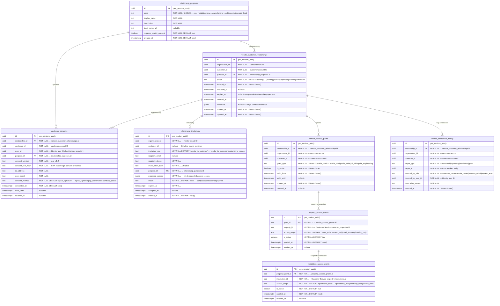

# AETHRA — Vendor Relationship Service ERD

> Phase 0 · Database: `vendor_relationship_db` · v0.1.0

---

## 1. Overview

The Vendor Relationship Service is the **security and governance bridge** of the AETHRA platform. It controls, records, and audits all multi-tenant interactions between vendor organisations and customer accounts.

**Architecture Rules:**
1. A customer record exists independently in Customer Service. A vendor only sees customer data if an explicit active relationship exists.
2. Even with an active relationship, vendor access is granular: access may be granted only for a specific purpose (e.g., `installation_epc`, `annual_maintenance`, `monitoring_only`), and only for specific properties or installations.
3. Access revocation is immediate: revoking a relationship or property grant invalidates vendor access tokens and cached policy decisions across all services.
4. An immutable audit record of consent and revocation is maintained.

---

## 2. ERD



---

## 3. Data Dictionary & Constraints

### 3.1 `vendor_customer_relationships`
- Unique constraint: `UNIQUE(organisation_id, customer_id, purpose_id)` prevents conflicting duplicate relationships for the same operational purpose.
- Status transition engine: Valid transitions: `pending → active → suspended ↔ active → revoked`.

### 3.2 `property_access_grants`
- Unique constraint: `UNIQUE(grant_id, property_id)`.
- Index: `CREATE INDEX idx_prop_grants_org_prop ON property_access_grants(property_id) WHERE is_active = true;`

---

## 4. Cross-Service References

| Local Column | Target Service | Entity Referenced | Handling / Enforcement |
|---|---|---|---|
| `organisation_id` | Organisation Service | `organisations.id` | Vendor organization |
| `customer_id` | Customer Service | `customer_accounts.id` | Customer account |
| `property_access_grants.property_id` | Customer Service | `customer_properties.id` | Target property |
| `installation_access_grants.installation_id` | Customer Service | `property_installations.id` | Target solar/BESS setup |
| `customer_consents.user_id` | Identity Service | `users.id` | Signatory of digital consent |

---

## 5. Security & Isolation

- **Revocation Propagation:** On insert into `access_revocation_history`, the service publishes `vendor_relationship.revoked.v1` to Kafka with payload:
  `{ relationship_id, organisation_id, customer_id, property_id, installation_id, revoked_at }`.
- Dependent services (Quotation, Project, Service Management, Document) immediately invalidate cached access grants in Redis for that `(organisation_id, customer_id)` pair.
- Vendor tenant isolation policy:
  ```sql
  CREATE POLICY vendor_isolation ON vendor_customer_relationships
    USING (organisation_id = NULLIF(current_setting('app.current_organisation_id', true), '')::uuid);
  ```
