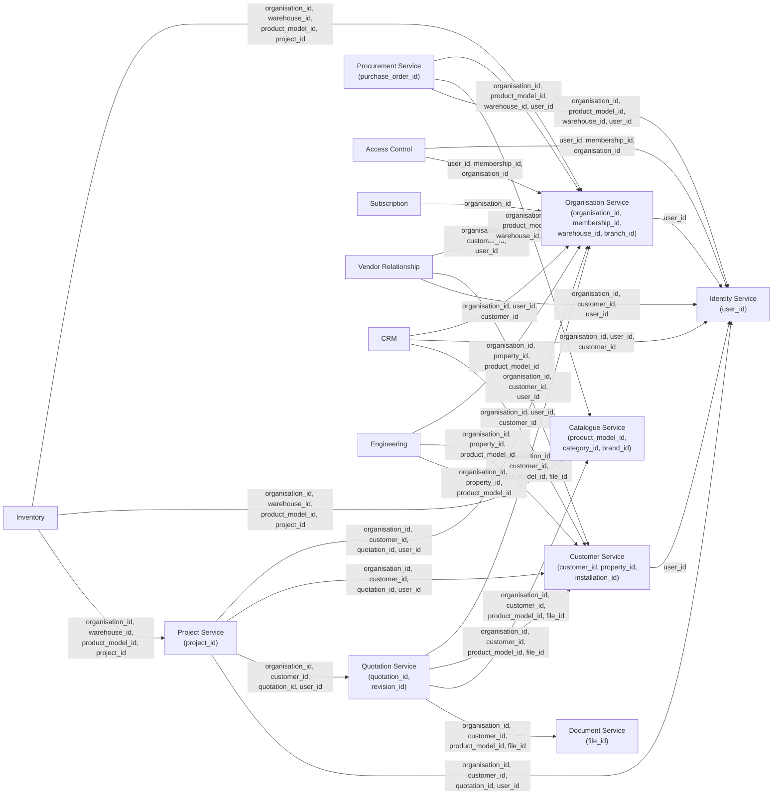

# AETHRA — Service-to-Data Ownership Matrix

> Phase 0 · Data Ownership · v0.1.0

---

## 1. Ownership Principles

1. **Single Writer** — Every table has exactly one owning service that can write to it.
2. **External ID References** — Services may store foreign IDs from other services but never join across databases.
3. **No Shared Tables** — No table is written by more than one service.
4. **Eventual Consistency** — Cross-service data is synchronized via domain events; strong consistency exists only within a single service's database.

---

## 2. Complete Ownership Matrix

### 2.1 Identity Service → `identity_db`

| Table | Owned By | External IDs Referenced | Source Service |
|-------|----------|------------------------|----------------|
| `users` | Identity | — | — |
| `user_auth_providers` | Identity | — | — |
| `email_verifications` | Identity | — | — |
| `phone_verifications` | Identity | — | — |
| `account_recovery` | Identity | — | — |
| `user_sessions` | Identity | — | — |

> No external references. Identity is the root of the user identity graph.

### 2.2 Organisation Service → `organisation_db`

| Table | Owned By | External IDs Referenced | Source Service |
|-------|----------|------------------------|----------------|
| `organisations` | Organisation | — | — |
| `organisation_profiles` | Organisation | `organisation_id` | Self |
| `business_categories` | Organisation | — | — |
| `organisation_business_categories` | Organisation | `organisation_id`, `business_category_id` | Self |
| `branches` | Organisation | `organisation_id` | Self |
| `warehouses` | Organisation | `organisation_id`, `branch_id` | Self |
| `organisation_configurations` | Organisation | `organisation_id` | Self |
| `organisation_memberships` | Organisation | `organisation_id`, `user_id` | Self, **Identity** |
| `membership_invitations` | Organisation | `organisation_id`, `invited_by_user_id` | Self, **Identity** |

### 2.3 Access Control Service → `access_control_db`

| Table | Owned By | External IDs Referenced | Source Service |
|-------|----------|------------------------|----------------|
| `roles` | Access Control | `organisation_id` (nullable for system roles) | **Organisation** |
| `permissions` | Access Control | — | — |
| `role_permissions` | Access Control | — | Self |
| `membership_roles` | Access Control | `membership_id`, `organisation_id` | **Organisation** |
| `access_scopes` | Access Control | `organisation_id` | **Organisation** |
| `resource_assignments` | Access Control | `organisation_id`, `user_id` | **Organisation**, **Identity** |
| `policy_cache_metadata` | Access Control | `organisation_id` | **Organisation** |
| `temporary_access_grants` | Access Control | `organisation_id`, `user_id`, `granted_by_user_id` | **Organisation**, **Identity** |

### 2.4 Subscription Service → `subscription_db`

| Table | Owned By | External IDs Referenced | Source Service |
|-------|----------|------------------------|----------------|
| `subscription_plans` | Subscription | — | — |
| `plan_modules` | Subscription | — | Self |
| `plan_features` | Subscription | — | Self |
| `module_catalogue` | Subscription | — | — |
| `feature_catalogue` | Subscription | — | — |
| `organisation_subscriptions` | Subscription | `organisation_id` | **Organisation** |
| `subscription_modules` | Subscription | `organisation_id` | **Organisation** |
| `entitlement_limits` | Subscription | `organisation_id` | **Organisation** |
| `usage_records` | Subscription | `organisation_id` | **Organisation** |
| `subscription_events` | Subscription | `organisation_id` | **Organisation** |

### 2.5 Customer Service → `customer_db`

| Table | Owned By | External IDs Referenced | Source Service |
|-------|----------|------------------------|----------------|
| `customer_accounts` | Customer | — | — |
| `customer_profiles` | Customer | `customer_id` | Self |
| `customer_contacts` | Customer | `customer_id` | Self |
| `customer_users` | Customer | `customer_id`, `user_id` | Self, **Identity** |
| `customer_properties` | Customer | `customer_id` | Self |
| `property_installations` | Customer | `property_id`, `product_model_id` | Self, **Catalogue** |
| `property_assets` | Customer | `property_id`, `serial_number_id` | Self, **Inventory** |
| `property_access_delegations` | Customer | `property_id`, `delegated_to_user_id` | Self, **Identity** |

### 2.6 Vendor Relationship Service → `vendor_relationship_db`

| Table | Owned By | External IDs Referenced | Source Service |
|-------|----------|------------------------|----------------|
| `vendor_customer_relationships` | Vendor Relationship | `organisation_id`, `customer_id` | **Organisation**, **Customer** |
| `relationship_invitations` | Vendor Relationship | `organisation_id`, `customer_id`, `invited_by_user_id` | **Organisation**, **Customer**, **Identity** |
| `customer_consents` | Vendor Relationship | `relationship_id`, `customer_id` | Self, **Customer** |
| `relationship_purposes` | Vendor Relationship | — | — |
| `vendor_access_grants` | Vendor Relationship | `relationship_id`, `organisation_id`, `customer_id` | Self, **Organisation**, **Customer** |
| `property_access_grants` | Vendor Relationship | `relationship_id`, `property_id` | Self, **Customer** |
| `installation_access_grants` | Vendor Relationship | `relationship_id`, `installation_id` | Self, **Customer** |
| `access_revocation_history` | Vendor Relationship | `relationship_id`, `revoked_by_user_id` | Self, **Identity** |

### 2.7 CRM Service → `crm_db`

| Table | Owned By | External IDs Referenced | Source Service |
|-------|----------|------------------------|----------------|
| `leads` | CRM | `organisation_id`, `customer_id` (nullable) | **Organisation**, **Customer** |
| `lead_sources` | CRM | `organisation_id` | **Organisation** |
| `lead_stages` | CRM | `organisation_id` | **Organisation** |
| `lead_assignments` | CRM | `lead_id`, `assigned_to_user_id` | Self, **Identity** |
| `lead_activities` | CRM | `lead_id`, `performed_by_user_id` | Self, **Identity** |
| `lead_follow_ups` | CRM | `lead_id`, `assigned_to_user_id` | Self, **Identity** |
| `lead_interactions` | CRM | `lead_id` | Self |
| `lead_conversions` | CRM | `lead_id`, `customer_id`, `quotation_id` (nullable) | Self, **Customer**, **Quotation** |

### 2.8 Product Catalogue Service → `catalogue_db`

| Table | Owned By | External IDs Referenced | Source Service |
|-------|----------|------------------------|----------------|
| `product_categories` | Catalogue | — | — |
| `brands` | Catalogue | — | — |
| `product_models` | Catalogue | `category_id`, `brand_id` | Self |
| `product_specifications` | Catalogue | `product_model_id` | Self |
| `specification_values` | Catalogue | `specification_id` | Self |
| `units` | Catalogue | — | — |
| `product_documents` | Catalogue | `product_model_id`, `file_id` | Self, **Document** |
| `warranty_templates` | Catalogue | `product_model_id` | Self |
| `vendor_catalogue_entries` | Catalogue | `product_model_id`, `organisation_id` | Self, **Organisation** |

### 2.9 Quotation Service → `quotation_db`

| Table | Owned By | External IDs Referenced | Source Service |
|-------|----------|------------------------|----------------|
| `quotations` | Quotation | `organisation_id`, `customer_id`, `property_id` | **Organisation**, **Customer** |
| `quotation_revisions` | Quotation | `quotation_id`, `created_by_user_id` | Self, **Identity** |
| `quotation_lines` | Quotation | `revision_id`, `product_model_id` | Self, **Catalogue** |
| `pricing_snapshots` | Quotation | `revision_id` | Self |
| `quotation_discounts` | Quotation | `revision_id` | Self |
| `quotation_taxes` | Quotation | `revision_id` | Self |
| `payment_terms` | Quotation | `revision_id` | Self |
| `customer_responses` | Quotation | `revision_id`, `customer_id` | Self, **Customer** |
| `quotation_documents` | Quotation | `revision_id`, `file_id` | Self, **Document** |

### 2.10 Engineering & Estimation Service → `engineering_db`

| Table | Owned By | External IDs Referenced | Source Service |
|-------|----------|------------------------|----------------|
| `calculation_profiles` | Engineering | `organisation_id`, `property_id` | **Organisation**, **Customer** |
| `calculation_profile_versions` | Engineering | `profile_id` | Self |
| `engineering_inputs` | Engineering | `profile_version_id` | Self |
| `engineering_estimates` | Engineering | `profile_version_id`, `quotation_revision_id` (nullable) | Self, **Quotation** |
| `calculation_outputs` | Engineering | `estimate_id` | Self |
| `calculation_assumptions` | Engineering | `estimate_id` | Self |
| `bill_of_materials` | Engineering | `organisation_id`, `estimate_id` | **Organisation**, Self |
| `bom_versions` | Engineering | `bom_id` | Self |
| `bom_items` | Engineering | `bom_version_id`, `product_model_id` | Self, **Catalogue** |
| `engineering_disclaimers` | Engineering | `estimate_id` | Self |

### 2.11 Inventory Service → `inventory_db`

| Table | Owned By | External IDs Referenced | Source Service |
|-------|----------|------------------------|----------------|
| `stock_ledger_entries` | Inventory | `organisation_id`, `warehouse_id`, `product_model_id` | **Organisation**, **Catalogue** |
| `stock_balances` | Inventory | `organisation_id`, `warehouse_id`, `product_model_id` | **Organisation**, **Catalogue** |
| `warehouses` | Inventory | `organisation_id`, `source_warehouse_id` | **Organisation** |
| `stock_reservations` | Inventory | `organisation_id`, `warehouse_id`, `product_model_id`, `quotation_id` or `project_id` | **Organisation**, **Catalogue**, **Quotation**, **Project** |
| `stock_transfers` | Inventory | `organisation_id`, `from_warehouse_id`, `to_warehouse_id` | **Organisation** |
| `stock_receipts` | Inventory | `organisation_id`, `warehouse_id`, `purchase_order_id` | **Organisation**, **Procurement** |
| `stock_issues` | Inventory | `organisation_id`, `warehouse_id`, `project_id` | **Organisation**, **Project** |
| `stock_returns` | Inventory | `organisation_id`, `warehouse_id` | **Organisation** |
| `stock_adjustments` | Inventory | `organisation_id`, `warehouse_id`, `adjusted_by_user_id` | **Organisation**, **Identity** |
| `batch_numbers` | Inventory | `organisation_id`, `product_model_id` | **Organisation**, **Catalogue** |
| `serial_numbers` | Inventory | `organisation_id`, `product_model_id` | **Organisation**, **Catalogue** |
| `project_allocations` | Inventory | `organisation_id`, `project_id`, `warehouse_id` | **Organisation**, **Project** |

### 2.12 Procurement Service → `procurement_db`

| Table | Owned By | External IDs Referenced | Source Service |
|-------|----------|------------------------|----------------|
| `suppliers` | Procurement | `organisation_id` | **Organisation** |
| `purchase_requisitions` | Procurement | `organisation_id`, `requested_by_user_id` | **Organisation**, **Identity** |
| `purchase_requisition_lines` | Procurement | `requisition_id`, `product_model_id` | Self, **Catalogue** |
| `purchase_orders` | Procurement | `organisation_id`, `supplier_id`, `approved_by_user_id` | **Organisation**, Self, **Identity** |
| `purchase_order_lines` | Procurement | `order_id`, `product_model_id` | Self, **Catalogue** |
| `goods_receipts` | Procurement | `organisation_id`, `purchase_order_id`, `warehouse_id`, `received_by_user_id` | **Organisation**, Self, **Identity** |
| `goods_receipt_lines` | Procurement | `receipt_id`, `order_line_id` | Self |
| `supplier_invoice_references` | Procurement | `purchase_order_id` | Self |

### 2.13 Project Management Service → `project_db`

| Table | Owned By | External IDs Referenced | Source Service |
|-------|----------|------------------------|----------------|
| `projects` | Project | `organisation_id`, `customer_id`, `property_id`, `quotation_id` | **Organisation**, **Customer**, **Quotation** |
| `project_sites` | Project | `project_id`, `property_id` | Self, **Customer** |
| `milestones` | Project | `project_id` | Self |
| `tasks` | Project | `milestone_id`, `project_id` | Self |
| `task_dependencies` | Project | `task_id`, `depends_on_task_id` | Self |
| `task_assignments` | Project | `task_id`, `assigned_to_user_id` | Self, **Identity** |
| `project_events` | Project | `project_id`, `triggered_by_user_id` | Self, **Identity** |
| `handover_records` | Project | `project_id`, `handed_over_by_user_id`, `customer_user_id` | Self, **Identity** |
| `customer_progress_views` | Project | `project_id`, `customer_id` | Self, **Customer** |

### 2.14 Document Service → `document_db`

| Table | Owned By | External IDs Referenced | Source Service |
|-------|----------|------------------------|----------------|
| `files` | Document | `organisation_id`, `uploaded_by_user_id` | **Organisation**, **Identity** |
| `upload_sessions` | Document | `organisation_id`, `user_id` | **Organisation**, **Identity** |
| `file_access_policies` | Document | `file_id`, `organisation_id` | Self, **Organisation** |
| `file_classifications` | Document | `file_id` | Self |
| `file_processing_state` | Document | `file_id` | Self |
| `retention_policies` | Document | `organisation_id` | **Organisation** |

### 2.15 Notification Service → `notification_db`

| Table | Owned By | External IDs Referenced | Source Service |
|-------|----------|------------------------|----------------|
| `notification_preferences` | Notification | `user_id`, `organisation_id` | **Identity**, **Organisation** |
| `notification_templates` | Notification | `organisation_id` (nullable) | **Organisation** |
| `notification_deliveries` | Notification | `user_id`, `organisation_id` | **Identity**, **Organisation** |
| `delivery_attempts` | Notification | `delivery_id` | Self |
| `in_app_notifications` | Notification | `user_id`, `organisation_id` | **Identity**, **Organisation** |

### 2.16 Service Management Service → `service_db`

| Table | Owned By | External IDs Referenced | Source Service |
|-------|----------|------------------------|----------------|
| `service_tickets` | Service Mgmt | `organisation_id`, `customer_id`, `installation_id` | **Organisation**, **Customer** |
| `ticket_events` | Service Mgmt | `ticket_id`, `user_id` | Self, **Identity** |
| `service_assignments` | Service Mgmt | `ticket_id`, `assigned_to_user_id` | Self, **Identity** |
| `service_visits` | Service Mgmt | `ticket_id`, `technician_user_id` | Self, **Identity** |
| `warranty_references` | Service Mgmt | `ticket_id`, `installation_id` | Self, **Customer** |
| `amc_contracts` | Service Mgmt | `organisation_id`, `customer_id`, `installation_id` | **Organisation**, **Customer** |
| `parts_used` | Service Mgmt | `visit_id`, `product_model_id`, `serial_number_id` | Self, **Catalogue**, **Inventory** |

### 2.17 Reporting Service → `reporting_db`

| Table | Owned By | External IDs Referenced | Source Service |
|-------|----------|------------------------|----------------|
| `report_definitions` | Reporting | `organisation_id` | **Organisation** |
| `report_projections` | Reporting | `definition_id`, `organisation_id` | Self, **Organisation** |
| `export_jobs` | Reporting | `organisation_id`, `requested_by_user_id` | **Organisation**, **Identity** |
| `analytics_aggregations` | Reporting | `organisation_id` | **Organisation** |

### 2.18 Integration Service → `integration_db`

| Table | Owned By | External IDs Referenced | Source Service |
|-------|----------|------------------------|----------------|
| `integration_providers` | Integration | — | — |
| `integration_connections` | Integration | `organisation_id`, `provider_id` | **Organisation**, Self |
| `webhook_endpoints` | Integration | `organisation_id` | **Organisation** |
| `webhook_deliveries` | Integration | `endpoint_id` | Self |
| `integration_logs` | Integration | `connection_id`, `organisation_id` | Self, **Organisation** |
| `sync_status` | Integration | `connection_id`, `organisation_id` | Self, **Organisation** |

### 2.19 Audit Service → `audit_db`

| Table | Owned By | External IDs Referenced | Source Service |
|-------|----------|------------------------|----------------|
| `audit_events` | Audit | `organisation_id`, `user_id`, `resource_id` | **Organisation**, **Identity**, (any service) |

---

## 3. External ID Reference Summary

The following diagram shows the primary cross-service ID references:

---

## 4. Cross-Service Reference Validation Strategy

### 4.1 At Write Time

| Approach | When to Use |
|----------|-------------|
| **Synchronous API call** | Critical writes where the referenced entity *must* exist (e.g., creating an `organisation_membership` validates `user_id` against Identity Service) |
| **Event-driven local cache** | High-frequency reads where latency matters (e.g., Inventory caches `warehouse_id` list from Organisation Service events) |
| **Deferred validation** | Non-critical references that can be validated asynchronously (e.g., `file_id` references in Quotation Service) |

### 4.2 At Read Time

- Services resolve external IDs by calling the owning service's API (with caching).
- API Gateway / BFF layer may aggregate responses from multiple services for UI composition.

### 4.3 Orphan Detection

- Periodic reconciliation jobs compare stored external IDs against the owning service.
- Orphaned references are flagged in an `_orphan_audit` log (not deleted — data is preserved for investigation).
- Frequency: Daily for non-critical references; hourly for financial-adjacent data (quotations, inventory).

### 4.4 ID Format Convention

All cross-service IDs use **UUID v7** (time-ordered) to enable:
- Globally unique references without coordination
- Natural time-ordering for range queries
- No information leakage (unlike sequential integers)

---

## 5. Data Consistency Guarantees

| Scope | Guarantee | Mechanism |
|-------|-----------|-----------|
| Within a service's database | **Strong consistency** (ACID) | PostgreSQL transactions |
| Across services | **Eventual consistency** | Domain events via message broker (e.g., NATS, RabbitMQ, or Kafka) |
| Tenant isolation | **Strong isolation** (within each service) | RLS policies + `SET LOCAL` per transaction |
| Immutable records | **Append-only** (no UPDATE/DELETE) | DB-level triggers + revoked DML privileges on specific tables |
| Financial/audit data | **Tamper-resistant** | Append-only + checksum chains in Audit Service |

### 5.1 Saga Patterns for Multi-Service Operations

Complex business flows that span services (e.g., "accept quotation → create project → reserve stock") use **choreography-based sagas**:

1. Each service publishes domain events on completion.
2. Downstream services react to events and perform their local transaction.
3. Compensating transactions are defined for rollback scenarios.
4. The Audit Service records the full saga trace.

> [!NOTE]
> Orchestration-based sagas may be introduced later if choreography complexity grows. This is an open decision for Phase 1.

---

## Open Decisions

| # | Decision | Status |
|---|----------|--------|
| 1 | Saga orchestration vs. choreography for complex flows | Choreography for Day 1; revisit at scale |
| 2 | Event broker choice (NATS / RabbitMQ / Kafka) | TBD — depends on throughput and ordering requirements |
| 3 | Local cache invalidation strategy for external IDs | TTL-based + event-driven; exact TTL values TBD per service |
| 4 | Orphan reconciliation alerting threshold | TBD — define acceptable orphan count per entity |
