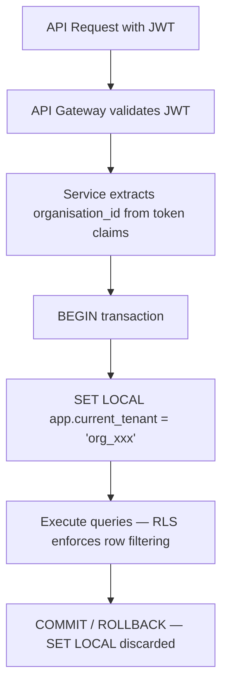
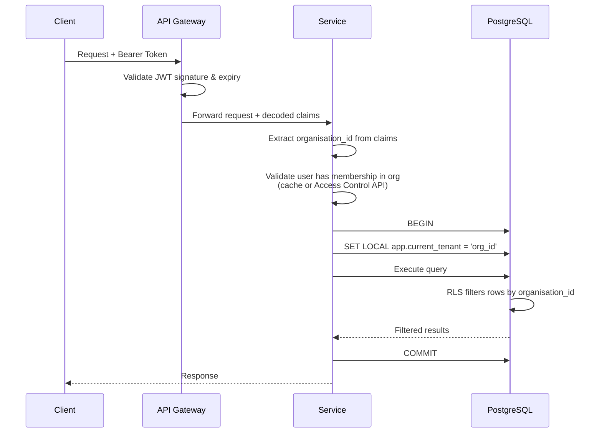
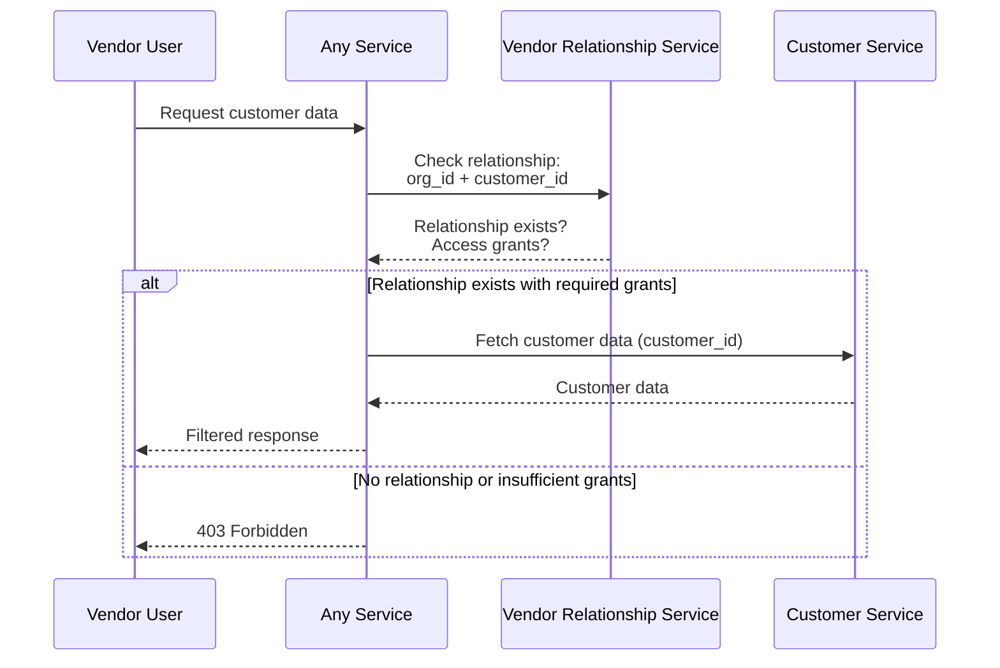
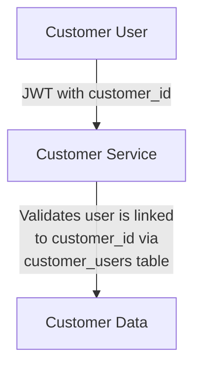

# AETHRA — Multi-Tenant Isolation Design

> Phase 0 · Tenant Isolation · v0.1.0

---

## 1. Isolation Model Overview

AETHRA uses **Row-Level Security (RLS)** as the primary tenant isolation mechanism. Every tenant-scoped table includes an `organisation_id` column, and PostgreSQL RLS policies enforce that a service connection can only see rows belonging to the tenant set in the current transaction context.



---

## 2. PostgreSQL RLS Strategy

### 2.1 Core Mechanism

Every tenant-scoped table has:
1. An `organisation_id UUID NOT NULL` column.
2. RLS enabled via `ALTER TABLE ... ENABLE ROW LEVEL SECURITY`.
3. RLS forced on table owner via `ALTER TABLE ... FORCE ROW LEVEL SECURITY`.
4. A policy that compares `organisation_id` to `current_setting('app.current_tenant')`.

### 2.2 Which Tables Are Tenant-Scoped?

| Category | Tenant-Scoped? | Examples |
|----------|----------------|----------|
| Vendor business data | ✅ Yes | leads, quotations, inventory, projects |
| Organisation configuration | ✅ Yes | branches, warehouses, org_configurations |
| Platform reference data | ❌ No | product_categories, brands, units, subscription_plans, module_catalogue |
| Identity data | ❌ No | users, user_auth_providers, user_sessions |
| Customer master data | ⚠️ Special | customer_accounts are NOT scoped to a single vendor — see §8 |
| Audit events | ✅ Yes (with exceptions) | audit_events are tenant-scoped; platform-level events have a sentinel org ID |

### 2.3 Tables That Are NOT RLS-Protected

The following tables are platform-wide and do not carry `organisation_id`:

- `identity_db.*` — all tables (user identity is cross-tenant)
- `catalogue_db.product_categories`
- `catalogue_db.brands`
- `catalogue_db.product_models` (platform catalogue)
- `catalogue_db.product_specifications`
- `catalogue_db.specification_values`
- `catalogue_db.units`
- `catalogue_db.warranty_templates`
- `subscription_db.subscription_plans`
- `subscription_db.plan_modules`
- `subscription_db.plan_features`
- `subscription_db.module_catalogue`
- `subscription_db.feature_catalogue`
- `customer_db.customer_accounts` (global — see §8)
- `customer_db.customer_profiles` (global)
- `customer_db.customer_contacts` (global)
- `customer_db.customer_users` (global)
- `vendor_relationship_db.relationship_purposes` (reference data)

---

## 3. Row-Level Security Policy Patterns

### 3.1 Standard Tenant Policy

Applied to all tenant-scoped tables:

```sql
-- Enable RLS
ALTER TABLE app.leads ENABLE ROW LEVEL SECURITY;
ALTER TABLE app.leads FORCE ROW LEVEL SECURITY;

-- Tenant isolation policy
CREATE POLICY tenant_isolation ON app.leads
  USING (organisation_id = current_setting('app.current_tenant')::uuid)
  WITH CHECK (organisation_id = current_setting('app.current_tenant')::uuid);
```

- `USING` — filters rows on `SELECT`, `UPDATE`, `DELETE`.
- `WITH CHECK` — validates rows on `INSERT`, `UPDATE` (ensures new/modified rows belong to current tenant).

### 3.2 Platform-Admin Bypass Policy

For platform operations (support, migrations, billing), a separate role bypasses RLS:

```sql
-- Platform admin role bypasses RLS
CREATE POLICY platform_admin_bypass ON app.leads
  FOR ALL
  TO svc_platform_admin
  USING (true)
  WITH CHECK (true);
```

> [!CAUTION]
> The `svc_platform_admin` role is never used by application services. It is restricted to platform operations tools with additional audit logging.

### 3.3 Read-Only Cross-Tenant Policy (Reporting)

For the Reporting Service that aggregates across tenants:

```sql
-- Reporting role can read across tenants (SELECT only)
CREATE POLICY reporting_read_all ON app.analytics_aggregations
  FOR SELECT
  TO svc_reporting
  USING (true);

-- But cannot write
-- (No INSERT/UPDATE/DELETE policy for svc_reporting)
```

### 3.4 Multi-Tenant Access Policy (Vendor Relationship)

For tables where a user may have access to multiple organisations:

```sql
-- app.current_tenant_set is a comma-separated list or uses array
CREATE POLICY multi_tenant_access ON app.vendor_customer_relationships
  USING (
    organisation_id = ANY(
      string_to_array(current_setting('app.current_tenant_set', true), ',')::uuid[]
    )
  );
```

> [!NOTE]
> Multi-tenant access is only used in the Vendor Relationship Service for specific cross-vendor views. Most services use single-tenant context.

---

## 4. Transaction-Scoped Tenant Context (`SET LOCAL`)

### 4.1 Pattern

```sql
BEGIN;
  -- Set tenant context for this transaction only
  SET LOCAL app.current_tenant = 'a1b2c3d4-e5f6-7890-abcd-ef1234567890';

  -- All subsequent queries in this TX are filtered by RLS
  SELECT * FROM app.leads;  -- Only returns leads for this org

  INSERT INTO app.leads (id, organisation_id, name, ...)
    VALUES (gen_random_uuid(), 'a1b2c3d4-e5f6-7890-abcd-ef1234567890', ...);
    -- WITH CHECK ensures organisation_id matches current_tenant
COMMIT;
-- SET LOCAL is automatically discarded after COMMIT/ROLLBACK
```

### 4.2 Application-Level Implementation

```python
# Python / SQLAlchemy example
class TenantMiddleware:
    def set_tenant_context(self, session, organisation_id: str):
        """Must be called at the start of every request handler."""
        session.execute(
            text("SET LOCAL app.current_tenant = :tenant_id"),
            {"tenant_id": organisation_id}
        )

# Usage in request handler
@app.route("/leads")
async def list_leads(request):
    org_id = request.auth.organisation_id  # From JWT claims
    async with db.transaction() as session:
        tenant_middleware.set_tenant_context(session, org_id)
        leads = await session.execute(select(Lead))
        return leads.all()
```

### 4.3 Validation Rules

| Rule | Enforcement |
|------|-------------|
| Tenant context MUST be set before any query | Application middleware; failsafe: if `app.current_tenant` is not set, RLS policy returns zero rows |
| Tenant context comes from JWT `organisation_id` claim | API Gateway validates JWT; service extracts claim |
| `SET LOCAL` (not `SET`) | Enforced by code review and linting rules; `SET` without `LOCAL` persists for the session — dangerous |
| `organisation_id` in `INSERT` must match context | `WITH CHECK` clause in RLS policy; application layer also validates |

### 4.4 Failsafe: Missing Tenant Context

If `app.current_tenant` is not set, `current_setting('app.current_tenant')` raises an error by default. This is the desired behavior — it prevents accidental unscoped queries:

```sql
-- Ensure error on missing context (PostgreSQL default for undefined GUC)
-- Alternatively, use current_setting('app.current_tenant', false) to raise error
-- DO NOT use current_setting('app.current_tenant', true) which returns NULL silently
```

---

## 5. Connection Pool Safety — Preventing Context Leakage

### 5.1 The Risk

In connection pooling (PgBouncer, pgpool), a database connection may be reused by a different request. If `SET` (session-level) is used instead of `SET LOCAL` (transaction-level), the tenant context persists and may leak to the next request.

### 5.2 Mitigation Strategy

| Layer | Mitigation |
|-------|------------|
| **PgBouncer pool mode** | Use `transaction` mode — connections are returned to the pool at transaction end, and `SET LOCAL` is discarded |
| **Application code** | Always use `SET LOCAL` within an explicit `BEGIN...COMMIT` block |
| **PgBouncer `server_reset_query`** | Set to `DISCARD ALL` or `RESET ALL` — clears any leaked session state when a connection returns to the pool |
| **Code review / linting** | CI checks that no raw `SET app.current_tenant` (without `LOCAL`) exists in codebase |
| **Integration tests** | Tests verify that after a transaction, the connection does not retain tenant context |

### 5.3 PgBouncer Configuration

```ini
[pgbouncer]
pool_mode = transaction
server_reset_query = DISCARD ALL
server_reset_query_always = 1
```

> [!IMPORTANT]
> `server_reset_query_always = 1` ensures the reset query runs even for `transaction` pool mode, providing defense-in-depth against context leakage.

---

## 6. Service-Level Tenant Validation

### 6.1 Request Flow



### 6.2 Validation Layers

| Layer | What Is Validated |
|-------|-------------------|
| **API Gateway** | JWT signature, expiry, issuer |
| **Service middleware** | `organisation_id` claim is present and is a valid UUID |
| **Membership check** | User actually belongs to the claimed organisation (cached from Organisation Service) |
| **RLS policy** | Database enforces row-level filtering regardless of application bugs |
| **WITH CHECK** | Database prevents inserting/updating rows with wrong `organisation_id` |

### 6.3 Defense in Depth

RLS is the **last line of defense**, not the only line. Even if application code has a bug that passes the wrong `organisation_id`, the RLS policy prevents data leakage. The layers above exist to provide:
- Early rejection (fail fast at gateway)
- Meaningful error messages (application layer)
- Audit trail (which user tried to access which org)

---

## 7. Testing Cross-Tenant Isolation

### 7.1 Test Categories

| Category | Description | Frequency |
|----------|-------------|-----------|
| **Unit tests** | Verify RLS policies in isolation using `pgTAP` or equivalent | Every CI build |
| **Integration tests** | Multi-tenant scenario: create data for Org A, query as Org B, assert zero results | Every CI build |
| **Penetration tests** | Attempt to bypass RLS via SQL injection, parameter tampering, direct connection | Quarterly |
| **Chaos tests** | Kill connections mid-transaction, verify no context leakage | Monthly |

### 7.2 Standard Integration Test Template

```sql
-- Test: Org B cannot see Org A's data
BEGIN;
  SET LOCAL app.current_tenant = 'org_a_uuid';
  INSERT INTO app.leads (id, organisation_id, name)
    VALUES (gen_random_uuid(), 'org_a_uuid', 'Lead for Org A');
COMMIT;

BEGIN;
  SET LOCAL app.current_tenant = 'org_b_uuid';
  -- This must return 0 rows
  SELECT count(*) FROM app.leads WHERE name = 'Lead for Org A';
  -- Assert: count = 0
COMMIT;
```

### 7.3 pgTAP RLS Policy Tests

```sql
-- pgTAP test
BEGIN;
  SELECT plan(3);

  -- Set tenant A
  SET LOCAL app.current_tenant = 'aaaa-aaaa-aaaa-aaaa';

  -- Insert as tenant A
  INSERT INTO app.leads (id, organisation_id, name)
    VALUES ('1111-1111', 'aaaa-aaaa-aaaa-aaaa', 'A Lead');

  -- Verify visible
  SELECT is(
    (SELECT count(*)::int FROM app.leads WHERE id = '1111-1111'),
    1,
    'Tenant A can see own lead'
  );

  -- Switch to tenant B
  SET LOCAL app.current_tenant = 'bbbb-bbbb-bbbb-bbbb';

  -- Verify invisible
  SELECT is(
    (SELECT count(*)::int FROM app.leads WHERE id = '1111-1111'),
    0,
    'Tenant B cannot see Tenant A lead'
  );

  -- Verify cannot insert with wrong org_id
  SELECT throws_ok(
    $$INSERT INTO app.leads (id, organisation_id, name)
      VALUES ('2222-2222', 'aaaa-aaaa-aaaa-aaaa', 'Sneaky')$$,
    '23514',  -- check_violation
    NULL,
    'Tenant B cannot insert row for Tenant A'
  );

  SELECT finish();
ROLLBACK;
```

### 7.4 CI Pipeline Integration

```yaml
# .github/workflows/tenant-isolation.yml
tenant-isolation-tests:
  runs-on: ubuntu-latest
  services:
    postgres:
      image: postgres:16
      env:
        POSTGRES_PASSWORD: test
  steps:
    - uses: actions/checkout@v4
    - name: Run RLS migrations
      run: migrate -path ./migrations -database $DB_URL up
    - name: Run pgTAP tests
      run: pg_prove -d $DB_URL tests/rls/*.sql
```

---

## 8. Shared Data Patterns — Platform-Wide Reference Data

### 8.1 Pattern: Unscoped Reference Tables

Platform-wide data (product categories, brands, units, subscription plans) does NOT have `organisation_id` and is NOT protected by RLS.

```sql
-- No RLS on reference data
CREATE TABLE app.product_categories (
    id          UUID PRIMARY KEY DEFAULT gen_random_uuid(),
    name        TEXT NOT NULL,
    parent_id   UUID REFERENCES app.product_categories(id),
    is_active   BOOLEAN NOT NULL DEFAULT true,
    created_at  TIMESTAMPTZ NOT NULL DEFAULT now(),
    updated_at  TIMESTAMPTZ NOT NULL DEFAULT now()
);
-- No ALTER TABLE ... ENABLE ROW LEVEL SECURITY
```

### 8.2 Pattern: Tenant Overlay on Platform Data

When vendors customize platform data, use a tenant-scoped overlay table:

```sql
-- Platform-wide product models (no RLS)
CREATE TABLE app.product_models (
    id          UUID PRIMARY KEY,
    name        TEXT NOT NULL,
    brand_id    UUID NOT NULL,
    ...
);

-- Vendor-specific pricing/availability (RLS-protected)
CREATE TABLE app.vendor_catalogue_entries (
    id                UUID PRIMARY KEY DEFAULT gen_random_uuid(),
    organisation_id   UUID NOT NULL,  -- tenant discriminator
    product_model_id  UUID NOT NULL,
    vendor_sku        TEXT,
    unit_price        NUMERIC(12,2),
    is_available      BOOLEAN NOT NULL DEFAULT true,
    ...
);
ALTER TABLE app.vendor_catalogue_entries ENABLE ROW LEVEL SECURITY;
ALTER TABLE app.vendor_catalogue_entries FORCE ROW LEVEL SECURITY;
CREATE POLICY tenant_isolation ON app.vendor_catalogue_entries
  USING (organisation_id = current_setting('app.current_tenant')::uuid)
  WITH CHECK (organisation_id = current_setting('app.current_tenant')::uuid);
```

### 8.3 Who Can Modify Platform Data?

| Actor | Allowed Operations |
|-------|-------------------|
| Platform Admin | Full CRUD on platform reference tables |
| Vendor Admin | Read platform data; CRUD on vendor overlay tables |
| Service accounts | Read-only on platform data |

---

## 9. Customer Data Isolation with Multi-Vendor Access

### 9.1 The Problem

A customer (`customer_accounts`) is NOT scoped to a single vendor. Customer A may have relationships with Vendor X and Vendor Y. The Vendor Relationship Service governs which vendors can see which customer data.

### 9.2 Customer Service — No Org-Based RLS

The Customer Service database does NOT use `organisation_id`-based RLS on core customer tables. Instead:

```sql
-- customer_accounts: NO organisation_id column, NO RLS
CREATE TABLE app.customer_accounts (
    id          UUID PRIMARY KEY DEFAULT gen_random_uuid(),
    status      TEXT NOT NULL DEFAULT 'active',
    created_at  TIMESTAMPTZ NOT NULL DEFAULT now()
);
```

### 9.3 Access Control via Vendor Relationship Service

When a vendor-side user wants to access customer data:



### 9.4 Vendor Relationship as Access Boundary

The `vendor_customer_relationships` table is the source of truth for which vendor can access which customer:

```sql
CREATE TABLE app.vendor_customer_relationships (
    id                UUID PRIMARY KEY DEFAULT gen_random_uuid(),
    organisation_id   UUID NOT NULL,  -- the vendor
    customer_id       UUID NOT NULL,  -- the customer
    status            TEXT NOT NULL DEFAULT 'active',
    established_at    TIMESTAMPTZ NOT NULL DEFAULT now(),
    UNIQUE (organisation_id, customer_id)
);

-- This table IS RLS-protected by organisation_id
-- so vendor X can only see their own customer relationships
```

### 9.5 Property and Installation Access Grants

Granular access is controlled by grant tables:

| Table | Controls Access To |
|-------|-------------------|
| `vendor_access_grants` | Overall customer data access level |
| `property_access_grants` | Specific properties of the customer |
| `installation_access_grants` | Specific installations at a property |

A vendor can only access a customer's property data if:
1. A `vendor_customer_relationship` exists AND is active.
2. A `property_access_grant` exists for that property AND is not revoked.

### 9.6 Customer-Side User Access

Customers access their own data directly via the Customer Service without going through Vendor Relationship checks:



### 9.7 Summary: Isolation Strategy by Service

| Service | Tenant Discriminator | RLS Column | Special Rules |
|---------|---------------------|------------|---------------|
| Organisation | `organisation_id` | `organisation_id` | Standard |
| Access Control | `organisation_id` | `organisation_id` | Standard |
| Subscription | `organisation_id` | `organisation_id` | Standard |
| CRM | `organisation_id` | `organisation_id` | Standard |
| Quotation | `organisation_id` | `organisation_id` | Standard |
| Engineering | `organisation_id` | `organisation_id` | Standard |
| Inventory | `organisation_id` | `organisation_id` | Standard |
| Procurement | `organisation_id` | `organisation_id` | Standard |
| Project | `organisation_id` | `organisation_id` | Standard |
| Document | `organisation_id` | `organisation_id` | Standard |
| Notification | `organisation_id` | `organisation_id` | Some tables also filter by `user_id` |
| Service Mgmt | `organisation_id` | `organisation_id` | Standard |
| Reporting | `organisation_id` | `organisation_id` | Reporting role has cross-tenant read |
| Integration | `organisation_id` | `organisation_id` | Standard |
| Audit | `organisation_id` | `organisation_id` | Platform events use sentinel org ID |
| Customer | `customer_id` | None (app-level) | No RLS — access governed by Vendor Relationship Service |
| Vendor Relationship | `organisation_id` | `organisation_id` | Standard RLS on vendor side; cross-customer access is app-level |
| Identity | N/A | None | No tenant scoping — identity is global |
| Catalogue | Mixed | `organisation_id` on vendor entries only | Platform data is unscoped; vendor overlays are RLS-protected |

---

## Open Decisions

| # | Decision | Options | Recommendation |
|---|----------|---------|----------------|
| 1 | Customer Service: app-level access control vs. RLS with dynamic policy | App-level via VRS API calls vs. RLS with `app.accessible_customers` GUC | App-level for Day 1; RLS if customer data volume is very high |
| 2 | Audit events for platform-level operations | Sentinel `organisation_id` vs. nullable column | Sentinel UUID (`00000000-0000-0000-0000-000000000000`) for simpler RLS |
| 3 | Multi-org user context (user belongs to Org A and Org B) | Single `app.current_tenant` per request vs. allow multi-tenant context | Single tenant per request; user switches org in UI |
| 4 | RLS testing in staging with production-like data | Anonymized production snapshots vs. synthetic data | Synthetic data for Day 1; anonymized snapshots when available |
