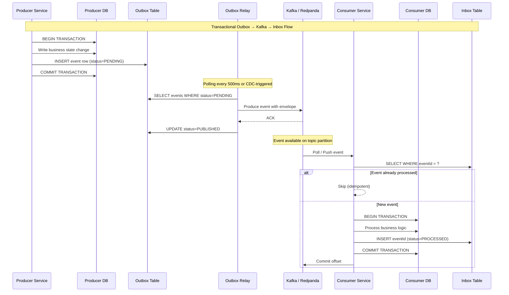

# AETHRA — Event Versioning Strategy

> Phase 0 · v0.1 · 2026-11-03

---

## 1. Schema Versioning Approach

### 1.1 Version Semantics

AETHRA events use **semantic version numbers embedded in the event name** (`.v1`, `.v2`, etc.). The version number represents the **schema contract** — not the business logic version.

| Change Type | Version Bump? | Examples |
|------------|---------------|---------|
| **Add optional field** | No — backward compatible | Adding `middleName?` to `identity.user.registered.v1` |
| **Add required field** | Yes — new version | Adding required `gstNumber` → `identity.user.registered.v2` |
| **Remove field** | Yes — new version | Removing `legacyCode` → new version |
| **Rename field** | Yes — new version | `name` → `fullName` requires new version |
| **Change field type** | Yes — new version | `amount: string` → `amount: number` |
| **Change semantics** | Yes — new version | `status` enum values reinterpreted |

### 1.2 Multi-Version Coexistence

When a new version is introduced:

1. **Producer publishes both versions** during a transition window (configurable, default 90 days).
2. Consumers migrate at their own pace within the window.
3. After the window, the old version is **deprecated** and eventually removed.
4. The same Kafka topic carries all versions of an entity's events (version is in the event name, not the topic).

```
Topic: aethra.identity.user.events
  → identity.user.registered.v1  (deprecated, still published)
  → identity.user.registered.v2  (current)
```

---

## 2. Backward/Forward Compatibility Rules

### 2.1 Backward Compatibility (New producer, old consumer)

> A consumer built for v1 MUST be able to safely process messages after a producer upgrades.

Rules:
- **New optional fields** are ignored by old consumers (they don't read them).
- **Removed fields** require a new version; old version continues to be published.
- Consumers MUST use **tolerant reader** pattern: ignore unknown fields.

### 2.2 Forward Compatibility (Old producer, new consumer)

> A consumer built for v2 MUST be able to safely process v1 messages.

Rules:
- New consumers MUST handle **absence of new fields** with defaults.
- Consumers SHOULD check `eventType` (including version) before processing.
- Consumers MAY subscribe to multiple versions and apply adapter logic.

### 2.3 Compatibility Matrix

```
┌──────────────────────────────────────────────────┐
│                   PRODUCERS                      │
│           v1 only │ v1+v2  │ v2 only             │
├──────────────────────────────────────────────────┤
│ Consumer v1  ✅   │  ✅    │  ❌ (must migrate)  │
│ Consumer v2  ✅*  │  ✅    │  ✅                  │
└──────────────────────────────────────────────────┘
 * v2 consumer handles v1 with defaults
```

---

## 3. Schema Registry Strategy

### 3.1 Registry Choice

AETHRA uses a **schema registry** (AWS Glue Schema Registry or Confluent-compatible if using Redpanda) to:

- Store and version JSON schemas for all events.
- Validate event payloads at production time (producer-side validation).
- Enable consumer-side schema lookup for deserialization.

### 3.2 Schema Format

**JSON Schema (Draft 2020-12)** is the schema format. Rationale:
- Native to TypeScript/NestJS ecosystem.
- Human-readable.
- Supports `additionalProperties: true` for forward compatibility.
- Wide tooling support.

> [!NOTE]
> Avro was considered but rejected for Phase 0 due to ecosystem friction with TypeScript. This may be revisited if schema evolution overhead becomes problematic.

### 3.3 Schema Registration Flow

1. Schema definitions live **in the producing service's repository** under `schemas/events/`.
2. CI pipeline validates schemas and registers them with the registry on merge to main.
3. Registry enforces **backward compatibility** mode by default.
4. Breaking changes require explicit compatibility override and version bump.

```
service-repo/
  src/
  schemas/
    events/
      identity.user.registered.v1.json
      identity.user.registered.v2.json
```

---

## 4. Event Envelope Structure

Every event published to Kafka is wrapped in a standard **envelope**:

```typescript
interface EventEnvelope<T = unknown> {
  // ── Envelope Metadata ──
  eventId: string;            // UUID v7 (time-ordered) — idempotency key
  eventType: string;          // e.g., "identity.user.registered.v1"
  eventVersion: number;       // Numeric version (1, 2, ...)
  timestamp: string;          // ISO 8601 UTC (e.g., "2026-11-03T08:00:00.000Z")
  
  // ── Source Context ──
  source: {
    service: string;          // Producing service name (e.g., "identity-service")
    instance: string;         // Instance/pod ID for traceability
  };
  
  // ── Tenant & Correlation ──
  tenantId: string | null;    // Null for platform-level events
  correlationId: string;      // Trace ID — propagated across saga steps
  causationId: string;        // eventId of the event/command that caused this event
  
  // ── Auth Context ──
  actor: {
    userId: string | null;    // Null for system-initiated events
    serviceAccount: string | null; // Non-null for service-initiated events
  };
  
  // ── Schema ──
  schemaRef: string;          // Schema registry reference (e.g., "identity.user.registered.v1")
  
  // ── Payload ──
  data: T;                    // Domain-specific event payload
  
  // ── Metadata ──
  metadata: Record<string, string>; // Extensible metadata (saga ID, retry count, etc.)
}
```

### 4.1 Example

```json
{
  "eventId": "0192d3e4-5f6a-7b8c-9d0e-1f2a3b4c5d6e",
  "eventType": "identity.user.registered.v1",
  "eventVersion": 1,
  "timestamp": "2026-11-03T08:00:00.000Z",
  "source": {
    "service": "identity-service",
    "instance": "identity-service-abc123"
  },
  "tenantId": "tenant_01HXYZ",
  "correlationId": "corr_01HABCDEF",
  "causationId": "cmd_01H98765",
  "actor": {
    "userId": "user_01HMNOPQ",
    "serviceAccount": null
  },
  "schemaRef": "identity.user.registered.v1",
  "data": {
    "userId": "user_01HMNOPQ",
    "email": "vendor@example.com",
    "phone": "+919876543210",
    "identityProviderRef": "cognito:sub:abc123",
    "registrationType": "self"
  },
  "metadata": {
    "sagaId": "saga_vendor_onboarding_01H999"
  }
}
```

---

## 5. Dead-Letter Handling

### 5.1 DLQ Strategy

```
aethra.{domain}.{entity}.events           ← primary topic
aethra.{domain}.{entity}.events.retry.1   ← 1st retry (30s delay)
aethra.{domain}.{entity}.events.retry.2   ← 2nd retry (2 min delay)
aethra.{domain}.{entity}.events.retry.3   ← 3rd retry (15 min delay)
aethra.{domain}.{entity}.events.dlq       ← dead-letter (manual intervention)
```

### 5.2 Retry Policy

| Attempt | Delay | Behaviour |
|---------|-------|-----------|
| 1st retry | 30 seconds | Automatic |
| 2nd retry | 2 minutes | Automatic |
| 3rd retry | 15 minutes | Automatic |
| DLQ | — | Alert + manual review |

### 5.3 DLQ Event Enrichment

When an event is routed to DLQ, it is enriched with failure metadata:

```json
{
  "originalEvent": { ... },
  "dlqMetadata": {
    "failedConsumerGroup": "aethra.access-control.identity-user",
    "failedService": "access-control-service",
    "failureReason": "DatabaseConnectionError: timeout after 30s",
    "failedAt": "2026-11-03T08:05:00.000Z",
    "retryCount": 3,
    "firstFailedAt": "2026-11-03T08:00:30.000Z"
  }
}
```

### 5.4 DLQ Monitoring

- DLQ depth is monitored via CloudWatch metrics.
- Alert thresholds: **> 0 messages** → P3 alert; **> 100 messages** → P1 alert.
- An admin API allows replaying DLQ events back to the primary topic after fix.

---

## 6. Event Replay Strategy

### 6.1 Use Cases

| Use Case | Mechanism |
|----------|-----------|
| **New consumer bootstrap** | Replay from earliest offset on dedicated consumer group |
| **Bug fix reprocessing** | Reset consumer group offset to specific timestamp |
| **DLQ reprocessing** | Replay DLQ messages to primary topic |
| **Cross-region sync** | Mirror topics to secondary region and replay |

### 6.2 Replay Safeguards

1. **Idempotency** — All consumers MUST be idempotent (see §6.3). Replayed events must not cause duplicate side effects.
2. **Inbox table deduplication** — Consumers track processed `eventId` values in an inbox table and skip duplicates.
3. **Replay header** — Replayed events carry `x-replay: true` and `x-replay-reason` headers. Consumers MAY use these for special handling (e.g., skip notifications on replay).
4. **Retention** — Kafka topics retain events for **14 days** by default. Critical topics (identity, subscription) retain for **30 days**.

### 6.3 Idempotency Contract

Every consumer MUST:

```typescript
async function handleEvent(envelope: EventEnvelope): Promise<void> {
  // 1. Check inbox for duplicate
  const exists = await inboxRepository.exists(envelope.eventId);
  if (exists) {
    logger.debug(`Duplicate event ${envelope.eventId}, skipping`);
    return;
  }
  
  // 2. Process event within transaction
  await database.transaction(async (tx) => {
    // Business logic here
    await processBusinessLogic(tx, envelope.data);
    
    // 3. Mark as processed in same transaction
    await inboxRepository.markProcessed(tx, {
      eventId: envelope.eventId,
      eventType: envelope.eventType,
      processedAt: new Date(),
    });
  });
}
```

---

## 7. Outbox → Kafka → Inbox Flow

### 7.1 Transactional Outbox Pattern

The producer writes the event to an **outbox table** in the same database transaction as the business state change. A separate **outbox relay** process (polling or CDC-based) reads from the outbox and publishes to Kafka.

### 7.2 Inbox Pattern

The consumer reads from Kafka, checks the **inbox table** for deduplication, and processes the event within a database transaction that also records the event in the inbox.

### 7.3 Flow Diagram



### 7.4 Outbox Table Schema

```sql
CREATE TABLE outbox_events (
    id              UUID PRIMARY KEY DEFAULT gen_random_uuid(),
    event_id        UUID NOT NULL UNIQUE,          -- Same as envelope.eventId
    event_type      VARCHAR(255) NOT NULL,
    partition_key   VARCHAR(255) NOT NULL,          -- Kafka partition key
    topic           VARCHAR(255) NOT NULL,          -- Target Kafka topic
    payload         JSONB NOT NULL,                 -- Full EventEnvelope JSON
    status          VARCHAR(20) NOT NULL DEFAULT 'PENDING',  -- PENDING | PUBLISHED
    created_at      TIMESTAMPTZ NOT NULL DEFAULT NOW(),
    published_at    TIMESTAMPTZ,
    tenant_id       VARCHAR(50)                     -- For RLS (if outbox is tenant-scoped)
);

CREATE INDEX idx_outbox_pending ON outbox_events (status, created_at)
    WHERE status = 'PENDING';
```

### 7.5 Inbox Table Schema

```sql
CREATE TABLE inbox_events (
    event_id        UUID PRIMARY KEY,
    event_type      VARCHAR(255) NOT NULL,
    consumer_group  VARCHAR(255) NOT NULL,
    processed_at    TIMESTAMPTZ NOT NULL DEFAULT NOW(),
    tenant_id       VARCHAR(50)
);

-- Composite unique to support multiple consumer groups processing the same event
ALTER TABLE inbox_events ADD CONSTRAINT uq_inbox_event_consumer
    UNIQUE (event_id, consumer_group);

CREATE INDEX idx_inbox_cleanup ON inbox_events (processed_at);
```

> [!IMPORTANT]
> Inbox rows should be periodically cleaned up (retain for 14 days to match Kafka retention) to prevent unbounded table growth.

---

## 8. Outbox Relay Options

| Approach | Mechanism | Pros | Cons |
|----------|-----------|------|------|
| **Polling Relay** | Periodic `SELECT` on outbox table | Simple; no infrastructure dependency | Latency (polling interval); DB load |
| **CDC-based (Debezium)** | Change Data Capture on outbox table | Near real-time; no polling overhead | Operational complexity; Debezium dependency |
| **Listen/Notify (PostgreSQL)** | `pg_notify` triggers relay | Low-latency; native to PostgreSQL | Single-instance limitation; needs fallback polling |

> [!TIP]
> **Phase 0 Recommendation:** Start with **Polling Relay** (500ms interval) for simplicity. Migrate to CDC (Debezium or equivalent) when latency requirements tighten or DB polling overhead becomes measurable.

---

## 9. Open Decisions

| # | Decision | Notes |
|---|----------|-------|
| 1 | **Schema registry product** | AWS Glue Schema Registry vs. Confluent Schema Registry (Redpanda-compatible) |
| 2 | **Outbox relay mechanism** | Polling vs. CDC — deferred to implementation phase |
| 3 | **Avro adoption** | Revisit if JSON Schema evolution proves insufficient at scale |
| 4 | **Inbox cleanup interval** | 14 days baseline — may need tuning per service |
| 5 | **Cross-service replay coordination** | How to orchestrate replay across multiple consumers consistently |
