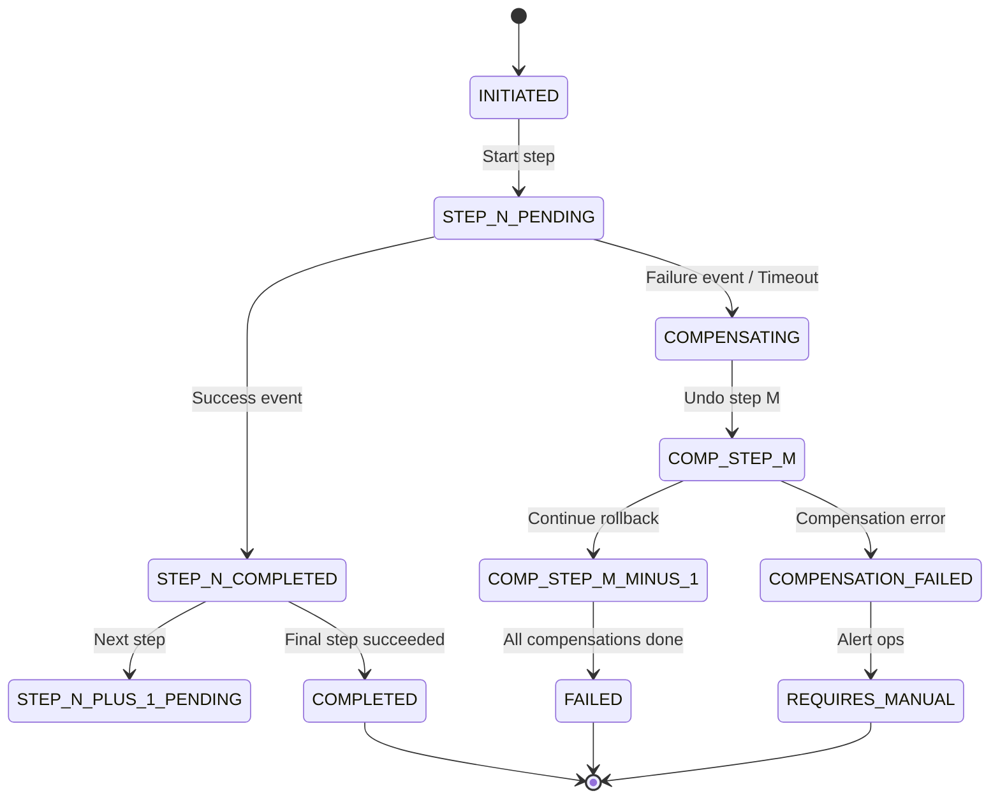
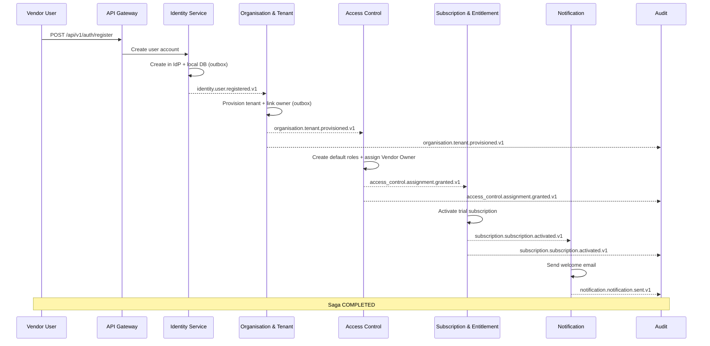
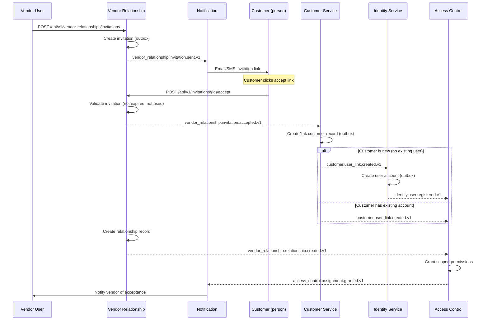
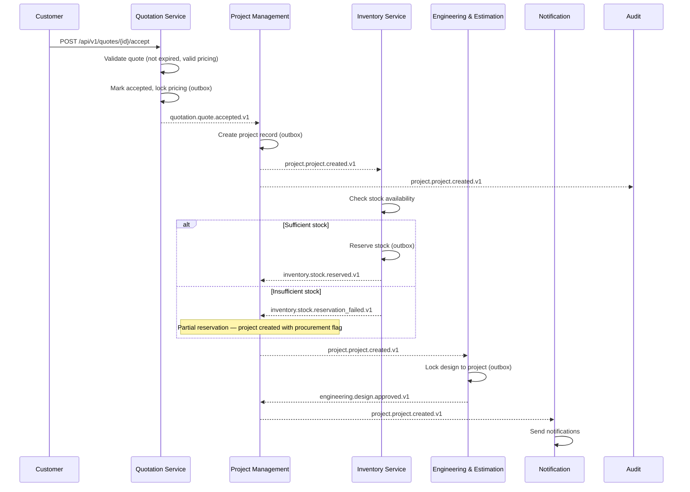
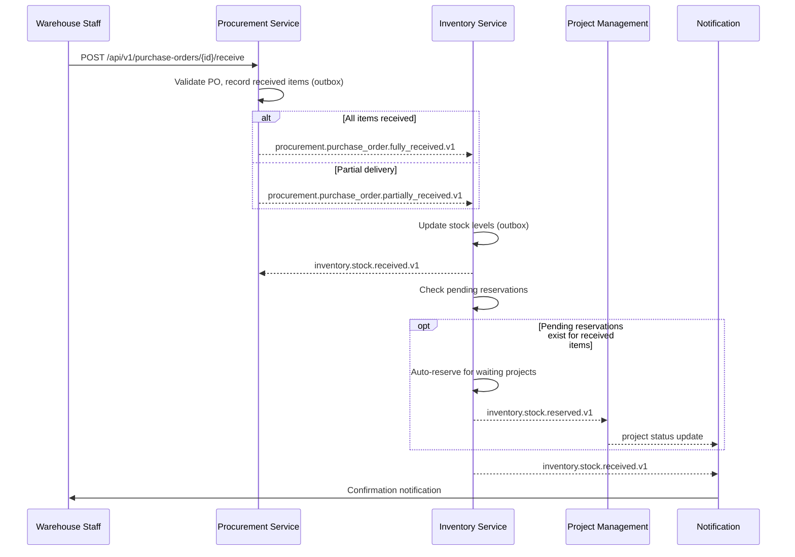
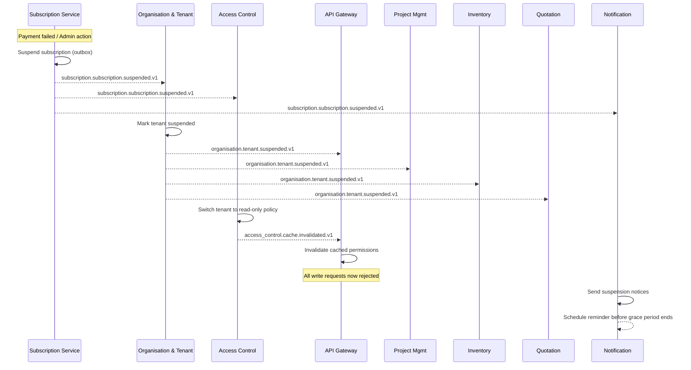
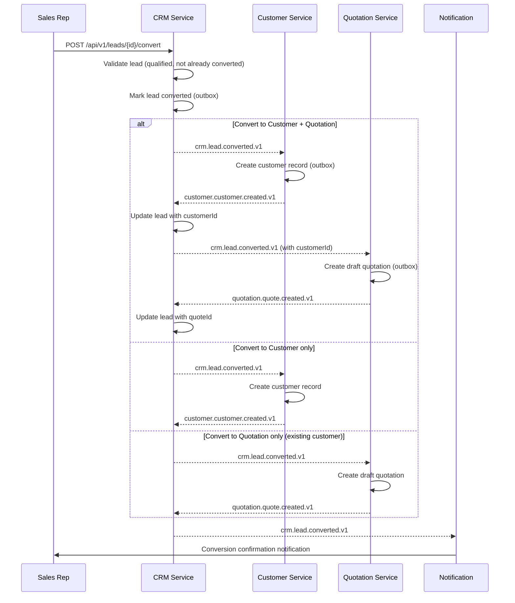

# AETHRA — Saga & Workflow Designs

> Phase 0 · v0.1 · 2026-11-03

---

## 1. Saga Design Principles

### 1.1 Pattern Choice

AETHRA uses **choreography-based sagas** as the default pattern: each service listens for events and reacts independently. An **orchestration-based saga** (centralized coordinator) is used only when:

- The workflow has more than 5 steps.
- Complex conditional branching is required.
- Strict ordering and timeout management is critical.

### 1.2 Cross-Cutting Concerns

| Concern | Strategy |
|---------|----------|
| **Idempotency** | Every saga step checks the inbox table for duplicate `eventId` before processing. Compensations are also idempotent. |
| **Correlation** | All events in a saga carry the same `correlationId`. A `sagaId` is stored in `metadata`. |
| **Timeout** | Each saga step has a configurable timeout. If a step does not emit its success/failure event within the timeout, a compensation timer fires. |
| **Observability** | Saga state transitions are logged to the Audit service. A saga status table tracks overall saga state for debugging. |
| **Concurrency** | Optimistic locking on saga state rows prevents concurrent step execution for the same saga instance. |

### 1.3 Saga State Machine

Every saga follows this generic state machine:



---

## 2. Saga 1: Vendor Onboarding

**Trigger:** Vendor self-registration or platform admin invitation  
**Pattern:** Orchestrated (complex branching, 4+ services)  
**Orchestrator:** Organisation & Tenant Service

### 2.1 Steps

| Step | Service | Action | Success Event | Failure Event |
|------|---------|--------|--------------|---------------|
| 1 | Identity | Create user account in IdP + local store | `identity.user.registered.v1` | `identity.user.registration_failed.v1` |
| 2 | Organisation & Tenant | Provision tenant, link owner user | `organisation.tenant.provisioned.v1` | `organisation.tenant.provisioning_failed.v1` |
| 3 | Access Control | Create default roles, assign Vendor Owner role to user | `access_control.assignment.granted.v1` | `access_control.assignment.failed.v1` |
| 4 | Subscription & Entitlement | Activate trial/initial subscription plan | `subscription.subscription.activated.v1` | `subscription.subscription.activation_failed.v1` |
| 5 | Notification | Send welcome email + onboarding instructions | `notification.notification.sent.v1` | (non-critical — logged, no compensation) |

### 2.2 Sequence Diagram



### 2.3 Compensation Actions

| Step | Compensation Action | Details |
|------|-------------------|---------|
| 4 (Subscription) | Cancel subscription | `subscription.subscription.cancelled.v1` — remove trial plan |
| 3 (Access Control) | Revoke role assignments | `access_control.assignment.revoked.v1` — remove all assignments for tenant |
| 2 (Organisation) | Delete tenant | `organisation.tenant.deleted.v1` — soft-delete tenant record |
| 1 (Identity) | Deactivate user | `identity.user.deactivated.v1` — deactivate account (preserve for audit) |

### 2.4 Failure Scenarios

| Failure Point | Behaviour |
|--------------|-----------|
| IdP user creation fails (duplicate email) | Return error to user immediately; no compensation needed |
| Tenant provisioning fails (DB error) | Compensate: deactivate Identity user |
| Access Control fails | Compensate: delete tenant → deactivate user |
| Subscription activation fails | Compensate: revoke roles → delete tenant → deactivate user |
| Notification fails | Log warning; saga still completes (non-critical) |

### 2.5 Timeout Handling

| Step | Timeout | Action on Timeout |
|------|---------|------------------|
| 1 (Identity) | 30 seconds | Fail saga, return error to user |
| 2 (Organisation) | 30 seconds | Begin compensation from step 1 |
| 3 (Access Control) | 30 seconds | Begin compensation from step 2 |
| 4 (Subscription) | 30 seconds | Begin compensation from step 3 |
| 5 (Notification) | 60 seconds | Log warning, do not compensate (fire-and-forget) |

### 2.6 Idempotency

- Step 1: Identity service checks for existing user by email before creation (upsert semantics).
- Step 2: Tenant provisioning is keyed by `sagaId` — duplicate event produces no new tenant.
- Step 3: Role assignment checks existing assignments before granting.
- Step 4: Subscription activation is keyed by `tenantId` + `sagaId`.

---

## 3. Saga 2: Customer Invitation

**Trigger:** Vendor invites a customer to establish a relationship  
**Pattern:** Choreography  
**Initiator:** Vendor Relationship Service

### 3.1 Steps

| Step | Service | Action | Success Event | Failure Event |
|------|---------|--------|--------------|---------------|
| 1 | Vendor Relationship | Create invitation record | `vendor_relationship.invitation.sent.v1` | (sync validation — fails immediately) |
| 2 | Notification | Send invitation email/SMS to customer | `notification.notification.sent.v1` | `notification.notification.failed.v1` |
| 3 | Customer (on accept) | Ensure customer record exists (create or link) | `customer.customer.created.v1` or `customer.user_link.created.v1` | `customer.customer.creation_failed.v1` |
| 4 | Identity (on accept) | Create user account if customer is new | `identity.user.registered.v1` | `identity.user.registration_failed.v1` |
| 5 | Vendor Relationship | Establish relationship record | `vendor_relationship.relationship.created.v1` | `vendor_relationship.relationship.creation_failed.v1` |
| 6 | Access Control | Grant customer access permissions scoped to vendor | `access_control.assignment.granted.v1` | `access_control.assignment.failed.v1` |
| 7 | Notification | Notify vendor of acceptance | `notification.notification.sent.v1` | (non-critical) |

### 3.2 Sequence Diagram



### 3.3 Compensation Actions

| Step | Compensation Action |
|------|-------------------|
| 6 (Access Control) | Revoke granted permissions |
| 5 (Vendor Relationship) | Delete relationship record |
| 4 (Identity) | Deactivate user (only if newly created) |
| 3 (Customer) | Soft-delete customer record (only if newly created) |
| 2 (Notification) | No compensation (already sent) |
| 1 (Invitation) | Mark invitation as `FAILED` |

### 3.4 Failure Scenarios

| Failure Point | Behaviour |
|--------------|-----------|
| Invitation expired when customer clicks accept | Return 410 Gone; no saga compensation |
| Customer record creation fails | Mark invitation as failed; notify vendor |
| Identity user creation fails | Compensate customer record; mark invitation failed |
| Access Control grant fails | Compensate: revoke relationship → undo identity if new → undo customer if new |

### 3.5 Timeout Handling

| Step | Timeout | Action |
|------|---------|--------|
| Invitation acceptance | Configurable (default: 7 days) | `vendor_relationship.invitation.expired.v1` — no compensation needed |
| Steps 3-6 | 60 seconds each | Begin compensation chain |

### 3.6 Idempotency

- Invitation accept is idempotent — re-accepting an already-accepted invitation returns the existing relationship.
- Customer creation checks for existing customer by email/phone before creating.
- Identity user creation checks IdP for existing account.

---

## 4. Saga 3: Quotation Acceptance → Project Creation

**Trigger:** Customer accepts a quotation  
**Pattern:** Orchestrated (Quotation Service initiates; Project Management orchestrates project creation)  
**Orchestrator:** Project Management Service

### 4.1 Steps

| Step | Service | Action | Success Event | Failure Event |
|------|---------|--------|--------------|---------------|
| 1 | Quotation | Mark quote as accepted, lock pricing | `quotation.quote.accepted.v1` | (sync — fails immediately) |
| 2 | Project Management | Create project from accepted quote | `project.project.created.v1` | `project.project.creation_failed.v1` |
| 3 | Inventory | Reserve stock for project line items | `inventory.stock.reserved.v1` | `inventory.stock.reservation_failed.v1` |
| 4 | Engineering & Estimation | Lock design version for project | `engineering.design.approved.v1` | `engineering.design.approval_failed.v1` |
| 5 | Notification | Notify vendor team + customer of project creation | `notification.notification.sent.v1` | (non-critical) |

### 4.2 Sequence Diagram



### 4.3 Compensation Actions

| Step | Compensation Action |
|------|-------------------|
| 4 (Engineering) | Unlock design version |
| 3 (Inventory) | Release stock reservation — `inventory.stock.reservation_released.v1` |
| 2 (Project) | Cancel project — `project.project.cancelled.v1` |
| 1 (Quotation) | Revert quote to `SENT` status — `quotation.quote.acceptance_reverted.v1` |

### 4.4 Failure Scenarios

| Failure Point | Behaviour |
|--------------|-----------|
| Quote expired or already accepted | Synchronous error — 409 Conflict |
| Project creation fails | Compensate: revert quote status |
| Stock reservation fails (insufficient) | **NOT a saga failure** — project is created with a procurement flag; triggers procurement workflow |
| Engineering design lock fails | Compensate: release stock → cancel project → revert quote |

> [!IMPORTANT]
> Insufficient stock is **not** a failure condition. The project is created with status `AWAITING_MATERIALS`, and a procurement workflow is triggered separately. Only a hard failure (DB error, service unavailable) triggers compensation.

### 4.5 Timeout Handling

| Step | Timeout | Action |
|------|---------|--------|
| 2 (Project creation) | 30 seconds | Revert quote acceptance |
| 3 (Inventory reservation) | 60 seconds | Proceed without reservation (flag project) |
| 4 (Engineering lock) | 30 seconds | Log warning; project proceeds (design can be locked later) |

### 4.6 Idempotency

- Quote acceptance is idempotent — re-accepting returns existing project.
- Project creation is keyed by `quoteId` — duplicate events produce no new project.
- Stock reservation is keyed by `projectId` — duplicate events reuse existing reservation.

---

## 5. Saga 4: Procurement → Stock Receipt

**Trigger:** Purchase order fully or partially received at warehouse  
**Pattern:** Choreography  
**Initiator:** Procurement Service

### 5.1 Steps

| Step | Service | Action | Success Event | Failure Event |
|------|---------|--------|--------------|---------------|
| 1 | Procurement | Record goods received against PO | `procurement.purchase_order.partially_received.v1` or `procurement.purchase_order.fully_received.v1` | (sync validation) |
| 2 | Inventory | Update stock levels, record receipt | `inventory.stock.received.v1` | `inventory.stock.receipt_failed.v1` |
| 3 | Inventory | Auto-fulfil pending reservations if applicable | `inventory.stock.reserved.v1` (for waiting projects) | — |
| 4 | Notification | Notify relevant project managers of stock arrival | `notification.notification.sent.v1` | (non-critical) |

### 5.2 Sequence Diagram



### 5.3 Compensation Actions

| Step | Compensation Action |
|------|-------------------|
| 3 (Auto-reservation) | Release auto-reservations |
| 2 (Inventory receipt) | Reverse stock receipt — `inventory.stock.adjusted.v1` (negative adjustment) |
| 1 (Procurement receipt) | Revert PO to `PENDING_RECEIPT` status |

> [!NOTE]
> Compensation for goods receipt is rare — typically only triggered if a quality inspection fails or if the wrong items were received. This is usually handled as a separate **stock adjustment** rather than a saga compensation.

### 5.4 Failure Scenarios

| Failure Point | Behaviour |
|--------------|-----------|
| Invalid PO (not found, already fully received) | Synchronous 409 error |
| Inventory stock update fails | Revert PO receipt status; alert ops |
| Auto-reservation fails | Stock received but reservations pending — logged for manual review |

### 5.5 Timeout Handling

| Step | Timeout | Action |
|------|---------|--------|
| 2 (Inventory update) | 60 seconds | Alert ops; PO stays in `RECEIVING` state |

### 5.6 Idempotency

- PO receipt is keyed by `purchaseOrderId` + `receiptId` — duplicate events produce no additional stock.
- Stock receipt checks for existing receipt record by `receiptId`.

---

## 6. Saga 5: Subscription Suspension

**Trigger:** Payment failure or admin action suspends a tenant's subscription  
**Pattern:** Choreography (fan-out)  
**Initiator:** Subscription & Entitlement Service

### 6.1 Steps

| Step | Service | Action | Success Event |
|------|---------|--------|--------------|
| 1 | Subscription | Suspend subscription, set grace period | `subscription.subscription.suspended.v1` |
| 2 | Organisation & Tenant | Mark tenant as suspended | `organisation.tenant.suspended.v1` |
| 3 | Access Control | Restrict permissions to read-only | `access_control.cache.invalidated.v1` |
| 4 | API Gateway / BFFs | Enforce read-only mode for tenant | (reacts to cache invalidation) |
| 5 | All write-path services | Reject write operations for suspended tenant | (check tenant status on each request) |
| 6 | Notification | Notify tenant owner + admins of suspension | `notification.notification.sent.v1` |

### 6.2 Sequence Diagram



### 6.3 Compensation Actions (Reactivation)

Suspension reactivation is a **separate saga**, not a compensation:

| Step | Service | Action |
|------|---------|--------|
| 1 | Subscription | Reactivate subscription | 
| 2 | Organisation & Tenant | Clear suspended status |
| 3 | Access Control | Restore full permissions |
| 4 | Notification | Notify tenant of reactivation |

### 6.4 Failure Scenarios

| Failure Point | Behaviour |
|--------------|-----------|
| Organisation update fails | Retry; subscription remains suspended. Eventual consistency — service checks subscription status as fallback |
| Access Control update fails | Retry; gateway falls back to checking tenant status directly |
| Any service misses suspension event | All write-path services MUST check tenant active status as a secondary guard (not solely event-driven) |

> [!WARNING]
> Suspension enforcement MUST NOT rely solely on event propagation. Every write endpoint must verify tenant active status (cached, refreshed on `organisation.tenant.suspended.v1`). This is a **defence-in-depth** requirement.

### 6.5 Timeout Handling

- **Grace period** (configurable, default: 7 days): Tenant is suspended but data is preserved. After grace period, a `subscription.subscription.cancelled.v1` event triggers data archival workflows.
- Individual step timeouts: 60 seconds, with automatic retry.

### 6.6 Idempotency

- Suspension is idempotent — suspending an already-suspended tenant is a no-op.
- Each service records the suspension event's `eventId` and skips duplicates.

---

## 7. Saga 6: Customer Relationship Revocation

**Trigger:** Vendor or customer revokes the vendor-customer relationship  
**Pattern:** Orchestrated (Access Control changes are security-critical)  
**Orchestrator:** Vendor Relationship Service

### 7.1 Steps

| Step | Service | Action | Success Event | Failure Event |
|------|---------|--------|--------------|---------------|
| 1 | Vendor Relationship | Revoke relationship record | `vendor_relationship.relationship.revoked.v1` | (sync) |
| 2 | Access Control | Revoke all customer access permissions scoped to this vendor | `access_control.assignment.revoked.v1` | `access_control.revocation_failed.v1` |
| 3 | Quotation | Cancel/archive active quotes for this customer-vendor pair | `quotation.quote.cancelled.v1` (per quote) | (non-critical) |
| 4 | Project Management | Flag active projects (do not cancel — existing obligations) | `project.project.status_changed.v1` | (non-critical) |
| 5 | Notification | Notify both parties of revocation | `notification.notification.sent.v1` | (non-critical) |

### 7.2 Sequence Diagram

```mermaid
sequenceDiagram
    participant Actor as Vendor/Customer
    participant VR as Vendor Relationship
    participant AC as Access Control
    participant QS as Quotation Service
    participant PM as Project Management
    participant NOTIF as Notification

    Actor->>VR: DELETE /api/v1/vendor-relationships/{id}
    VR->>VR: Validate relationship exists
    VR->>VR: Revoke relationship (outbox)
    VR-->>AC: vendor_relationship.relationship.revoked.v1

    AC->>AC: Revoke all scoped permissions
    AC-->>VR: access_control.assignment.revoked.v1

    VR-->>QS: vendor_relationship.relationship.revoked.v1
    QS->>QS: Cancel active quotes for pair

    VR-->>PM: vendor_relationship.relationship.revoked.v1
    PM->>PM: Flag active projects (relationship revoked)
    Note over PM: Projects continue — contractual obligation

    VR-->>NOTIF: vendor_relationship.relationship.revoked.v1
    NOTIF->>NOTIF: Notify both parties
```

### 7.3 Compensation Actions

| Step | Compensation Action |
|------|-------------------|
| 5 (Notification) | No compensation (already sent) |
| 4 (Project flagging) | Remove flag from projects |
| 3 (Quotation cancel) | Re-open cancelled quotes |
| 2 (Access Control) | Re-grant revoked permissions |
| 1 (Relationship) | Restore relationship record |

> [!NOTE]
> Relationship revocation compensation is unusual. It would only trigger if the Access Control step fails hard (not timeout — that retries). If Access Control cannot revoke permissions, the revocation itself must be rolled back to avoid a state where the relationship is revoked but permissions still exist.

### 7.4 Failure Scenarios

| Failure Point | Behaviour |
|--------------|-----------|
| Access Control revocation fails | **Critical** — compensate step 1 (restore relationship). Cannot have revoked relationship with active permissions. |
| Quotation cancellation fails | Non-critical — log and retry. Quotes will expire naturally. |
| Project flagging fails | Non-critical — log and retry. |

### 7.5 Timeout Handling

| Step | Timeout | Action |
|------|---------|--------|
| 2 (Access Control) | 30 seconds | Retry 3 times, then compensate step 1 |
| 3 (Quotation) | 60 seconds | Log warning, continue |
| 4 (Project) | 60 seconds | Log warning, continue |

### 7.6 Idempotency

- Revocation is idempotent — revoking an already-revoked relationship returns 200 OK.
- Access Control permission revocation checks current state before revoking.

---

## 8. Saga 7: Lead Conversion

**Trigger:** CRM user converts a qualified lead into a customer and/or quotation  
**Pattern:** Choreography  
**Initiator:** CRM Service

### 8.1 Steps

| Step | Service | Action | Success Event | Failure Event |
|------|---------|--------|--------------|---------------|
| 1 | CRM | Mark lead as converted, record conversion target | `crm.lead.converted.v1` | (sync validation) |
| 2a | Customer | Create customer record (if converting to customer) | `customer.customer.created.v1` | `customer.customer.creation_failed.v1` |
| 2b | Quotation | Create draft quotation (if converting to quotation) | `quotation.quote.created.v1` | `quotation.quote.creation_failed.v1` |
| 3 | Notification | Notify assigned sales rep of conversion | `notification.notification.sent.v1` | (non-critical) |

> Steps 2a and 2b may happen in parallel or only one may apply, depending on the conversion type.

### 8.2 Sequence Diagram



### 8.3 Compensation Actions

| Step | Compensation Action |
|------|-------------------|
| 2b (Quotation) | Cancel draft quotation |
| 2a (Customer) | Soft-delete customer record (if newly created) |
| 1 (CRM) | Revert lead status to `QUALIFIED` |

### 8.4 Failure Scenarios

| Failure Point | Behaviour |
|--------------|-----------|
| Customer creation fails (duplicate) | Link to existing customer instead; not a failure |
| Quotation creation fails | Compensate: revert lead status. Customer record persists (valid independently). |
| Both customer and quotation fail | Full compensation: revert lead to QUALIFIED |

### 8.5 Timeout Handling

| Step | Timeout | Action |
|------|---------|--------|
| 2a (Customer creation) | 30 seconds | Retry 3 times, then compensate |
| 2b (Quotation creation) | 30 seconds | Retry 3 times, then compensate |

### 8.6 Idempotency

- Lead conversion is idempotent — re-converting returns existing customer/quotation IDs.
- Customer creation checks for duplicates by email/phone.
- Quotation creation is keyed by `leadId` — prevents duplicate quotes from same lead.

---

## 9. Summary of Saga Patterns

| Saga | Pattern | Orchestrator | Steps | Critical Compensation |
|------|---------|-------------|-------|----------------------|
| Vendor Onboarding | Orchestrated | Organisation & Tenant | 5 | Deactivate user, delete tenant |
| Customer Invitation | Choreography | — | 7 | Revoke permissions, delete relationship |
| Quotation → Project | Orchestrated | Project Management | 5 | Release reservation, cancel project, revert quote |
| Procurement → Receipt | Choreography | — | 4 | Reverse stock receipt |
| Subscription Suspension | Choreography (fan-out) | — | 6 | Separate reactivation saga |
| Relationship Revocation | Orchestrated | Vendor Relationship | 5 | Restore relationship if access revocation fails |
| Lead Conversion | Choreography | — | 3-4 | Revert lead status |

---

## 10. Open Decisions

| # | Decision | Notes |
|---|----------|-------|
| 1 | **Saga state persistence** | Dedicated saga state table per service vs. shared saga service |
| 2 | **Timeout mechanism** | Application-level timers vs. Kafka-based delayed messages vs. external scheduler |
| 3 | **Compensation ordering** | Strict reverse-order vs. parallel compensations where independent |
| 4 | **Partial success handling** | When non-critical steps fail, how to surface partial completion to the user |
| 5 | **Saga monitoring dashboard** | Tooling for visualising in-flight sagas and their states |
