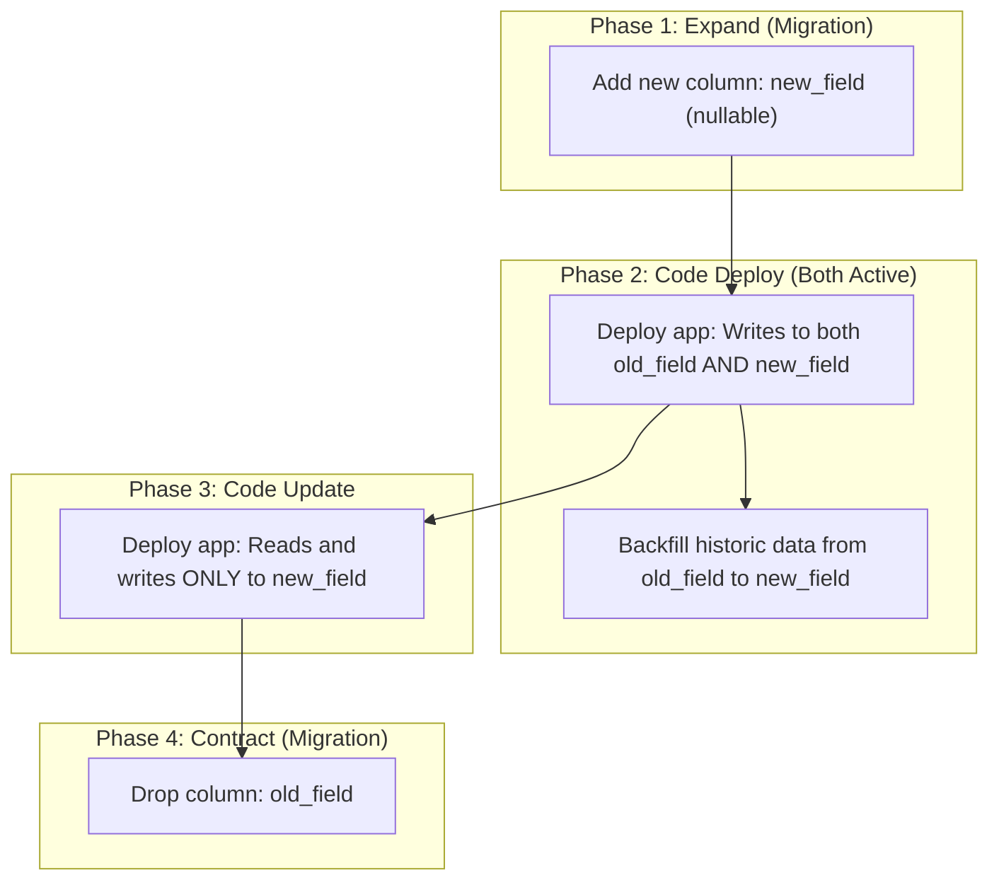
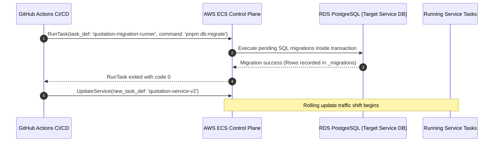

# AETHRA — Database Migration Runbook

> Phase 0 · Database Operations · v0.1.0

---

## 1. Migration Architecture & Principles

Every microservice strictly owns its database migrations. There are no centralized, cross-service migration scripts.

### Core Migration Principles
1. **Plain, Auditable SQL:** Migrations are written in plain PostgreSQL DDL/DML files (`.sql`) committed to version control inside each service (`services/<service-name>/src/database/migrations/`).
2. **Deterministic Sequence:** Migrations follow ISO timestamp prefixes: `20261103120000_create_quotations_table.sql`.
3. **Idempotency & Locks:** Every migration executes inside an atomic database transaction (`BEGIN ... COMMIT;`) and records its execution in a local `_migrations` metadata table.
4. **Expand-and-Contract Pattern:** Breaking database changes (e.g. column renaming or splitting) must be executed in backward-compatible phases to support rolling zero-downtime application deployments.

---

## 2. Directory Layout per Service

```text
services/quotation-service/src/database/migrations/
├── 20261103000001_create_quotations_table.sql
├── 20261103000002_create_quotation_revisions_table.sql
├── 20261103000003_create_pricing_snapshots_table.sql
└── 20261103000004_add_quotation_rls_policies.sql
```

---

## 3. The Expand-and-Contract Pattern (Zero-Downtime)

To avoid breaking running containers during rolling deployments, never execute a breaking DDL migration simultaneously with code changes:



---

## 4. Production Migration Execution Workflow

In production, migrations are executed as **standalone ECS Fargate RunTask jobs** immediately prior to updating the live service task definition:



If the migration task fails (non-zero exit code), the pipeline immediately aborts, preventing deployment of the new application version to ECS.

---

## 5. Local Migration Commands

```bash
# 1. Create a new migration file for a specific service
pnpm --filter quotation-service db:migration:create --name=add_subsidy_fields

# 2. Apply pending migrations locally
pnpm --filter quotation-service db:migrate

# 3. Check migration status
pnpm --filter quotation-service db:migrate:status

# 4. Rollback last migration (local development only)
pnpm --filter quotation-service db:migrate:down
```

---

## 6. Safety Checklist for Production DDL

- [ ] Does the migration add columns without default values that require full table rewrites? (Use PostgreSQL 11+ safe defaults: `ADD COLUMN ... DEFAULT 'val'`).
- [ ] Are new indexes created concurrently on large production tables? (`CREATE INDEX CONCURRENTLY ...`).
- [ ] Is row-level security (RLS) explicitly enabled on newly created tenant tables? (`ALTER TABLE ... ENABLE ROW LEVEL SECURITY;`).
- [ ] Are RLS policies tested for negative isolation (Tenant A cannot see Tenant B)?
- [ ] Has the migration been tested against production-sized datasets in staging?
