# AETHRA — Production & Staging Deployment Runbook

> Phase 0 · Cloud Infrastructure & DevOps · v0.1.0

---

## 1. CI/CD Architecture Overview

AETHRA uses **GitHub Actions** coupled with **Turborepo** to power independent, continuous deployment pipelines for each microservice.

```mermaid
graph LR
    subgraph "GitHub Actions"
        PR["Pull Request"] --> LINT["Lint & Typecheck"]
        LINT --> TEST["Unit & Contract Tests"]
        TEST --> MERGE["Merge to main"]
        MERGE --> AFFECTED["Turborepo: Detect Changed Services"]
    end

    subgraph "Build & Registry"
        AFFECTED --> DOCKER["Build Multi-Arch Docker Image"]
        DOCKER --> ECR["Push to AWS ECR (Immutable SHA)"]
    end

    subgraph "AWS ECS Deployment"
        ECR --> TASK_DEF["Register New Task Definition"]
        TASK_DEF --> ECS_UPDATE["Update ECS Fargate Service"]
        ECS_UPDATE --> ROLLING["Rolling Update (Min 100%, Max 200%)"]
        ROLLING --> HEALTH["Evaluate Health Probes (/health/ready)"]
    end
```



---

## 2. Independent Service Pipelines

Because the codebase is maintained in a Turborepo monorepo, a code change in `services/quotation-service` only builds and deploys `quotation-service`. It does **not** trigger builds or deployments for unaffected services.

### GitHub Actions Workflow Filter Example
```yaml
name: Deploy Quotation Service

on:
  push:
    branches: [main]
    paths:
      - 'services/quotation-service/**'
      - 'packages/**'
      - '.github/workflows/deploy-quotation.yml'

jobs:
  deploy:
    runs-on: ubuntu-latest
    steps:
      - uses: actions/checkout@v4
      - name: Build & Push ECR
        run: |
          docker build -t $ECR_REGISTRY/aethra-quotation-service:$GITHUB_SHA -f services/quotation-service/Dockerfile .
          docker push $ECR_REGISTRY/aethra-quotation-service:$GITHUB_SHA
      - name: Deploy to ECS Fargate
        uses: aws-actions/amazon-ecs-deploy-task-definition@v2
        with:
          task-definition: task-def.json
          service: quotation-service-prod
          cluster: aethra-prod-cluster
          wait-for-service-stability: true
```

---

## 3. Zero-Downtime Rolling Updates

ECS Fargate executes rolling deployments using AWS Application Load Balancer target group health checks:
1. **Minimum Healthy Percent:** `100%` (at least the current number of tasks remain active during rollout).
2. **Maximum Percent:** `200%` (ECS provisions new tasks running the new container image alongside old tasks).
3. **Traffic Shift:** ALB directs traffic to new tasks only after they pass 3 consecutive readiness probes (`GET /health/ready` returns `200 OK` over a 15-second interval).
4. **Deregistration Delay (Connection Draining):** 30 seconds to allow active HTTP requests to complete gracefully.
5. **Circuit Breaker Rollback:** If new tasks fail health checks within 10 minutes, ECS automatically rolls back to the previous stable task definition revision and fires a PagerDuty alert.

---

## 4. Terraform Infrastructure Provisioning

Cloud infrastructure is defined declaratively using Terraform:

```bash
cd infrastructure/terraform/environments/prod

# 1. Initialize Terraform provider plugins & remote S3 backend
terraform init

# 2. Review infrastructure execution plan
terraform plan -out=tfplan

# 3. Apply infrastructure updates
terraform apply tfplan
```

### Terraform Module Layout
```text
infrastructure/terraform/
├── modules/
│   ├── vpc/                  # Multi-AZ VPC, subnets, NAT, routing
│   ├── security-groups/      # Least-privilege ingress/egress rules
│   ├── rds-postgres/         # Multi-AZ RDS instance & parameter groups
│   ├── elasticache/          # Redis cluster & replication groups
│   ├── msk-kafka/            # Amazon MSK cluster, topics & users
│   ├── ecs-cluster/          # ECS cluster, Fargate task definitions, ALB
│   └── s3-storage/           # Private KMS-encrypted file buckets
└── environments/
    ├── dev/
    ├── staging/
    └── prod/
```

---

## 5. Promotion Workflow (Dev $\to$ Staging $\to$ Prod)

1. **Development (`dev`):**
   - Triggered automatically on merge to `develop` branch.
   - Deploys to AWS Dev account with Fargate Spot instances.
2. **Staging (`staging`):**
   - Triggered on merge to `release/*` branches.
   - Production-parity environment used for end-to-end integration tests and load tests.
3. **Production (`prod`):**
   - Triggered on Git Release Tag (`v*.*.*`).
   - Requires manual dual-signoff approval in GitHub Environments.
   - Executes automated database migrations prior to traffic shift.
