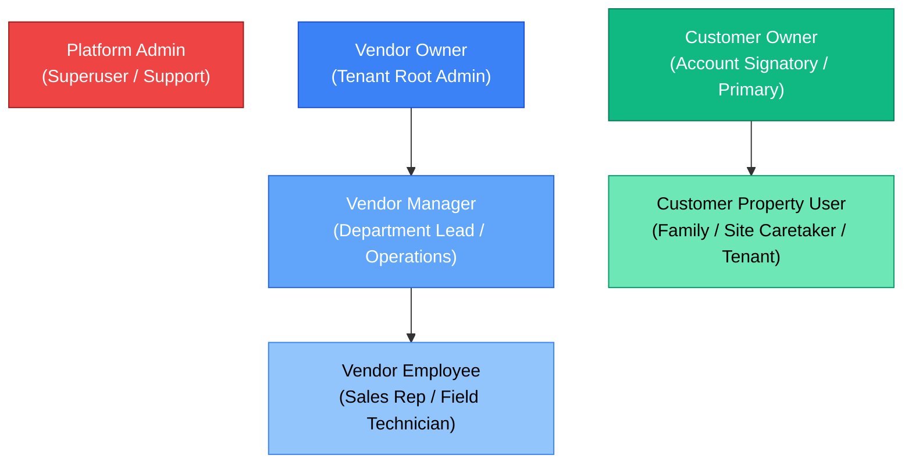
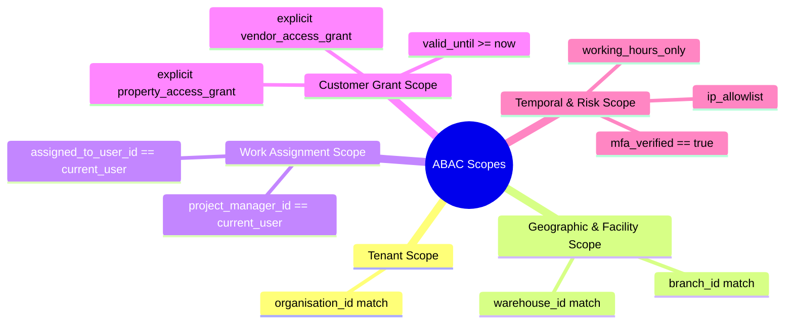
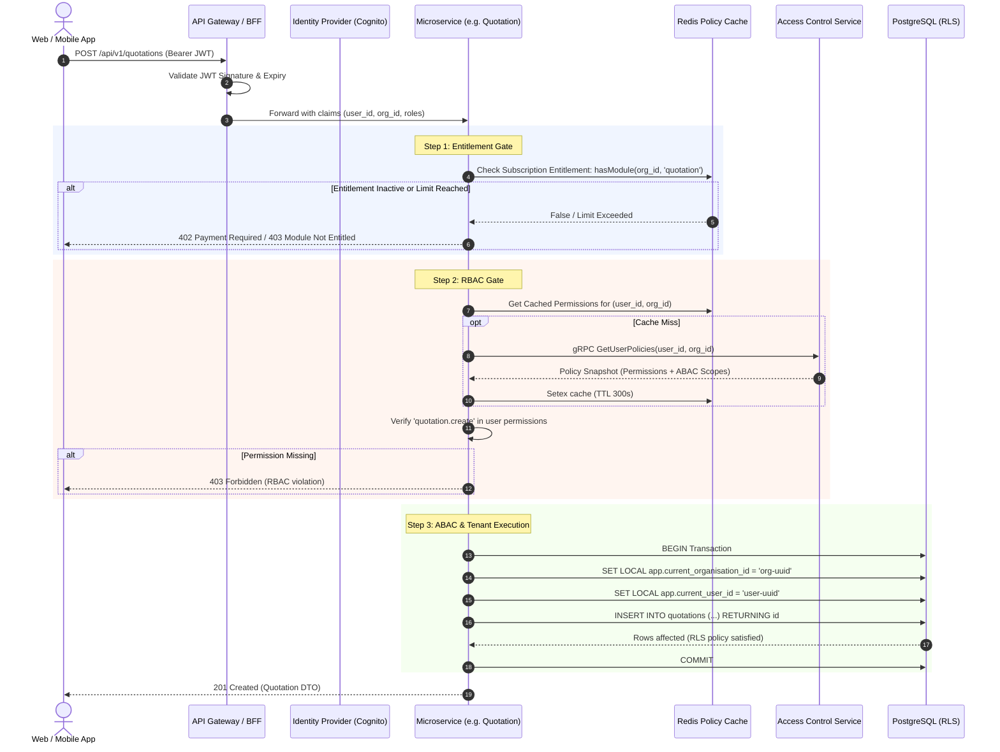

# AETHRA — RBAC & ABAC Security Architecture

> Phase 0 · Security Architecture · v0.1.0

---

## 1. Executive Summary

AETHRA implements a **hybrid Role-Based Access Control (RBAC) and Attribute-Based Access Control (ABAC)** model with a distributed enforcement pattern:
1. **Centralized Policy Definition:** Roles, permissions, scopes, and policy rules are authored and managed centrally in the Access Control Service (`access_control_db`).
2. **Distributed Decentralized Enforcement:** Microservices enforce policies locally using high-performance in-memory cached policy snapshots and JWT context claims without making synchronous HTTP calls on every incoming database query.
3. **Dual Gatekeeper Rule (Entitlement vs. Permission):**
   $$\text{Authorized} = \text{TenantHasModuleEntitlement} \land \text{UserHasPermission} \land \text{ContextualABACScopeValid}$$
   Even if a user is assigned `quotation.create`, the action is blocked if the vendor organization has not subscribed to the `quotation` module or has exceeded its monthly quotation limit.
4. **Default-Deny:** Unless explicitly permitted by an active role-permission binding and matching ABAC attributes, access is rejected with HTTP 403 Forbidden.

---

## 2. Role Hierarchy



### 2.1 Role Profiles

| Role Code | Type | Scope | Capabilities |
|---|---|---|---|
| `platform_admin` | System | Global Platform | Cross-tenant platform maintenance, module catalog management, system health, audit review. Restricted by time-bound elevation. |
| `vendor_owner` | Tenant | Organisation-wide | Full commercial and administrative authority over the vendor organization, subscription billing, employee invites, branch setup. |
| `vendor_manager` | Tenant | Branch / Department | Operational management over CRM leads, project allocation, procurement approval, inventory release within assigned branches. |
| `vendor_employee` | Tenant | Resource Assignment | Assigned leads, site surveys, field installations, service tickets. Constrained to specifically assigned projects and tasks. |
| `customer_owner` | Customer | Customer Account | Legal signatory for quotes, digital consent for vendor access, view billing, full property management, delegate property access. |
| `customer_property_user` | Customer | Specific Property | Read-only access to generation telemetry and service tickets for a single delegated property (e.g. branch tenant or family member). |

---

## 3. Permission Taxonomy

All permissions follow the standardized dot-notation syntax:
$$\text{domain} \cdot \text{resource} \cdot \text{action}$$

### 3.1 Domain Permission Matrix

| Domain | Permission String | Description | Assigned Default Roles |
|---|---|---|---|
| **Identity & Org** | `org.profile.read` | View organization profile | `vendor_owner`, `vendor_manager`, `vendor_employee` |
| | `org.profile.update` | Edit business address, branding, tax IDs | `vendor_owner` |
| | `org.member.invite` | Invite staff members | `vendor_owner` |
| | `org.member.manage` | Suspend or revoke memberships | `vendor_owner` |
| | `org.branch.manage` | Create and configure branches/warehouses | `vendor_owner` |
| **Access Control** | `access.role.assign` | Assign roles to staff members | `vendor_owner` |
| | `access.role.custom` | Create tenant-custom roles | `vendor_owner` |
| **Subscription** | `subscription.plan.view` | View subscription tier, limits, and usage | `vendor_owner`, `vendor_manager` |
| | `subscription.plan.manage` | Upgrade, downgrade, cancel subscription | `vendor_owner` |
| **Customer & Grants**| `relationship.invite` | Send customer onboarding invitation | `vendor_owner`, `vendor_manager`, `vendor_employee` |
| | `relationship.view` | View active customer relationships | `vendor_owner`, `vendor_manager`, `vendor_employee` |
| | `relationship.revoke` | Terminate relationship with customer | `vendor_owner`, `customer_owner` |
| | `customer.property.read` | View site address, electrical specs | Granted via active relationship grant |
| **CRM** | `crm.lead.create` | Add new prospect lead | `vendor_owner`, `vendor_manager`, `vendor_employee` |
| | `crm.lead.view_all` | View all leads in the organization | `vendor_owner`, `vendor_manager` |
| | `crm.lead.view_assigned`| View only assigned leads | `vendor_employee` |
| | `crm.lead.assign` | Reassign lead to team member | `vendor_owner`, `vendor_manager` |
| | `crm.lead.convert` | Convert lead into customer/quote | `vendor_owner`, `vendor_manager` |
| **Catalogue** | `catalogue.product.view` | View global equipment specifications | All authenticated users |
| | `catalogue.price.view_cost`| View internal vendor procurement costs | `vendor_owner`, `vendor_manager` |
| | `catalogue.price.manage` | Set selling prices and floor margins | `vendor_owner`, `vendor_manager` |
| **Quotation** | `quotation.create` | Generate quotation draft | `vendor_owner`, `vendor_manager`, `vendor_employee` |
| | `quotation.discount.apply`| Apply discount beyond rep limit | `vendor_owner`, `vendor_manager` |
| | `quotation.issue` | Issue final proposal to customer | `vendor_owner`, `vendor_manager` |
| | `quotation.view_costing`| View internal estimated costs/margins | `vendor_owner`, `vendor_manager` |
| | `quotation.customer.accept`| Digitally accept proposal revision | `customer_owner` |
| **Engineering** | `engineering.calc.run` | Run solar sizing and generation simulation | `vendor_owner`, `vendor_manager`, `vendor_employee` |
| | `engineering.bom.generate` | Generate Bill of Materials from estimate | `vendor_owner`, `vendor_manager`, `vendor_employee` |
| | `engineering.profile.edit`| Customize calculation assumptions | `vendor_owner` |
| **Inventory** | `inventory.stock.view` | View stock balances and ledgers | `vendor_owner`, `vendor_manager` |
| | `inventory.receipt.post`| Post goods receipt intake | `vendor_owner`, `vendor_manager` |
| | `inventory.issue.post` | Issue stock to project or technician | `vendor_owner`, `vendor_manager` |
| | `inventory.adjust.post` | Post physical count discrepancy adjustment | `vendor_owner` |
| **Procurement** | `procurement.po.create` | Draft purchase order | `vendor_owner`, `vendor_manager` |
| | `procurement.po.approve`| Approve purchase order to supplier | `vendor_owner` |
| **Projects** | `project.create` | Initialize project from accepted quote | `vendor_owner`, `vendor_manager` |
| | `project.milestone.publish`| Publish progress update to customer | `vendor_owner`, `vendor_manager` |
| | `project.task.manage` | Assign and track internal EPC tasks | `vendor_owner`, `vendor_manager`, `vendor_employee` |
| | `project.handover.sign` | Sign commissioning report | `vendor_owner`, `customer_owner` |
| **Service** | `service.ticket.create` | Log maintenance ticket | `customer_owner`, `vendor_employee` |
| | `service.ticket.dispatch`| Assign field technician | `vendor_owner`, `vendor_manager` |
| | `service.ticket.resolve`| Mark ticket resolved with parts list | `vendor_employee` (technician) |

---

## 4. Attribute-Based Access Control (ABAC) Scope Dimensions

While RBAC evaluates *what* action can be executed, ABAC evaluates *under what conditions and on which specific resources* the action is permitted:

$$\text{Evaluate}(User, Permission, Resource, Environment)$$

### ABAC Dimensions



1. **`organisation_id` (Tenant Boundary):** Mandatory for all tenant-scoped data. An employee in Org A can never evaluate permissions against Org B's data.
2. **`branch_id` / `warehouse_id` (Facility Boundary):** A store manager in Bengaluru Branch cannot issue stock from the Mumbai Central Warehouse.
3. **`assigned_to_user_id` (Ownership Boundary):** A junior sales rep (`vendor_employee`) can only view and update leads where `assigned_agent_user_id == current_user.id`.
4. **`property_access_grant` (Customer Delegation):** A vendor can only read property telemetry if `property_access_grants` contains an active, unrevoked grant.

---

## 5. Policy Evaluation Sequence



---

## 6. Policy Distribution & Invalidation Strategy

To maintain sub-millisecond API response times and avoid distributed denial-of-service on the Access Control Service:
1. **User Token Packaging:** The authentication JWT contains core identity claims: `sub` (user_id), `current_org_id`, `assigned_roles`, and `session_id`.
2. **Local Redis Policy Cache:** Each microservice cluster reads from a distributed Redis cache containing serialized permission bitmaps and ABAC scopes keyed by `auth:policy:{org_id}:{user_id}` (TTL: 5 minutes).
3. **Asynchronous Real-Time Invalidation via Kafka:**
   When an admin updates a role, revokes membership, or changes a customer grant:
   - Access Control Service publishes `access_control.policy.invalidated.v1` to Kafka.
   - All microservice instances consume the event and immediately evict the relevant Redis cache keys.
   - Subsequent user requests refresh policy state from Access Control Service on demand.

---

## 7. NestJS Guard & Decorator Implementation Architecture

Microservices enforce security declaratively using NestJS custom decorators:

```typescript
// Example Controller Endpoint
@Controller('api/v1/quotations')
@UseGuards(JwtAuthGuard, TenantContextGuard, EntitlementGuard, PermissionsGuard)
export class QuotationController {

  @Post()
  @RequireEntitlement('quotation', { checkQuota: true })
  @RequirePermissions('quotation.create')
  @RequireAbacScope({ resource: 'customer', action: 'verify_relationship' })
  async createQuotation(
    @CurrentTenant() tenant: TenantContext,
    @CurrentUser() user: AuthenticatedUser,
    @Body() dto: CreateQuotationDto,
  ): Promise<QuotationResponseDto> {
    return this.quotationService.create(tenant.id, user.id, dto);
  }
}
```

### NestJS Pipeline Order
1. **`JwtAuthGuard`:** Validates token signature, expiration, and issuer.
2. **`TenantContextGuard`:** Extracts active `organisation_id` header or token claim, verifies user membership in tenant, and injects context into request scope.
3. **`EntitlementGuard`:** Checks if tenant organization has the required module active in subscription.
4. **`PermissionsGuard`:** Checks if user has necessary `resource.action` permissions.
5. **Database Interceptor:** Sets `SET LOCAL app.current_organisation_id` on the PostgreSQL connection prior to query execution.
