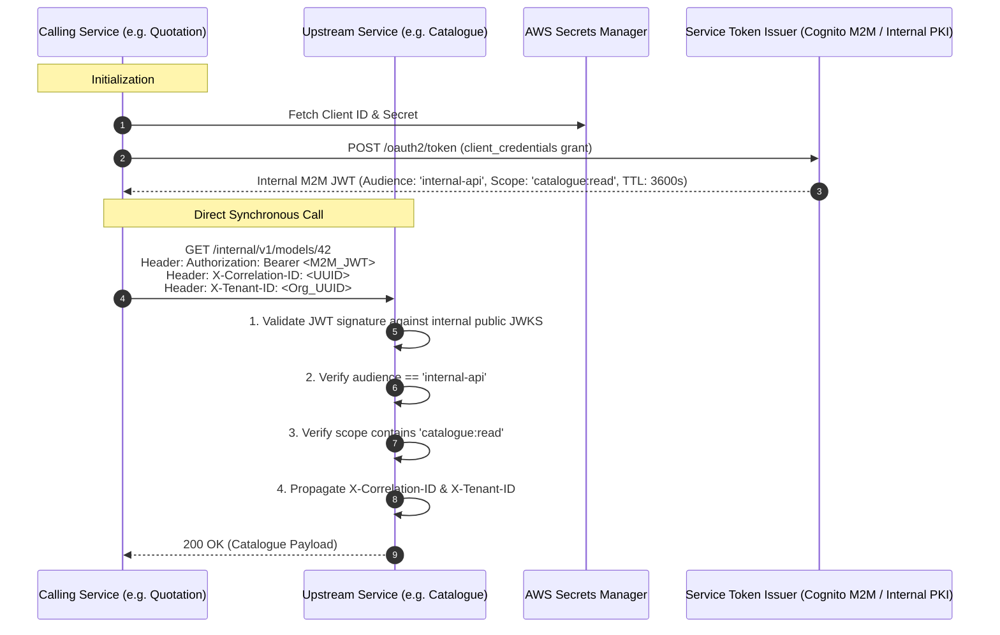
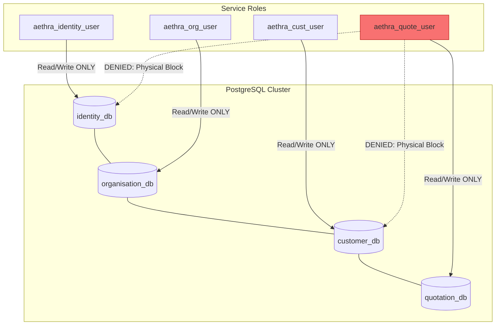
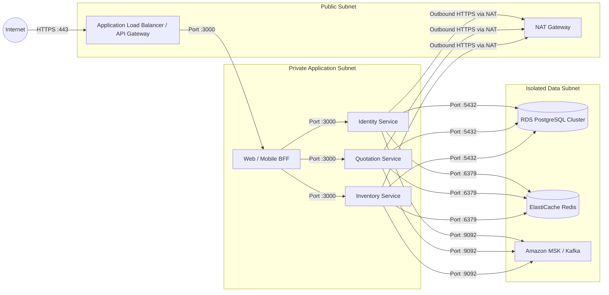

# AETHRA — Service-to-Service Security & Zero-Trust Architecture

> Phase 0 · Security Architecture · v0.1.0

---

## 1. Zero-Trust Security Principles

Internal network proximity does **not** equal trust. A compromised microservice or container must not possess unrestricted lateral access to other services or databases.

The AETHRA internal security model is built on four core pillars:
1. **Cryptographic Service Identity:** Every service proves its identity via short-lived Machine-to-Machine (M2M) JWT tokens or mutual TLS (mTLS).
2. **Strict Least-Privilege Network Segmentation:** Internal services run in private subnets with explicit AWS Security Group ingress/egress rules.
3. **Database Credential Isolation:** Each service connects with dedicated PostgreSQL credentials that have access exclusively to its own database. Cross-database queries are physically impossible.
4. **Signed Asynchronous Event Provenance:** All Kafka messages carry cryptographic producer signatures and tenant provenance metadata.

---

## 2. Service-to-Service Authentication & Authorization



### 2.1 Internal Header Propagation Standard

Every internal request (sync HTTP/gRPC or async event) must propagate the following context headers:

| Header Name | Type | Description |
|---|---|---|
| `Authorization` | String | `Bearer <M2M_JWT>` for internal microservice authentication |
| `X-Correlation-ID` | UUID | Distributed tracing identifier across the entire request span |
| `X-Tenant-ID` | UUID | Active vendor organisation context |
| `X-Originating-User-ID` | UUID | End-user who triggered the initiating request |
| `X-Client-Platform` | Enum | `web`, `android`, `ios`, `system_worker` |

---

## 3. Database Credential Isolation

A shared PostgreSQL instance is utilized initially to minimize operational cost, but database credentials are strictly partitioned per service:



### Database Hardening Script Example
```sql
-- Create isolated service user
CREATE USER aethra_quotation_user WITH PASSWORD 'vault_retrieved_secret';

-- Grant access strictly to quotation_db
GRANT CONNECT ON DATABASE quotation_db TO aethra_quotation_user;
\c quotation_db
GRANT USAGE ON SCHEMA public TO aethra_quotation_user;
GRANT SELECT, INSERT, UPDATE, DELETE ON ALL TABLES IN SCHEMA public TO aethra_quotation_user;

-- Explicitly revoke access to other databases
REVOKE CONNECT ON DATABASE customer_db FROM aethra_quotation_user;
REVOKE CONNECT ON DATABASE identity_db FROM aethra_quotation_user;
```

---

## 4. Network Segmentation & Topology

All microservices run inside private VPC subnets. Direct ingress from the public internet is physically impossible:



### AWS Security Group Rules
- **Data Subnet (RDS / Redis / MSK):** Ingress permitted *only* from the Private Application Subnet Security Group (`sg-aethra-services`). Ingress from public subnets or internet is strictly 0.0.0.0/0 denied.
- **Application Subnet:** Ingress permitted *only* from ALB/API Gateway Security Group (`sg-aethra-alb`). Ingress from internet is blocked.

---

## 5. Secrets Management & Rotation

- **Storage:** No secrets or credentials exist in Git repositories, Docker images, or plaintext environment variables.
- **AWS Secrets Manager Integration:** ECS task definitions retrieve database credentials, private encryption keys, and third-party API keys at container boot using IAM Task Roles:
  ```json
  {
    "name": "DB_PASSWORD",
    "valueFrom": "arn:aws:secretsmanager:ap-south-1:123456789012:secret:aethra/quotation/db_password"
  }
  ```
- **Automated Rotation:** Database passwords rotate every 60 days via AWS Lambda Secrets Manager rotation handlers.

---

## 6. Event Provenance & Message Tamper Protection

Kafka event messages carry an immutable security envelope:

```json
{
  "eventId": "9b1deb4d-3b7d-4bad-9bdd-2b0d7b3dcb6d",
  "eventType": "quotation.issued.v1",
  "producer": "aethra-quotation-service",
  "timestamp": "2026-11-03T10:00:00.000Z",
  "correlationId": "c8a4114f-6c19-4a4b-927b-fb86c7cfc563",
  "tenantContext": {
    "organisationId": "3fa85f64-5717-4562-b3fc-2c963f66afa6",
    "originatingUserId": "7c9e6679-7425-40de-944b-e07fc1f90ae7"
  },
  "signature": "hmac_sha256_of_payload_with_service_private_key",
  "data": {
    "quotationId": "4a7f2302-6017-4562-b3fc-2c963f66afa6",
    "revisionNumber": 1,
    "totalPayableAmount": 450000.00
  }
}
```

Consumers verify `producer` and `signature` before parsing data payloads to prevent message injection or privilege spoofing from untrusted Kafka clients.
